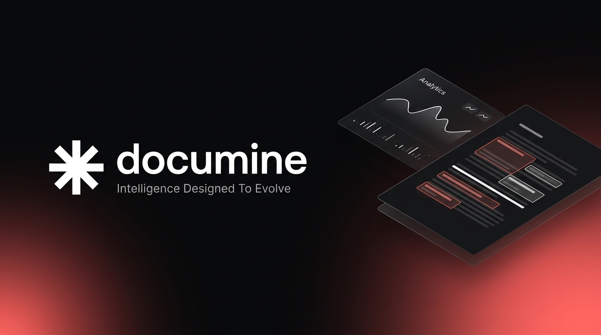
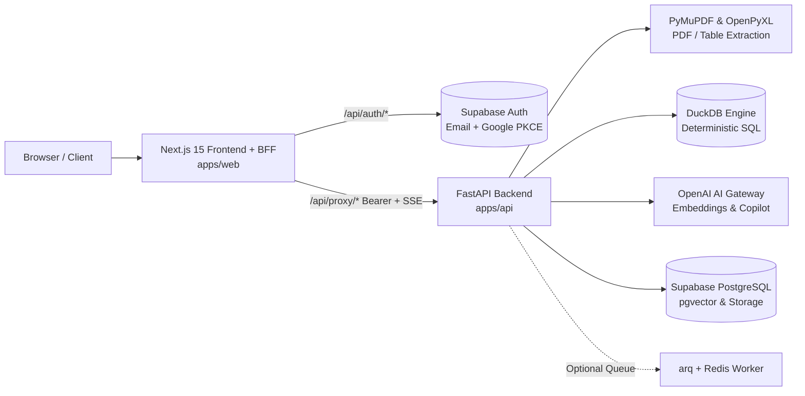

<div align="center">

<a href="#overview">
  
</a>

<br /><br />

&nbsp;&nbsp;&nbsp;

# documine

**Modular AI Document Intelligence & Signal-to-Action Workspace**  
*Turn complex PDFs, spreadsheets, and multi-document corpora into grounded citations, deterministic DuckDB analytics, and production workflows.*

<p>
  
  
  
  
  
  
</p>

<p>
  <a href="#overview">Overview</a> •
  <a href="#visual-showcase">Showcase</a> •
  <a href="#system-architecture">Architecture</a> •
  <a href="#quick-start">Quick Start</a> •
  <a href="#api-reference">API Reference</a> •
  <a href="#deployment">Deployment</a> •
  <a href="#security">Security</a>
</p>

</div>

---

## Overview

**documine** adalah platform AI *full-stack* berbasis monorepo yang menggabungkan pengalaman web modern di **Next.js 15** dengan mesin pemrosesan dokumen dan analitik deterministik di **FastAPI**:

- **Zero-Hallucination Analytics** — Kueri SQL deterministik melalui **DuckDB** yang langsung memproduksi konfigurasi grafik **ECharts**.
- **Coordinate-Accurate PDF Intelligence** — Ekstraksi chunk beserta *normalized bounding boxes* lewat **PyMuPDF (`pymupdf`)**, spreadsheet **OpenPyXL / Pandas**, dan dukungan Vision OCR.
- **Cognitive AI Copilot** — Tanya-jawab adaptif dengan sitasi halaman visual, level penjelasan (`eli5`, `high_school`, `academic`), generator kuis Sokratik (`proof_quote`), matriks sintesis lintas dokumen, dan skrip audio briefing.
- **Hardened Authentication & Multi-Tenancy** — Sesi cookie `HttpOnly` lewat Next.js BFF, Google OAuth PKCE, verifikasi email + recovery password, indikator kekuatan password *real-time*, *rate limit* & *account lockout*, serta isolasi tenant `workspace_id`.

---

## Visual Showcase

<table>
  <tr>
    <td width="50%" align="center">
      
      <br />
      <sub><strong>Spatial Workspace &amp; Visual Citations</strong> — Kanvas monokrom 1-halaman penuh dengan inspeksi layer, metrik deterministik, dan penanda sitasi dokumen.</sub>
    </td>
    <td width="50%" align="center">
      
      <br />
      <sub><strong>Signal-to-Action Experience</strong> — Landing page interaktif dengan lazy viewport video, dot-matrix metrics SVG, dan sistem auth responsif.</sub>
    </td>
  </tr>
</table>

---

## Core Capabilities

| Pillar | Stack / Engine | Capabilities |
|---|---|---|
| **Document Ingestion** | `PyMuPDF`, `pymupdf4llm`, `openpyxl` | Ekstraksi teks & tabel berkoordinat (`bounding_boxes`), chunking multi-halaman, dan antrean kerja `arq` + Redis (`apps/api/app/worker.py`). |
| **Deterministic Analytics** | `DuckDB`, `Pandas`, `NumPy`, `SymPy`, `ECharts` | Konversi dataset terstruktur ke tabel DuckDB terisolasi dan generasi opsi grafik tanpa halusinasi angka. |
| **AI Gateway & RAG** | `OpenAI SDK`, `tiktoken`, `pgvector` | Routing model (`fast`, `balanced`, `deep`), kontrol biaya token per workspace, pencarian semantik, sintesis matriks, dan kuis Sokratik. |
| **Frontend & BFF Security** | `Next.js 15`, `React 19`, `TypeScript`, `Lenis` | Route protection di `middleware.ts`, proxy `/api/proxy/[...path]` dengan pass-through SSE stream, serta `HttpOnly` cookie session. |

---

## System Architecture



---

## Repository Structure

```text
.
├── package.json                 # Unified root workspace commands (`npm run dev`)
├── scripts/dev.mjs              # Concurrent FastAPI + Next.js runner with clean Ctrl+C teardown
├── .vercelignore                # Excludes backend/docs/legacy static files for clean Vercel deploys
├── .gitignore                   # Blocks .env*, venv/, node_modules/, .next/, uploads/, *.duckdb
├── supabase/
│   └── migrations/              # PostgreSQL schemas, pgvector tables, & RLS policies
├── docs/
│   ├── assets/                  # README visual banner assets
│   ├── documind-blueprint/      # 25+ Architecture Decisions (ADR) & System Contracts
│   └── reports/                 # Technical & project documentation PDFs
└── apps/
    ├── web/                     # Next.js 15 Frontend (Vercel target)
    │   ├── app/                 # /, /login, /signup, /forgot-password, /reset-password, /dashboard
    │   ├── app/api/auth/        # HttpOnly auth endpoints (login, signup, callback, account, etc.)
    │   ├── app/api/proxy/       # Authenticated API proxy with SSE streaming support
    │   ├── components/          # AuthPrimitives, SignalAuthShell, FeatureMosaicSection, Dashboard
    │   ├── lib/                 # Validation, friendly notifications, server auth & security helpers
    │   ├── middleware.ts        # Session guard & server-side callback verification
    │   ├── next.config.js       # Workspace-pinned outputFileTracingRoot & URL rewrites
    │   └── vercel.json          # Vercel Next.js build preset config
    └── api/                     # FastAPI Backend (Railway / Render / Cloud Run target)
        ├── app/
        │   ├── ai/              # AI gateway, model registry, OpenAI provider adapter
        │   ├── core/            # Pydantic settings, JWT security, multi-tenant workspace context
        │   ├── db/              # Supabase client & tenant repository
        │   ├── routers/         # auth, documents, search, chat, analytics, synthesis, audio
        │   └── services/        # PDF, DuckDB, ingestion, retrieval, storage services
        ├── tests/               # Pytest API & pipeline suites
        └── requirements.txt
```

---

## Quick Start

### 1. Prerequisites

- **Node.js** `18+` / `20+` and `npm`
- **Python** `3.11+`
- **Supabase Project** & **OpenAI API Key**

### 2. Configure Environment Variables

<details>
<summary><strong>Frontend: <code>apps/web/.env.local</code> (copy from <code>apps/web/.env.example</code>)</strong></summary>

```env
SUPABASE_URL=https://your-project-id.supabase.co
SUPABASE_SERVICE_ROLE_KEY=your_supabase_service_role_key
NEXT_PUBLIC_SUPABASE_URL=https://your-project-id.supabase.co
NEXT_PUBLIC_API_URL=http://localhost:8000
FASTAPI_URL=http://localhost:8000
```

</details>

<details>
<summary><strong>Backend: <code>apps/api/.env</code> (copy from <code>apps/api/.env.example</code>)</strong></summary>

```env
APP_NAME="DocuMind API"
APP_ENV="development"
HOST="0.0.0.0"
PORT=8000
ALLOWED_ORIGINS="http://localhost:3000,http://127.0.0.1:3000"

AI_DEFAULT_PROVIDER="openai"
OPENAI_API_KEY="your_openai_api_key_here"
SUPABASE_URL="https://your-project-ref.supabase.co"
SUPABASE_SERVICE_ROLE_KEY="your-supabase-service-role-key"
SUPABASE_ANON_KEY="your-supabase-anon-key"
```

</details>

### 3. Install Dependencies

```bash
# Install frontend dependencies
cd apps/web
npm install

# Setup Python venv & install backend dependencies
cd ../api
python -m venv venv
# Windows: venv\Scripts\activate
# macOS/Linux: source venv/bin/activate
pip install -r requirements.txt
```

### 4. Launch Backend + Frontend Together

Dari **root repository**, jalankan satu perintah untuk mengontrol Backend + Frontend sekaligus:

```bash
npm run dev
```

| Service | Local URL | Command |
|---|---|---|
| **Frontend (Next.js 15)** | `http://localhost:3000` | `npm run dev:web` |
| **Backend (FastAPI)** | `http://127.0.0.1:8000` (`Docs: /docs`) | `npm run dev:api` |
| **Both Together** | `3000` + `8000` | `npm run dev` |
| **Production Build (Web)** | `apps/web/.next` | `npm run build` |

---

## API Reference

> Interactive docs available at `http://127.0.0.1:8000/docs` (Swagger) and `/redoc`.

| Method | Endpoint | Purpose |
|---|---|---|
| `GET` | `/health` | Check Supabase connection & OpenAI configuration status |
| `GET` | `/api/auth/session` | Verify Bearer token and resolve active tenant workspace |
| `DELETE` | `/api/auth/account` | Self-service account & workspace cascade deletion |
| `POST` | `/api/documents/upload` | Upload PDF/spreadsheet for coordinate-aware chunk extraction |
| `GET` | `/api/documents/{id}` | Check asynchronous ingestion & processing job status |
| `GET` | `/api/documents/{id}/chunks` | Fetch document chunks with normalized `[0..1]` bounding boxes |
| `POST` | `/api/chat/message` | Grounded AI copilot chat with visual page citations |
| `POST` | `/api/chat/quiz` | Generate Socratic quizzes linked with exact `proof_quote` |
| `POST` | `/api/analytics/widget` | Generate deterministic DuckDB-backed ECharts configurations |
| `POST` | `/api/synthesis/matrix` | Cross-document comparison & contradiction analysis |
| `POST` | `/api/audio/briefing-script` | Generate structured 2-host audio briefing script |

---

## Deployment

Arsitektur yang direkomendasikan adalah **Split Production Deployment**:

### Frontend on Vercel (`apps/web`)
1. Hubungkan seluruh repository GitHub ini ke **Vercel**.
2. Di **Project Settings -> Build & Deployment -> Root Directory**, isi **`apps/web`** (Framework Preset: **Next.js**).
3. Tambahkan Environment Variables berikut di Vercel Dashboard:
   - `SUPABASE_URL`
   - `SUPABASE_SERVICE_ROLE_KEY`
   - `NEXT_PUBLIC_SUPABASE_URL`
   - `FASTAPI_URL` & `NEXT_PUBLIC_API_URL` *(arahkan ke URL HTTPS backend production Anda)*
4. Di **Supabase Dashboard -> Authentication -> URL Configuration**, tambahkan `https://<domain-vercel-anda>.vercel.app/auth/callback*` ke **Redirect URLs**.

### Backend on Railway / Render / Cloud Run (`apps/api`)
Backend FastAPI sebaiknya dijalankan pada container always-on (bukan Vercel Serverless) karena membutuhkan dependency native (`pymupdf`, `duckdb`, `pandas`, `numpy`) dan mendukung worker background `arq`/Redis ([apps/api/app/worker.py](apps/api/app/worker.py)).
- Pastikan `ALLOWED_ORIGINS` di backend mencakup URL Vercel Anda.

---

## Verification & Testing

```bash
# Type-check & verify production build for Vercel
cd apps/web && npx tsc --noEmit && npm run build

# Run backend sanity & pytest suites
cd apps/api && python test_backend.py && pytest
```

---

## Security

- Seluruh kredensial asli (`.env`, `apps/api/.env`, `apps/web/.env.local`), file upload lokal (`uploads/`, `apps/api/uploads/`), dan database lokal (`*.duckdb`, `*.sqlite3`) dikecualikan lewat [`.gitignore`](.gitignore).
- Token sesi disimpan dalam cookie `HttpOnly` (`sb_access_token`, `sb_refresh_token`) oleh Next.js API routes, divalidasi di `middleware.ts`, dan diteruskan sebagai `Authorization: Bearer ...` oleh proxy server-side.
- Endpoint sensitif seperti `DELETE /api/auth/account` dilindungi oleh validasi same-origin (`validateSameOrigin`) dan rate limiter.
