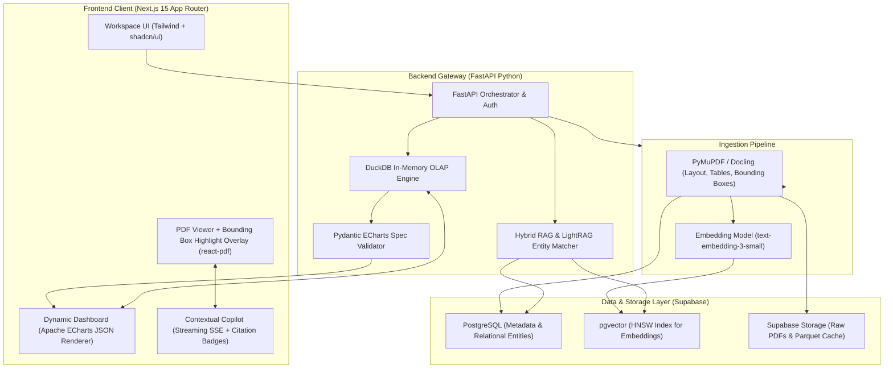

# DOCUMIND — Technical Architecture & Implementation Blueprint
**AI-Powered Document Intelligence & Dynamic Visualization Workspace**

*Version: 1.0 (Production SOTA 2026)*  
*Target Stack: Next.js 15 (App Router) + FastAPI (Python 3.11+) + Supabase (PostgreSQL + pgvector) + DuckDB + Apache ECharts*

---

## 1. Executive Summary & Design Principles

DOCUMIND is an enterprise-grade document intelligence platform that bridges unstructured document understanding with deterministic, interactive data dashboards and source-grounded visual citations.

### Core Architectural Pillars
1. **Zero Hallucination Visualization (The VegaChat/LIDA Pattern):** The LLM never synthesizes raw chart numbers. Tabular document data is queried deterministically via an in-memory OLAP engine (**DuckDB**). The LLM's role is strictly restricted to generating the declarative visual grammar specification (**Apache ECharts** JSON spec) validated via **Pydantic**.
2. **NotebookLM-Grade Visual Citations:** Document chunks retain normalized bounding box coordinates (`0.0`–`1.0`). When users click citations in the conversational assistant, the integrated PDF viewer (`react-pdf`) automatically scrolls to the exact page and paints an animated highlight bounding box over the exact cited text.
3. **Hybrid Search & Incremental Graph Retrieval (LightRAG Pattern):** Eliminates static monolithic GraphRAG re-indexing. Uses dual-level retrieval (entity-level precise facts + concept-level summaries) paired with Reciprocal Rank Fusion (Dense Vector + BM25 Lexical).
4. **Pragmatic Monorepo Separation:** Fast iteration with Next.js App Router for frontend UI and an async Python FastAPI engine to handle the heavy lifting of PDF layout decomposition, vector embeddings, and DuckDB analytical queries.

---

## 2. System Architecture Diagram



---

## 3. Monorepo Repository Structure

```text
WAICY/
├── apps/
│   ├── web/                              # Next.js 15 Frontend
│   │   ├── app/
│   │   │   ├── (workspace)/
│   │   │   │   ├── documents/[id]/page.tsx # Split-view PDF + Highlights
│   │   │   │   ├── dashboard/page.tsx     # Dynamic ECharts widgets
│   │   │   │   └── layout.tsx
│   │   │   ├── api/                      # Edge routes / auth pass-through
│   │   │   └── layout.tsx
│   │   ├── components/
│   │   │   ├── pdf-viewer/
│   │   │   │   ├── pdf-canvas-viewer.tsx    # react-pdf page renderer
│   │   │   │   ├── pdf-highlight-overlay.tsx # absolute bbox canvas overlay
│   │   │   │   └── citation-pill.tsx        # clickable [Hal. X] badge
│   │   │   ├── charts/
│   │   │   │   ├── dynamic-echarts.tsx      # ECharts React container
│   │   │   │   └── widget-card.tsx
│   │   │   └── ui/                          # shadcn/ui primitives
│   │   ├── lib/
│   │   │   ├── coordinates.ts               # Normalized 0..1 to px transforms
│   │   │   └── supabase.ts
│   │   ├── package.json
│   │   └── tsconfig.json
│   │
│   └── api/                              # FastAPI Backend
│       ├── app/
│       │   ├── core/
│       │   │   ├── config.py                # Pydantic BaseSettings
│       │   │   └── security.py
│       │   ├── db/
│       │   │   ├── duckdb_engine.py         # DuckDB in-memory session manager
│       │   │   └── supabase_client.py
│       │   ├── models/
│       │   │   ├── schemas.py               # Pydantic v2 schemas
│       │   │   └── echarts_schema.py        # Strict ECharts options definition
│       │   ├── services/
│       │   │   ├── pdf_parser.py            # PyMuPDF coordinate & markdown parser
│       │   │   ├── rag_service.py           # Hybrid vector & BM25 retrieval
│       │   │   └── dashboard_agent.py       # Text-to-DuckDB-SQL + ECharts generator
│       │   ├── routers/
│       │   │   ├── documents.py             # Upload & parsing endpoints
│       │   │   ├── chat.py                  # RAG with streaming citations
│       │   │   └── dashboard.py             # Auto-dashboard generation
│       │   └── main.py
│       ├── requirements.txt
│       └── Dockerfile
├── docs/
│   └── ARCHITECTURE.md                  # This specification document
└── supabase/
    └── migrations/
        └── 20261113000001_initial_schema.sql
```

---

## 4. Complete Supabase Database Schema (PostgreSQL + pgvector)

```sql
-- 1. Enable Required Extensions
create extension if not exists vector with schema extensions;
create extension if not exists "uuid-ossp";

-- 2. Workspaces
create table public.workspaces (
    id uuid primary key default uuid_generate_v4(),
    name text not null,
    created_at timestamptz not null default now()
);

-- 3. Documents
create table public.documents (
    id uuid primary key default uuid_generate_v4(),
    workspace_id uuid not null references public.workspaces(id) on delete cascade,
    title text not null,
    storage_path text not null,
    file_type text not null default 'pdf',
    page_count integer not null default 1,
    file_size_bytes bigint,
    processing_status text not null default 'pending', -- pending, processing, completed, failed
    metadata jsonb default '{}'::jsonb,
    created_at timestamptz not null default now(),
    updated_at timestamptz not null default now()
);

-- 4. Document Chunks with Normalized Bounding Boxes
create table public.chunks (
    id uuid primary key default uuid_generate_v4(),
    document_id uuid not null references public.documents(id) on delete cascade,
    workspace_id uuid not null references public.workspaces(id) on delete cascade,
    chunk_index integer not null,
    content text not null,
    page_number integer not null, -- 1-indexed
    -- Normalized bounding boxes: [{"left": 0.12, "top": 0.34, "width": 0.76, "height": 0.08}]
    bounding_boxes jsonb not null default '[]'::jsonb,
    embedding vector(1536), -- compatible with text-embedding-3-small or Gemini
    token_count integer,
    metadata jsonb default '{}'::jsonb,
    created_at timestamptz not null default now()
);

-- HNSW Vector Index for sub-millisecond similarity search
create index idx_chunks_embedding_hnsw on public.chunks 
using hnsw (embedding vector_cosine_ops)
with (m = 16, ef_construction = 64);

-- Full-text search index for hybrid search (BM25 fusion)
create index idx_chunks_fts on public.chunks using gin (to_tsvector('indonesian', content));
create index idx_chunks_doc_page on public.chunks (document_id, page_number);

-- 5. Extracted Topics & Entities (LightRAG Layer)
create table public.topics (
    id uuid primary key default uuid_generate_v4(),
    workspace_id uuid not null references public.workspaces(id) on delete cascade,
    name text not null,
    description text,
    category text default 'concept',
    created_at timestamptz not null default now()
);

create table public.chunk_topics (
    chunk_id uuid not null references public.chunks(id) on delete cascade,
    topic_id uuid not null references public.topics(id) on delete cascade,
    confidence real default 1.0,
    primary key (chunk_id, topic_id)
);

-- 6. Dynamic Dashboard Widgets
create table public.dashboard_widgets (
    id uuid primary key default uuid_generate_v4(),
    workspace_id uuid not null references public.workspaces(id) on delete cascade,
    document_id uuid references public.documents(id) on delete cascade,
    title text not null,
    description text,
    chart_type text not null, -- 'bar', 'line', 'pie', 'radar', 'timeline'
    sql_query text,           -- DuckDB deterministic SQL
    echarts_spec jsonb not null default '{}'::jsonb,
    layout_position jsonb not null default '{"x": 0, "y": 0, "w": 6, "h": 4}'::jsonb,
    created_at timestamptz not null default now()
);

-- 7. High-Performance Hybrid Vector Search Function (RPC)
create or replace function public.match_document_chunks (
    query_embedding vector(1536),
    match_threshold float,
    match_count int,
    filter_workspace_id uuid,
    filter_document_id uuid default null
)
returns table (
    id uuid,
    document_id uuid,
    chunk_index integer,
    content text,
    page_number integer,
    bounding_boxes jsonb,
    similarity float
)
language plpgsql
as $$
begin
    return query
    select
        c.id,
        c.document_id,
        c.chunk_index,
        c.content,
        c.page_number,
        c.bounding_boxes,
        1 - (c.embedding <=> query_embedding) as similarity
    from public.chunks c
    where c.workspace_id = filter_workspace_id
      and (filter_document_id is null or c.document_id = filter_document_id)
      and (1 - (c.embedding <=> query_embedding)) > match_threshold
    order by c.embedding <=> query_embedding
    limit match_count;
end;
$$;
```

---

## 5. Visual Citations & Coordinate Normalization

### Coordinate Space Transformation
PDF coordinate systems place `(0,0)` at the **bottom-left** with physical units (72 DPI points), while web browsers use standard DOM pixel coordinates with `(0,0)` at the **top-left**.

To ensure coordinates are invariant across screen sizes, zoom factors, and devices, all bounding boxes are normalized to floating point values between `0.0` and `1.0`:

$$\text{left} = \frac{x_0}{\text{pageWidth}}, \quad \text{top} = \frac{\text{pageHeight} - y_1}{\text{pageHeight}}, \quad \text{width} = \frac{x_1 - x_0}{\text{pageWidth}}, \quad \text{height} = \frac{y_1 - y_0}{\text{pageHeight}}$$

In the Next.js React viewer, a high-performance transparent overlay renders active highlights:

```tsx
// apps/web/components/pdf-viewer/pdf-highlight-overlay.tsx
export const HighlightBox: React.FC<{ box: BoundingBox; isActive: boolean }> = ({ box, isActive }) => (
  <div
    className={cn(
      "absolute pointer-events-none rounded transition-all duration-300",
      isActive 
        ? "bg-amber-400/40 border-2 border-amber-500 ring-4 ring-amber-300/40 shadow-lg"
        : "bg-yellow-300/20 border border-yellow-400/30"
    )}
    style={{
      left: `${box.left * 100}%`,
      top: `${box.top * 100}%`,
      width: `${box.width * 100}%`,
      height: `${box.height * 100}%`,
    }}
  />
);
```

---

## 6. Anti-Hallucination Dashboard Engine (DuckDB + ECharts)

### Two-Stage Pipeline

1. **Stage 1: Ingestion & Tabular Export**
   - Tables extracted from PDFs/CSVs are registered directly into an in-memory or transient DuckDB instance as virtual tables.
   - Example schema reflection: `table_grades(student_name VARCHAR, subject VARCHAR, score DOUBLE)`.

2. **Stage 2: Deterministic Analytical Query & ECharts Option Generation**
   - The LLM receives **only the table schema and sample 3 rows**, never the entire dataset.
   - The LLM outputs a strictly validated Pydantic model:
     - `sql_query`: A safe DuckDB query (e.g. `SELECT subject, AVG(score) as avg_score FROM table_grades GROUP BY subject`).
     - `chart_type`: e.g. `"bar"`.
     - `echarts_spec`: Declarative layout options.
   - DuckDB executes the SQL query. The returned column results populate the `series.data` and `xAxis.data` programmatically.
   - **Result**: Zero hallucinated numbers. 100% mathematical fidelity with interactive tooltips and zooming.

---

## 7. Execution Roadmap (Sprint 1 to Sprint 3)

| Sprint | Focus | Deliverable |
|---|---|---|
| **Sprint 1** | Ingestion & Citation Chat | - PDF parser with normalized bounding boxes (`pymupdf4llm`).<br>- Supabase migration with `pgvector`.<br>- Split-screen UI: PDF viewer on left, chat with `[Hal. X]` badge on right. |
| **Sprint 2** | Dynamic Dashboard Engine | - In-memory DuckDB query runner in FastAPI.<br>- Auto-classification (Qualitative vs Quantitative).<br>- ECharts widget renderer for Topic Distribution, Timeline, and Data Tables. |
| **Sprint 3** | Multi-Document Synthesis | - LightRAG incremental concept linker.<br>- Interactive Knowledge Map (React Flow node graph).<br>- Multi-document comparative insights. |

---
*Blueprint verified and ready for step-by-step implementation.*
