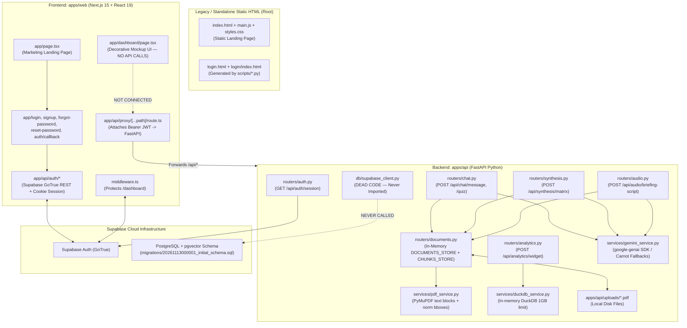

# Phase 1 — Comprehensive Existing System Audit

**Audit Date:** November 14, 2026  
**Project:** DocuMind (`WAICY` Monorepo)  
**Audit Mode:** Strict Analysis-Only (Zero Code Modifications)

---

## 1. Executive Summary of Actual Technical Condition

A line-by-line source code audit of the **DocuMind** repository (`c:\Users\arief\Downloads\WAICY`) reveals a stark divergence between the **aspirational architecture blueprint** documented in [`docs/ARCHITECTURE.md`](file:///c:/Users/arief/Downloads/WAICY/docs/ARCHITECTURE.md) and the **actual running implementation** across [`apps/api`](file:///c:/Users/arief/Downloads/WAICY/apps/api) and [`apps/web`](file:///c:/Users/arief/Downloads/WAICY/apps/web).

### Key Audit Findings at a Glance

1. **Blueprint vs. Reality Gap:** [`docs/ARCHITECTURE.md`](file:///c:/Users/arief/Downloads/WAICY/docs/ARCHITECTURE.md#L68-L121) describes a full production stack with `pdf_parser.py`, `rag_service.py`, `dashboard_agent.py`, `echarts_schema.py`, `react-pdf` (`pdf-canvas-viewer.tsx`), `dynamic-echarts.tsx`, OpenAI `text-embedding-3-small`, and LightRAG hybrid vector+BM25 search. **None of those files exist in the repository.**
2. **Backend Storage & Database Are Disconnected:** Although a well-designed PostgreSQL + `pgvector` schema exists in [`supabase/migrations/20261113000001_initial_schema.sql`](file:///c:/Users/arief/Downloads/WAICY/supabase/migrations/20261113000001_initial_schema.sql) and a `SupabaseManager` wrapper is defined in [`apps/api/app/db/supabase_client.py`](file:///c:/Users/arief/Downloads/WAICY/apps/api/app/db/supabase_client.py#L5-L66), **`supabase_db` is never imported or called anywhere in the backend.** All documents and chunks are stored exclusively in volatile Python dictionaries (`DOCUMENTS_STORE` and `CHUNKS_STORE`) in [`apps/api/app/routers/documents.py`](file:///c:/Users/arief/Downloads/WAICY/apps/api/app/routers/documents.py#L15-L16) backed by local disk files in `apps/api/uploads/`.
3. **Current AI Integration Uses Placeholder Gemini Model IDs & Hardcoded Fallbacks:** [`apps/api/app/core/config.py`](file:///c:/Users/arief/Downloads/WAICY/apps/api/app/core/config.py#L13-L16) configures `gemini_api_key = ""` (currently empty in `apps/api/.env`) and sets default model strings `gemini-3.8-flash`, `gemini-3.5-flash-lite`, and `gemini-3.8-live`. When `GEMINI_API_KEY` is empty or the API call fails, [`gemini_service.py`](file:///c:/Users/arief/Downloads/WAICY/apps/api/app/services/gemini_service.py#L74-L79), [`synthesis.py`](file:///c:/Users/arief/Downloads/WAICY/apps/api/app/routers/synthesis.py#L58-L78), and [`audio.py`](file:///c:/Users/arief/Downloads/WAICY/apps/api/app/routers/audio.py#L51-L73) return hardcoded Indonesian responses about the **Carnot thermodynamic cycle and R-134a refrigeration**, regardless of what PDF the user uploaded.
4. **Zero Embeddings, Zero Vector Search, Zero RAG:** No embedding model is ever called. In [`apps/api/app/routers/chat.py`](file:///c:/Users/arief/Downloads/WAICY/apps/api/app/routers/chat.py#L11-L14), "retrieval" consists of slicing the first 15 chunks (`doc_chunks[:15]`) of a single document from memory. Worse, [`gemini_service.py`](file:///c:/Users/arief/Downloads/WAICY/apps/api/app/services/gemini_service.py#L83-L100) ignores any `[cite:CHUNK_ID]` markers generated by the LLM and unconditionally attaches the first two chunks (`context_chunks[:2]`) as citations.
5. **Dashboard Generation Is 100% Hardcoded Demo Data:** [`apps/api/app/routers/analytics.py`](file:///c:/Users/arief/Downloads/WAICY/apps/api/app/routers/analytics.py#L14-L59) ignores both `request.document_id` and `request.query`, registers a hardcoded 5-row array (`demo_data`) into DuckDB, runs a fixed SQL query, and returns a static ECharts bar/line specification. No tables are ever extracted from uploaded PDFs, and no LLM is ever invoked to generate SQL or chart configs.
6. **Frontend Dashboard Is a Unwired UI Shell:** While the Next.js authentication system ([`apps/web/lib/server/supabase-auth.ts`](file:///c:/Users/arief/Downloads/WAICY/apps/web/lib/server/supabase-auth.ts), [`apps/web/lib/server/security.ts`](file:///c:/Users/arief/Downloads/WAICY/apps/web/lib/server/security.ts), [`apps/web/middleware.ts`](file:///c:/Users/arief/Downloads/WAICY/apps/web/middleware.ts)) and backend proxy ([`apps/web/app/api/proxy/[...path]/route.ts`](file:///c:/Users/arief/Downloads/WAICY/apps/web/app/api/proxy/%5B...path%5D/route.ts)) are genuinely and securely implemented, the protected [`/dashboard`](file:///c:/Users/arief/Downloads/WAICY/apps/web/app/dashboard/page.tsx) page is a purely decorative monochrome studio mockup ("Layer 01–03", "Shadow Pass") that makes **zero network calls** to FastAPI or `/api/proxy`. Although `echarts`, `echarts-for-react`, and `zustand` are installed in [`apps/web/package.json`](file:///c:/Users/arief/Downloads/WAICY/apps/web/package.json#L16-L25), none of them are imported anywhere in `apps/web`.

---

## 1.1 Project Structure & Component Investigation

### Current Repository Architecture Diagram (Actual vs. Unwired)

---

### Detailed Component-by-Component Inspection

#### 1. Frontend Architecture (`apps/web/` and Root Static Files)
- **Next.js Application (`apps/web/`):** Built with Next.js `^15.0.3`, React `^19.0.0`, TypeScript `^5.6.3`, and Tailwind CSS `^3.4.15` ([`apps/web/package.json`](file:///c:/Users/arief/Downloads/WAICY/apps/web/package.json)).
  - **Landing Page ([`apps/web/app/page.tsx`](file:///c:/Users/arief/Downloads/WAICY/apps/web/app/page.tsx)):** Marketing page with Lenis smooth scrolling, animated SVG gauges/radars, LED dot glyphs, and a dynamic header button (`Sign in` vs `Dashboard` based on `getCurrentUser()`). Note: Section 3 ([`apps/web/app/page.tsx`](file:///c:/Users/arief/Downloads/WAICY/apps/web/app/page.tsx#L770-L800)) still contains template text referencing `"Get your Vexor Account"`.
  - **Authentication UI & Flows:** Fully implemented across [`/login`](file:///c:/Users/arief/Downloads/WAICY/apps/web/app/login/page.tsx), [`/signup`](file:///c:/Users/arief/Downloads/WAICY/apps/web/app/signup/page.tsx), [`/forgot-password`](file:///c:/Users/arief/Downloads/WAICY/apps/web/app/forgot-password/page.tsx), [`/reset-password`](file:///c:/Users/arief/Downloads/WAICY/apps/web/app/reset-password/page.tsx), and [`/auth/callback`](file:///c:/Users/arief/Downloads/WAICY/apps/web/app/auth/callback/page.tsx), styled as "Signal — Log in" via [`SignalAuthShell.tsx`](file:///c:/Users/arief/Downloads/WAICY/apps/web/components/SignalAuthShell.tsx) and [`AuthPrimitives.tsx`](file:///c:/Users/arief/Downloads/WAICY/apps/web/components/auth/AuthPrimitives.tsx).
  - **Workspace Dashboard ([`apps/web/app/dashboard/page.tsx`](file:///c:/Users/arief/Downloads/WAICY/apps/web/app/dashboard/page.tsx) & [`components/dashboard/*`](file:///c:/Users/arief/Downloads/WAICY/apps/web/components/dashboard/MainCanvas.tsx)):** Currently a static visual prototype with an L-shaped SVG canvas, toggleable grid pills (`Grid`, `Snap`, `Align`, `Scale`, `Mask`, `Depth`, `Grain`, `Soft`, `Focus`), fanned layer cards (`Shadow Pass`, `Midtone Card`, `Highlight Card`), and a prompt input box that runs a `650ms` `setTimeout` and displays `"Updating preview..."` locally. **There is no PDF viewer, no file upload dropzone, no chat panel, no ECharts component, no quiz modal, and no synthesis view in the frontend.**
  - **Backend API Proxy ([`apps/web/app/api/proxy/[...path]/route.ts`](file:///c:/Users/arief/Downloads/WAICY/apps/web/app/api/proxy/%5B...path%5D/route.ts)):** A well-implemented server-side proxy that validates the user's `sb_access_token` cookie (or refreshes it via `sb_refresh_token`), attaches `Authorization: Bearer <accessToken>`, and forwards `GET/POST/PUT/DELETE/PATCH` requests to `${FASTAPI_URL}/api/${targetPath}`. However, no frontend component calls `/api/proxy/*` yet.
- **Root Static Files & Build Scripts:**
  - [`index.html`](file:///c:/Users/arief/Downloads/WAICY/index.html), [`main.js`](file:///c:/Users/arief/Downloads/WAICY/main.js), [`styles.css`](file:///c:/Users/arief/Downloads/WAICY/styles.css), [`login.html`](file:///c:/Users/arief/Downloads/WAICY/login.html), and [`login/index.html`](file:///c:/Users/arief/Downloads/WAICY/login/index.html) are standalone static HTML/CSS/JS prototypes of the landing and login pages.
  - [`scripts/build_standalone_index_html.py`](file:///c:/Users/arief/Downloads/WAICY/scripts/build_standalone_index_html.py) embeds base64 fonts (`FreeSans`, `Eloquia`) and a base64 WebP poster into `login/index.html`.
  - [`scripts/update_login_html.py`](file:///c:/Users/arief/Downloads/WAICY/scripts/update_login_html.py) synchronizes CSS from `apps/web/app/login/login.css` into `apps/web/public/login.html` and root `login.html`.

#### 2. Backend Architecture (`apps/api/`)
- **Framework:** FastAPI (`>=0.115.0`) + Uvicorn (`>=0.32.0`) + Pydantic v2 (`>=2.9.0`).
- **Entrypoint ([`apps/api/app/main.py`](file:///c:/Users/arief/Downloads/WAICY/apps/api/app/main.py)):** Configures CORS (`allow_origins=settings.cors_origins or ["*"]`) and mounts 6 routers under `/api`:
  1. `auth.router` (`/api/auth/session`)
  2. `documents.router` (`/api/documents`, `/api/documents/upload`, `/api/documents/{document_id}`, `/api/documents/{document_id}/file`, `/api/documents/{document_id}/chunks`, `DELETE /api/documents/{document_id}`)
  3. `chat.router` (`/api/chat/message`, `/api/chat/quiz`)
  4. `analytics.router` (`/api/analytics/widget`)
  5. `synthesis.router` (`/api/synthesis/matrix`)
  6. `audio.router` (`/api/audio/briefing-script`)

#### 3. Database & ORM (`supabase/` and `apps/api/app/db/`)
- **No ORM Used:** The project uses raw Supabase PostgREST/RPC calls via the `supabase-py` SDK (`supabase>=2.10.0`) in Python and direct `fetch` calls to Supabase GoTrue REST endpoints in Next.js.
- **Database Schema ([`supabase/migrations/20261113000001_initial_schema.sql`](file:///c:/Users/arief/Downloads/WAICY/supabase/migrations/20261113000001_initial_schema.sql)):**
  - Enables `vector` (`pgvector`) and `uuid-ossp`.
  - Defines 6 tables:
    1. `public.workspaces` (`id`, `name`, `created_at`) — **Notice: No `owner_id` or `user_id` column!**
    2. `public.documents` (`id`, `workspace_id`, `title`, `storage_path`, `file_type`, `page_count`, `file_size_bytes`, `processing_status`, `metadata`, `created_at`, `updated_at`) — **Notice: No `user_id` column!**
    3. `public.chunks` (`id`, `document_id`, `workspace_id`, `chunk_index`, `content`, `page_number`, `bounding_boxes` JSONB, `embedding vector(1536)`, `token_count`, `metadata`, `created_at`) with HNSW cosine index (`idx_chunks_embedding_hnsw`), Indonesian GIN FTS index (`idx_chunks_fts`), and `(document_id, page_number)` B-tree index.
    4. `public.topics` (`id`, `workspace_id`, `name`, `description`, `category`, `created_at`).
    5. `public.chunk_topics` (`chunk_id`, `topic_id`, `confidence`).
    6. `public.dashboard_widgets` (`id`, `workspace_id`, `document_id`, `title`, `description`, `chart_type`, `sql_query`, `echarts_spec`, `layout_position`, `created_at`).
  - Defines RPC function `public.match_document_chunks(query_embedding vector(1536), match_threshold float, match_count int, filter_workspace_id uuid, filter_document_id uuid default null)`.
  - **Critical Schema Deficiencies:**
    - **Zero Row-Level Security (RLS) policies** are defined in the migration (`ALTER TABLE ... ENABLE ROW LEVEL SECURITY` is completely absent).
    - **No `user_id` / `owner_id` foreign keys** linking `workspaces` or `documents` to `auth.users(id)`.
    - **Completely Unwired from Backend:** `SupabaseManager` in [`apps/api/app/db/supabase_client.py`](file:///c:/Users/arief/Downloads/WAICY/apps/api/app/db/supabase_client.py) is never imported by any router or service.

#### 4. Authentication and Authorization
- **Frontend Auth (`apps/web/lib/server/`):** High-quality implementation. Uses `httpOnly`, `sameSite: "lax"` cookies (`sb_access_token`, `sb_refresh_token`, `sb_recovery_token`, `sb_pkce_verifier`), PKCE S256 for Google OAuth, disposable email blocking (40 domains), honeypot + submission timing bot checks (`< 300ms`), IP rate limiting, and brute-force account lockout (`6` failures -> `5 min` lockout).
- **Backend Auth ([`apps/api/app/core/security.py`](file:///c:/Users/arief/Downloads/WAICY/apps/api/app/core/security.py)):** Implements `verify_supabase_bearer_token()`, `get_optional_current_user()`, and `require_authenticated_user()` by calling Supabase `/auth/v1/user`.
- **Critical Authorization Vulnerability in Backend Routers:**
  - `require_authenticated_user` is **ONLY** used on `GET /api/auth/session` ([`apps/api/app/routers/auth.py`](file:///c:/Users/arief/Downloads/WAICY/apps/api/app/routers/auth.py#L9)).
  - **Every single document, chat, quiz, analytics, synthesis, and audio endpoint in FastAPI (`documents.py`, `chat.py`, `analytics.py`, `synthesis.py`, `audio.py`) has ZERO authentication dependencies (`Depends(require_authenticated_user)` is missing) and ZERO tenant/user isolation!** Any unauthenticated caller reaching port `8000` can list, read, download, chat with, or delete every uploaded document in `DOCUMENTS_STORE`. Even when called via the Next.js proxy, all authenticated users share the exact same global `DOCUMENTS_STORE` and `CHUNKS_STORE` in memory.

#### 5. File Upload and Storage Mechanisms
- **Implementation ([`apps/api/app/routers/documents.py`](file:///c:/Users/arief/Downloads/WAICY/apps/api/app/routers/documents.py#L83-L113)):**
  - Accepts `multipart/form-data` via `POST /api/documents/upload`.
  - Validates only that `file.filename.lower().endswith(".pdf")` (no MIME magic-byte verification, no file size cap—a multi-gigabyte file can exhaust disk/RAM).
  - Writes directly to local disk (`./uploads/{doc_id}_{safe_name}`). Does **not** upload to Supabase Storage.
  - On module startup and on every `GET /api/documents` call, `_sync_uploads_from_disk()` ([`documents.py`](file:///c:/Users/arief/Downloads/WAICY/apps/api/app/routers/documents.py#L36-L79)) scans `./uploads` and re-parses any PDF not yet in `DOCUMENTS_STORE`. Currently, 4 sample PDF files (`sample_termo.pdf` x2, `sample_refrig.pdf` x2) sit in `apps/api/uploads/`.

#### 6. Background Jobs, Caching, Environment Config, and Dependencies
- **Background Jobs:** Uses FastAPI's in-process `BackgroundTasks` (`background_tasks.add_task(process_pdf_in_background, doc_id, save_path)` in [`documents.py`](file:///c:/Users/arief/Downloads/WAICY/apps/api/app/routers/documents.py#L111)). No Celery, Redis, BullMQ, or persistent job queue exists.
- **Caching:** No caching layer exists (apart from keeping parsed chunks in the global `CHUNKS_STORE` Python dict and `_sync_uploads_from_disk()`). Every call to `/api/chat/message`, `/api/chat/quiz`, `/api/synthesis/matrix`, or `/api/audio/briefing-script` re-runs from scratch without caching.
- **Environment Configuration:**
  - `apps/api/.env` and `apps/api/.env.example` define `APP_ENV`, `PORT`, `HOST`, `ALLOWED_ORIGINS`, `GEMINI_API_KEY`, `SUPABASE_URL`, `SUPABASE_SERVICE_ROLE_KEY`, `UPLOAD_DIR`.
  - `apps/web/.env.local` and `apps/web/.env.example` define `SUPABASE_URL`, `SUPABASE_SERVICE_ROLE_KEY`, `NEXT_PUBLIC_SUPABASE_URL`, `NEXT_PUBLIC_API_URL`, `FASTAPI_URL`.
  - **Security Risk:** There is **no `.gitignore` file** at the repository root, `apps/api/`, or `apps/web/`—only inside `apps/api/venv/.gitignore`.
- **Unused Dependencies:**
  - Backend ([`apps/api/requirements.txt`](file:///c:/Users/arief/Downloads/WAICY/apps/api/requirements.txt)): `pymupdf4llm>=0.0.17`, `numpy>=2.1.0`, `sympy>=1.13.3` are listed (and `supabase>=2.10.0` is only imported in dead code `supabase_client.py`).
  - Frontend ([`apps/web/package.json`](file:///c:/Users/arief/Downloads/WAICY/apps/web/package.json)): `echarts`, `echarts-for-react`, `framer-motion`, `zustand`, `@supabase/ssr`, `@supabase/supabase-js` are installed in `dependencies` but never imported in `apps/web` source files (auth uses direct `fetch` to GoTrue instead of `@supabase/supabase-js`).

---

## 1.2 Existing AI Functionality Mapping

The table below provides a complete, code-verified inventory of all 14 AI and document intelligence capabilities across DocuMind.

| # | Capability | Implementation Status | Exact Source Location | Current Implementation & Technical Dependencies | Current Limitations & Bugs | Uses External AI Provider? | Replaceable by Official OpenAI Capability? | Additional Custom Engineering Needed |
|---|---|---|---|---|---|---|---|---|
| 1 | **Document Understanding & Layout Parsing** | **Partially Implemented** (Basic PDF text blocks only) | [`pdf_service.py`](file:///c:/Users/arief/Downloads/WAICY/apps/api/app/services/pdf_service.py#L25-L108) | Uses PyMuPDF (`fitz`) `page.get_text("blocks")` to iterate text blocks (`b[6] == 0`), normalize `(x0, y0, x1, y1)` by `page_width`/`page_height` into `0.0–1.0` `BoundingBox` objects, and group blocks into ~250-word chunks per page. | Supports `.pdf` only (rejects DOCX, XLSX, PPTX, TXT, images). Ignores reading order across multi-column layouts, headers/footers, and tables. Contradicts [`docs/ARCHITECTURE.md`](file:///c:/Users/arief/Downloads/WAICY/docs/ARCHITECTURE.md#L258) on Y-axis origin (`fitz` uses top-left `y0/page_height`, which is actually right for DOM, while `ARCHITECTURE.md` wrote `(pageHeight - y1)/pageHeight`). | **No** (Local C++ PyMuPDF) | **Hybrid** (Retain PyMuPDF for fast local text + normalized bounding boxes; use OpenAI **`gpt-6.1-terra`** / **`gpt-6-luna`** Vision/Files input for complex layouts, charts, and scanned pages). | Add support for DOCX/PPTX/XLSX/TXT, structure-aware chunking with overlap, and table extraction into DuckDB. |
| 2 | **Text Extraction** | **Partially Implemented** (Digital PDFs only) | [`pdf_service.py`](file:///c:/Users/arief/Downloads/WAICY/apps/api/app/services/pdf_service.py#L44-L56) | Extracts embedded UTF-8 text from digital PDF blocks via `page.get_text("blocks")` and metadata via `doc.metadata`. | Fails silently (returns `0` chunks) on scanned PDFs, image-only PDFs, or photographed notes because image blocks (`b[6] == 1`) are explicitly skipped on line 51 (`if len(b) >= 7 and b[6] != 0: continue`). | **No** | **Hybrid** (Retain PyMuPDF for native digital PDFs; fallback to OpenAI multimodal vision for non-digital pages). | Detect low-text/scanned pages (`len(words) < threshold`) and route only those pages to vision OCR. |
| 3 | **OCR (Scanned Documents & Images)** | **Not Implemented** (Skipped in code) | [`pdf_service.py`](file:///c:/Users/arief/Downloads/WAICY/apps/api/app/services/pdf_service.py#L50-L52) | Explicitly skips image blocks (`b[6] != 0`). Image uploads (`.png`, `.jpg`, `.webp`) are rejected by [`documents.py`](file:///c:/Users/arief/Downloads/WAICY/apps/api/app/routers/documents.py#L88-L89). | Scanned PDFs produce an empty `CHUNKS_STORE[doc_id] = []`, causing downstream chat/quiz endpoints to fall back to hardcoded strings. | **No** | **Yes** (`gpt-6.1-terra` or `gpt-6-luna` multimodal vision / native PDF page rendering). | Render scanned PDF pages to images via PyMuPDF (`page.get_pixmap()`) and extract structured text via OpenAI Vision when native text is empty. |
| 4 | **Document Classification & Metadata Extraction** | **Minimal / Non-AI** | [`pdf_service.py`](file:///c:/Users/arief/Downloads/WAICY/apps/api/app/services/pdf_service.py#L14-L23) | Reads raw PDF header dictionary (`doc.metadata.get("title")`, `author`, `len(doc)`, `os.path.getsize`). [`docs/ARCHITECTURE.md`](file:///c:/Users/arief/Downloads/WAICY/docs/ARCHITECTURE.md#L308) mentions "Auto-classification (Qualitative vs Quantitative)", but it does not exist in code. | PDF header metadata is almost always blank or junk (e.g., `"Microsoft Word - Document1"`). No document type, domain, language, topic, or quantitative/qualitative classification is performed. | **No** | **Yes** (OpenAI **`gpt-6-luna`** with Structured Outputs during ingestion). | Create an ingestion step that classifies document category, language, summary, and quantitative table availability using `gpt-6-luna` over the first/sampled chunks. |
| 5 | **Embeddings Generation** | **Not Implemented** (Schema exists, zero code) | [`20261113000001_initial_schema.sql`](file:///c:/Users/arief/Downloads/WAICY/supabase/migrations/20261113000001_initial_schema.sql#L39) | SQL schema defines `embedding vector(1536)` on `public.chunks` with comment `-- compatible with text-embedding-3-small or Gemini embeddings`. **Zero Python code generates embeddings anywhere in `apps/api`.** | `DocumentChunk` in [`schemas.py`](file:///c:/Users/arief/Downloads/WAICY/apps/api/app/models/schemas.py#L21-L29) does not even have an `embedding` field. Chunks are stored in RAM without vectors. | **No** | **Yes** (OpenAI **`text-embedding-3-small`** at 1536 dimensions, `$0.02 / 1M` tokens, or `$0.01 / 1M` via Batch API). | Batch-embed extracted chunks using `client.embeddings.create(model="text-embedding-3-small", input=...)` and persist to Supabase `public.chunks`. |
| 6 | **Semantic Search & Contextual Retrieval** | **Dead Code / Unwired** | [`supabase_client.py`](file:///c:/Users/arief/Downloads/WAICY/apps/api/app/db/supabase_client.py#L42-L64), [`20261113000001_initial_schema.sql`](file:///c:/Users/arief/Downloads/WAICY/supabase/migrations/20261113000001_initial_schema.sql#L86-L121) | `supabase_db.search_similar_chunks()` wraps the PostgreSQL RPC `match_document_chunks` (`1 - (c.embedding <=> query_embedding)`), and a GIN index `to_tsvector('indonesian', content)` exists in SQL. Neither is ever called. | No search endpoint exists in FastAPI. Even `match_document_chunks` only does dense cosine similarity (the GIN FTS index is never queried by any SQL function). | **No** | **Hybrid** (OpenAI **`text-embedding-3-small`** query vectors + custom PostgreSQL hybrid RRF function combining `pgvector` HNSW + PostgreSQL FTS). | Wire `supabase_db` into a dedicated `retrieval_service.py` and upgrade the Supabase RPC to support Reciprocal Rank Fusion (dense + lexical) and permission filtering. |
| 7 | **Document Q&A & RAG Pipeline** | **Mocked / Naive Prefix Slice** | [`chat.py`](file:///c:/Users/arief/Downloads/WAICY/apps/api/app/routers/chat.py#L8-L32), [`gemini_service.py`](file:///c:/Users/arief/Downloads/WAICY/apps/api/app/services/gemini_service.py#L37-L110) | `POST /api/chat/message` grabs `CHUNKS_STORE[request.document_id][:15]` (first 15 chunks of the file, ignoring the user's question!). Calls `gemini-3.8-flash` via `google-genai` SDK if `GEMINI_API_KEY` is set; otherwise returns a hardcoded Carnot cycle string. Ignores `request.conversation_history`. | 1) No semantic retrieval—anything past chunk 15 (~page 5) is invisible. 2) `gemini-3.8-flash` is not a valid public Google API model ID, so live API calls fail and trigger the `except` fallback! 3) Citations (`context_chunks[:2]`) are hardcoded to the first 2 chunks regardless of what the LLM cited. 4) `suggested_followups` are hardcoded strings. | **Yes** (`google-genai` configured with invalid model `gemini-3.8-flash`, currently running in offline fallback mode) | **Yes** (OpenAI **Responses API** with **`gpt-6-luna`** or **`gpt-6.1-terra`** + Structured Outputs returning verified `citations` and dynamic `suggested_followups`). | Replace `gemini_service.py` with centralized `openai_service.py`, retrieve top-$k$ chunks via hybrid `pgvector` search, and map LLM-cited `chunk_id`s back to exact stored `bounding_boxes`. |
| 8 | **Adaptive Quiz Generation** | **Partially Implemented with Hardcoded Fallback** | [`chat.py`](file:///c:/Users/arief/Downloads/WAICY/apps/api/app/routers/chat.py#L34-L51), [`gemini_service.py`](file:///c:/Users/arief/Downloads/WAICY/apps/api/app/services/gemini_service.py#L112-L172) | `POST /api/chat/quiz` concatenates the first 20 chunks (`full_text[:6000]`) and requests `response_schema=QuizResponse` from `gemini-3.8-flash`. Falls back to 2 hardcoded Carnot thermodynamics questions. | Truncates document at 6,000 characters (~900 words). When the LLM generates a `proof_quote`, there is no logic to match that quote to actual `BoundingBox` coordinates in `CHUNKS_STORE` (or the LLM hallucinates bounding box floats!). | **Yes** (`google-genai` + fallback) | **Yes** (OpenAI **`gpt-6-luna`** or **`gpt-6.1-terra`** with Structured Outputs `strict: true`). | Pass chunk IDs to OpenAI so the model returns `source_chunk_id` + `proof_quote`, then deterministically look up `bounding_boxes` from the chunk record instead of asking the LLM to guess coordinates. |
| 9 | **Summarization & Insight Extraction** | **Fragmented / Hardcoded** | [`synthesis.py`](file:///c:/Users/arief/Downloads/WAICY/apps/api/app/routers/synthesis.py#L20), [`audio.py`](file:///c:/Users/arief/Downloads/WAICY/apps/api/app/routers/audio.py#L17), [`analytics.py`](file:///c:/Users/arief/Downloads/WAICY/apps/api/app/routers/analytics.py#L58) | No standalone summarization or insight extraction endpoint exists. Summaries only appear as sub-fields (`executive_summary` in synthesis, `takeaway_summary` in audio, and a hardcoded `insight_summary` in analytics). | Users cannot view an automatic document summary, key findings, entities, dates/deadlines, or key figures upon uploading a document. | **Partially** (`google-genai` in synthesis/audio + hardcoded in analytics) | **Yes** (OpenAI **`gpt-6-luna`** for ingestion summaries/metadata and **`gpt-6.1-sol`** for deep insight/inconsistency extraction via Structured Outputs). | Add structured ingestion summary & entity/insight extraction stored in `documents.metadata` and `public.topics`. |
| 10 | **Automatic Dashboard Generation** | **Mocked / Hardcoded** (DuckDB engine works, pipeline is fake) | [`analytics.py`](file:///c:/Users/arief/Downloads/WAICY/apps/api/app/routers/analytics.py#L14-L60), [`duckdb_service.py`](file:///c:/Users/arief/Downloads/WAICY/apps/api/app/services/duckdb_service.py#L5-L87) | `DuckDBAnalyticsEngine` in `duckdb_service.py` is genuinely implemented (`register_table_from_records`, `get_table_schema_summary`, `execute_safe_query`). However, `analytics.py` ignores the uploaded document and query, registers a hardcoded 5-row array `demo_data`, runs a static SQL string, and returns a static `DashboardWidget`. | 1) No tables or quantitative metrics are extracted from uploaded documents. 2) `get_table_schema_summary()` in `duckdb_service.py` is never called! 3) No LLM generates the DuckDB SQL or selects the chart type. 4) `execute_safe_query` token filter can be bypassed by punctuation like `DROP;`. | **No** (Currently 100% hardcoded in `analytics.py`) | **Hybrid** (Retain **DuckDB** for deterministic math; use OpenAI **`gpt-6.1-terra`** or **`gpt-6.1-sol`** with Structured Outputs to extract tables/metrics during ingestion and generate validated SQL + ECharts specs). | 1) Extract tables from PDFs/DOCX/XLSX (or extract structured metrics from qualitative docs) into DuckDB. 2) Call `get_table_schema_summary()` and use OpenAI Structured Outputs to generate the SQL query, chart config, and narrative insight. 3) Harden DuckDB read-only enforcement. |
| 11 | **Cross-Document Synthesis & Relationship Discovery** | **Broken Prompt + Missing Graph Logic** | [`synthesis.py`](file:///c:/Users/arief/Downloads/WAICY/apps/api/app/routers/synthesis.py#L25-L79), [`20261113000001_initial_schema.sql`](file:///c:/Users/arief/Downloads/WAICY/supabase/migrations/20261113000001_initial_schema.sql#L55-L69) | `POST /api/synthesis/matrix` compares 2+ documents. However, line 43 (`combined_context = f"Dokumen 1 ({doc_a})\nDokumen 2 ({doc_b})"`) passes **ONLY the filenames/titles** of the documents to the LLM—never their text chunks! Also, `public.topics` and `public.chunk_topics` in SQL are completely unused. | Even with a valid API key, the model has zero access to document contents when generating the synthesis matrix! Furthermore, there is no automated relationship graph or shared-entity discovery across a workspace. | **Yes** (`google-genai` with broken title-only prompt + hardcoded fallback) | **Hybrid** (Use **`text-embedding-3-small`** for document/chunk similarity + **`gpt-6-luna`** for entity/topic extraction into `topics`/`chunk_topics` + **`gpt-6.1-sol`** for cross-document synthesis & contradiction analysis). | Fix `synthesis.py` to pass retrieved/summarized content from each document; populate `topics` and `chunk_topics` during ingestion to power relational graph queries in PostgreSQL. |
| 12 | **Audio Briefing / Podcast Script & TTS** | **Script Only (With Fallback); No Audio Synthesis** | [`audio.py`](file:///c:/Users/arief/Downloads/WAICY/apps/api/app/routers/audio.py#L19-L74) | `POST /api/audio/briefing-script` passes the first 15 chunks (`full_text[:5000]`) to `gemini-3.8-flash` to generate a JSON script between hosts `"Alex"` and `"Sarah"`, with a 4-turn Carnot fallback. | Generates text JSON only—no actual audio file or speech stream is produced. | **Yes** (`google-genai` + fallback) | **Yes** (OpenAI **`gpt-6-luna`** for script generation + **`gpt-realtime-2.1-mini`** for voice output if audio playback is desired). | Keep script generation on `gpt-6-luna`; optionally add audio synthesis if the product roadmap requires playable briefings. |
| 13 | **AI Agents & Tool Orchestration** | **Not Implemented** | N/A | No agent loop, function calling, or tool router exists in `apps/api`. Each endpoint makes at most one single-turn LLM call. | The assistant cannot dynamically decide whether to search across multiple documents, query a DuckDB table, or compare specific pages based on user intent. | **No** | **Yes** (OpenAI **Responses API** native tool calling with custom functions: `search_workspace_chunks`, `query_document_tables_duckdb`, `get_document_metadata`). | Implement a bounded tool-calling loop in the centralized OpenAI service using the Responses API. |

---

## 1.3 Existing System Assessment

### 1. Unnecessary Complexity & Duplicate Implementations
- **Dual Frontend Maintenance Overhead:** The repository maintains both a full Next.js 15 application (`apps/web/`) and standalone root HTML/CSS/JS files (`index.html`, `login.html`, `login/index.html`, `main.js`, `styles.css`) synchronized via custom Python scripts (`scripts/build_standalone_index_html.py`, `scripts/update_login_html.py`) that hardcode 50KB+ of base64 strings. The Next.js app in `apps/web/` should be the single source of truth for the frontend.
- **Duplicate / Scattered Model Calls:** Instead of routing all AI calls through `gemini_service.py`, [`synthesis.py`](file:///c:/Users/arief/Downloads/WAICY/apps/api/app/routers/synthesis.py#L42-L54) and [`audio.py`](file:///c:/Users/arief/Downloads/WAICY/apps/api/app/routers/audio.py#L33-L47) directly reach into `gemini_service.client.models.generate_content(...)` and import `from google.genai import types` inside route handlers. This tightly couples FastAPI HTTP routers to a specific vendor SDK (`google.genai`).

### 2. Critical Bugs & Architectural Flaws Discovered
1. **Non-Existent Default Model Identifiers (`apps/api/app/core/config.py`):**
   - `default_model: str = "gemini-3.8-flash"`, `lite_model: str = "gemini-3.5-flash-lite"`, and `live_model: str = "gemini-3.8-live"` are configured as defaults, with `thinking_config=types.ThinkingConfig(thinking_budget=1024)` called on every request.
2. **LLM Hallucinated Bounding Boxes in Quiz Generation (`apps/api/app/models/schemas.py` & `gemini_service.py`):**
   - `QuizQuestion` includes `bounding_boxes: List[BoundingBox]`. Because `QuizResponse` is passed directly as `response_schema=QuizResponse` to the LLM (`gemini_service.py:127`) while the prompt (`gemini_service.py:121`) only passes raw text (`document_text[:6000]`) without any coordinate metadata, the LLM is forced to **invent arbitrary floating-point bounding box coordinates** (`left`, `top`, `width`, `height`)!
3. **Fake Citation Attachment in Chat (`apps/api/app/services/gemini_service.py:83-100`):**
   - Even when the LLM outputs `[cite:CHUNK_ID]` in `answer_text`, the code never parses `[cite:...]` from `answer_text`. Instead, it loops over `context_chunks[:2]` (always chunk 0 and chunk 1 on page 1) and returns them as the citations!
4. **Title-Only Cross-Document Synthesis (`apps/api/app/routers/synthesis.py:43`):**
   - `combined_context = f"Dokumen 1 ({doc_a})\nDokumen 2 ({doc_b})"` sends only the two document filenames to the model without any document text.
5. **SQL Blacklist Bypass in DuckDB (`apps/api/app/services/duckdb_service.py:74-78`):**
   - `tokens = [t.upper() for t.clean_sql.split()]` splits only on whitespace. A query like `SELECT 1; DROP TABLE tbl_x` or `COPY(SELECT * FROM tbl_x) TO '/tmp/x'` where punctuation or parentheses touch the keyword (`COPY(...)` -> token `"COPY(SELECT"`) bypasses `if any(w in tokens for w in disallowed)`! Furthermore, the DuckDB connection is not opened in `read_only` mode nor using a restricted execution context for untrusted SQL.
6. **Unauthenticated Backend Endpoints & Shared Global Memory (`apps/api/app/routers/*.py`):**
   - `DOCUMENTS_STORE` and `CHUNKS_STORE` are process-global dictionaries with no `user_id` or `workspace_id` partitioning, and none of the data routers require `require_authenticated_user`.

### 3. Component Disposition Matrix: What to Retain, Replace, or Redesign

| Component | Disposition | Technical Justification |
|---|---|---|
| **Next.js 15 Auth & Security Layer** (`apps/web/lib/server/supabase-auth.ts`, `security.ts`, `auth-validation.ts`, `middleware.ts`, `app/api/auth/*`) | **RETAIN (100%)** | Production-grade authentication with PKCE, `httpOnly` cookies, token refresh, rate limiting, brute-force lockout, and bot protection. Zero reason to touch or rewrite. |
| **Next.js Backend Proxy** (`apps/web/app/api/proxy/[...path]/route.ts`) | **RETAIN (100%)** | Cleanly bridges cookie-based browser sessions to `Authorization: Bearer <jwt>` headers for FastAPI, keeping backend URLs and tokens off the client. |
| **PyMuPDF Local PDF Extraction & Coordinate Normalization** (`apps/api/app/services/pdf_service.py`) | **RETAIN & EXTEND** | Fast C++ extraction of digital PDF text blocks with exact `0.0–1.0` DOM-normalized bounding boxes at **$0 API cost**. Sending every digital PDF page to an LLM just to extract text and coordinates would be slow, expensive, and less geometrically accurate. Retain for digital PDFs and extend with table extraction (`page.find_tables()`), structure-aware chunking, and a vision OCR fallback for scanned pages. |
| **DuckDB In-Memory Analytical Engine** (`apps/api/app/services/duckdb_service.py`) | **RETAIN & HARDEN** | The "VegaChat/LIDA" pattern (LLM generates SQL + chart spec over schema; DuckDB computes exact aggregations) is architecturally superior to asking an LLM to do math in tokens. Harden SQL validation (AST/statement check) and connect it to real tables extracted from documents. |
| **Supabase PostgreSQL + `pgvector` Schema** (`supabase/migrations/20261113000001_initial_schema.sql`) | **RETAIN & UPGRADE** | `pgvector` with HNSW (`vector(1536)`) + PostgreSQL GIN full-text search in the existing Supabase database avoids paying for a separate external vector database or OpenAI's $0.10/GB/day Vector Store fee while preserving Normalized Bounding Boxes (`bounding_boxes JSONB`) per chunk. Needs `user_id` ownership columns, RLS policies, and a hybrid RRF search function. |
| **`GeminiIntelligenceService` & `google-genai` SDK** (`apps/api/app/services/gemini_service.py`, `config.py`) | **REPLACE** | Currently uses invalid model IDs (`gemini-3.8-flash`), has an empty API key, leaks vendor SDK imports into routers, and relies on hardcoded Carnot cycle fallbacks. Replace with a centralized, provider-clean `OpenAIService` built on the official `openai` Python SDK and the **Responses API**. |
| **In-Memory `DOCUMENTS_STORE` & `CHUNKS_STORE`** (`apps/api/app/routers/documents.py`) | **REDESIGN** | Process-local dicts lose metadata on restart, lack multi-worker consistency, and have zero tenant isolation. Persist documents, chunks, embeddings, and widgets in Supabase PostgreSQL (retaining a lightweight LRU cache or local development fallback only when explicitly configured). |
| **Analytics, Synthesis, Chat & Quiz Routers** (`analytics.py`, `synthesis.py`, `chat.py`, `audio.py`) | **REDESIGN** | Must be wired to real document chunks, hybrid `pgvector` retrieval, deterministic citation/bounding-box lookup, real DuckDB table extraction, and `Depends(require_authenticated_user)`. |
| **Frontend Workspace Dashboard** (`apps/web/app/dashboard/page.tsx`) | **REDESIGN (Phase 2 UI)** | Currently a decorative monochrome studio shell. Needs to be connected to `/api/proxy/documents`, `/api/proxy/chat`, `/api/proxy/analytics`, and `/api/proxy/synthesis` with `echarts-for-react` (already installed) and a PDF + bounding-box highlight viewer. |
