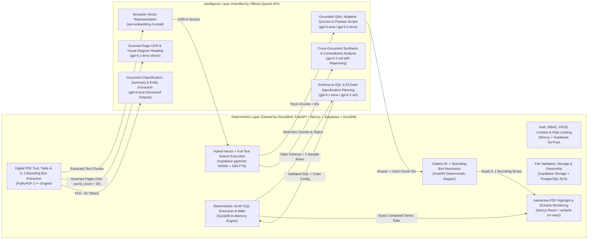

# Phase 3 — Capability Mapping & Migration Feasibility

**Document Date:** November 14, 2026  
**Project:** DocuMind (`WAICY` Monorepo)

---

## 3.1 Comprehensive Capability Mapping Table

The table below compares every existing DocuMind capability (audited in Phase 1) against the verified OpenAI API capabilities (researched in Phase 2), detailing the exact additional engineering required and the architectural recommendation (`Replace`, `Retain`, or `Hybrid`).

| Existing DocuMind Capability | Current Implementation (Actual Repo State) | Potential OpenAI Replacement (Verified Models & APIs) | Additional Engineering Required | Recommendation |
|---|---|---|---|---|
| **1. Digital PDF Text & Coordinate Extraction** | [`pdf_service.py`](file:///c:/Users/arief/Downloads/WAICY/apps/api/app/services/pdf_service.py#L25-L108) uses local C++ PyMuPDF (`fitz`) `page.get_text("blocks")` to extract text blocks and normalize `(x0, y0, x1, y1)` into `0.0–1.0` `BoundingBox` objects. | None needed for native digital text (sending digital PDF pages to an LLM for raw text extraction wastes tokens and loses exact bounding-box geometry). | Add paragraph/heading boundary awareness, configurable 15% chunk overlap, and PyMuPDF table detection (`page.find_tables()`). | **RETAIN (Extend Local PyMuPDF)** |
| **2. Multi-Format Document Ingestion (DOCX, XLSX, PPTX, TXT, CSV)** | Rejects everything except `.pdf` in [`documents.py:88-89`](file:///c:/Users/arief/Downloads/WAICY/apps/api/app/routers/documents.py#L88-L89). | OpenAI Files API supports `.pdf`, `.docx`, `.pptx`, `.txt`, `.md`, `.json`, `.html`, but **not** `.xlsx`/`.csv` in File Search. | Parse `.docx` (`python-docx`), `.pptx` (`python-pptx`), and `.txt`/`.md` locally into `DocumentChunk` records; load `.xlsx`/`.csv` directly into DuckDB via `duckdb.read_csv` / `spatial` extension. | **HYBRID** (Local deterministic parsers + DuckDB for spreadsheets) |
| **3. Scanned Document & Image OCR** | Not implemented. Image blocks (`b[6] != 0`) are explicitly skipped in [`pdf_service.py:51-52`](file:///c:/Users/arief/Downloads/WAICY/apps/api/app/services/pdf_service.py#L51-L52). Scanned PDFs yield 0 chunks. | **`gpt-6.1-terra`** (or **`gpt-6-luna`** for simple pages) via **Responses API** multimodal `input_image` with Structured Outputs. | Detect low-text PDF pages (`len(words) < 20`) during PyMuPDF pass, render only those pages to PNG (`page.get_pixmap(dpi=150)`), and call `gpt-6.1-terra` to extract text, tables, and coarse region boxes. | **HYBRID** (PyMuPDF page density check $\rightarrow$ OpenAI `gpt-6.1-terra` Vision fallback) |
| **4. Document Classification & Metadata Extraction** | [`pdf_service.py:14-23`](file:///c:/Users/arief/Downloads/WAICY/apps/api/app/services/pdf_service.py#L14-L23) only reads raw PDF header metadata (`doc.metadata.get("title")`, `author`). No AI classification exists. | **`gpt-6-luna`** (`$0.10/1M` input) via **Responses API + Structured Outputs** (`DocumentIngestionSummary` schema). | Run a single lightweight ingestion call over the first ~2,000 tokens + sampled headings to extract: clean title, document type (`academic`, `financial`, `administrative`, `technical`), language, `is_quantitative`, key entities/topics, and executive summary. | **REPLACE** (Use OpenAI `gpt-6-luna` once at ingestion and cache in `documents.metadata`) |
| **5. Embedding Generation** | **Unimplemented in active pipeline.** SQL schema defines `embedding vector(1536)` ([`20261113000001_initial_schema.sql:39`](file:///c:/Users/arief/Downloads/WAICY/supabase/migrations/20261113000001_initial_schema.sql#L39)), but no code generates vectors during upload. | **`text-embedding-3-small`** (`1536` dimensions, `$0.02/1M` tokens standard, `$0.01/1M` via Batch API). | Batch chunks (up to 2,048 chunks per request) into `client.embeddings.create(model="text-embedding-3-small", input=chunk_texts)` during ingestion and store in `public.chunks.embedding`. | **REPLACE** (Implement with OpenAI `text-embedding-3-small`) |
| **6. Semantic & Hybrid Search** | `supabase_db.search_similar_chunks()` in [`supabase_client.py:42-64`](file:///c:/Users/arief/Downloads/WAICY/apps/api/app/db/supabase_client.py#L42-L64) is dead code (never imported). `chat.py` just slices `doc_chunks[:15]`. | **Option A:** OpenAI Hosted File Search (`$0.10/GB/day` + `$2.50/1k` calls; loses bounding boxes). **Option B (Recommended):** OpenAI **`text-embedding-3-small`** query vector + Supabase PostgreSQL **`pgvector` HNSW + GIN FTS (Hybrid RRF)**. | Wire `supabase_db` into `retrieval_service.py`. Upgrade Supabase RPC `match_document_chunks` to combine dense cosine similarity (`<=>`) and full-text rank (`ts_rank_cd`) via Reciprocal Rank Fusion (RRF), scoped by `workspace_id` and `user_id`. | **HYBRID** (OpenAI `text-embedding-3-small` + Supabase `pgvector`/FTS Hybrid RRF) |
| **7. Document Q&A & Visual Citation RAG** | [`chat.py:8-32`](file:///c:/Users/arief/Downloads/WAICY/apps/api/app/routers/chat.py#L8-L32) and [`gemini_service.py:37-110`](file:///c:/Users/arief/Downloads/WAICY/apps/api/app/services/gemini_service.py#L37-L110) call non-existent `gemini-3.8-flash` over `doc_chunks[:15]`, fall back to hardcoded Carnot text, and hardcode `context_chunks[:2]` as citations. | **Responses API** (`/v1/responses`) with **`gpt-6-luna`** (for `eli5` / `high_school` depth) or **`gpt-6.1-terra`** (for `academic` depth) + **Structured Outputs** + **Prompt Caching**. | 1) Retrieve top-$k$ chunks via Hybrid RRF. 2) Pass chunks with stable `chunk_id`s to OpenAI. 3) Enforce a Pydantic schema returning `answer`, `cited_chunk_ids: List[str]`, `confidence`, and `suggested_followups`. 4) Deterministically map `cited_chunk_ids` to stored `BoundingBox` arrays in Python. | **REPLACE** (Migrate from `gemini_service` to OpenAI Responses API + deterministic citation mapping) |
| **8. Adaptive Socratic Quiz Generation** | [`chat.py:34-51`](file:///c:/Users/arief/Downloads/WAICY/apps/api/app/routers/chat.py#L34-L51) and [`gemini_service.py:112-172`](file:///c:/Users/arief/Downloads/WAICY/apps/api/app/services/gemini_service.py#L112-L172) pass `full_text[:6000]` to `gemini-3.8-flash` and ask the LLM to output `BoundingBox` floats directly (causing hallucinated coordinates) or return 2 hardcoded Carnot questions. | **Responses API** with **`gpt-6-luna`** or **`gpt-6.1-terra`** + **Structured Outputs** (`strict: true`). | Remove `bounding_boxes` from the LLM-generated schema; instead, require the LLM to output `source_chunk_id: str` and `proof_quote: str`. In Python, look up the exact `bounding_boxes` from `public.chunks` using `source_chunk_id`. Cache generated quizzes per `(document_id, difficulty)`. | **REPLACE** (OpenAI `gpt-6-luna` / `gpt-6.1-terra` + server-side coordinate lookup) |
| **9. Document Summarization & Insight Extraction** | Fragmented across `synthesis.py`, `audio.py`, and `analytics.py` with hardcoded fallbacks. No dedicated insight/entity extraction pipeline. | **`gpt-6-luna`** (standard summaries, dates, entities, key figures) and **`gpt-6.1-sol`** (deep inconsistency/risk detection) via **Structured Outputs**. | Extract structured insights (`key_findings`, `entities`, `dates_deadlines`, `key_metrics`, `inconsistencies`) once during document ingestion and persist in `public.documents.metadata` and `public.topics` so subsequent views cost $0. | **REPLACE** (OpenAI `gpt-6-luna` / `gpt-6.1-sol` with ingestion-time persistence) |
| **10. Automatic Dashboard Generation** | [`analytics.py:14-60`](file:///c:/Users/arief/Downloads/WAICY/apps/api/app/routers/analytics.py#L14-L60) ignores uploaded documents and queries a hardcoded 5-row array `demo_data` in [`duckdb_service.py`](file:///c:/Users/arief/Downloads/WAICY/apps/api/app/services/duckdb_service.py). | **Hybrid:** Retain **DuckDB** (`duckdb_service.py`) for deterministic SQL execution + use **`gpt-6.1-terra`** / **`gpt-6.1-sol`** with **Structured Outputs** to generate the DuckDB `sql_query`, chart type, axis mappings, and narrative `insight_summary`. | 1) Extract tables from PDFs (`page.find_tables()`) or structured metrics from text into DuckDB tables (`tbl_doc_<id>`). 2) Pass `duckdb_engine.get_table_schema_summary()` (schema + 3 sample rows) to OpenAI. 3) Validate and run generated SQL in DuckDB. 4) Populate `EChartsOption` series data deterministically from DuckDB query results. | **HYBRID** (Retain DuckDB OLAP + Add OpenAI Structured SQL/Chart Planner + Frontend `echarts-for-react`) |
| **11. Cross-Document Synthesis & Relationship Discovery** | [`synthesis.py:43`](file:///c:/Users/arief/Downloads/WAICY/apps/api/app/routers/synthesis.py#L43) passes **only document titles** (`Dokumen 1 (title_a)\nDokumen 2 (title_b)`) to `gemini-3.8-flash` and falls back to a hardcoded Carnot vs R-134a matrix. `topics` and `chunk_topics` tables are unused. | **`text-embedding-3-small`** (semantic similarity across docs) + **`gpt-6-luna`** (entity/topic extraction into PostgreSQL `topics`/`chunk_topics`) + **`gpt-6.1-sol`** (`reasoning={"effort": "medium"}` for cross-document synthesis & contradiction matrix). | 1) Populate `topics` and `chunk_topics` at ingestion. 2) Use SQL joins on `chunk_topics` + `pgvector` centroid cosine similarity to discover related documents. 3) Fix `synthesis.py` to retrieve relevant chunks/summaries from each document before calling `gpt-6.1-sol`. | **HYBRID** (PostgreSQL relational/vector graph + OpenAI `gpt-6.1-sol` synthesis) |
| **12. Audio Briefing Script & Voice Synthesis** | [`audio.py:19-74`](file:///c:/Users/arief/Downloads/WAICY/apps/api/app/routers/audio.py#L19-L74) passes `full_text[:5000]` to `gemini-3.8-flash` (or Carnot fallback) to generate a JSON script for `"Alex"` & `"Sarah"`. No audio is synthesized. | **`gpt-6-luna`** for 2-host dialogue script generation + optional **`gpt-realtime-2.1-mini`** for synthesized audio (since `gpt-4o-mini-tts` retires Jan 6, 2027). | Migrate script generation to `gpt-6-luna` via Structured Outputs (`PodcastScriptResponse`) and cache the generated script in `documents.metadata`. Add optional audio rendering endpoint only if required by UI. | **REPLACE** (OpenAI `gpt-6-luna` for script; optional `gpt-realtime-2.1-mini` for audio) |
| **13. Conversational Agent & Tool Orchestration** | Not implemented (single-turn calls only). | **OpenAI Responses API** (`client.responses.create`) with native **Function Calling** (`search_document_chunks`, `run_duckdb_analytics`, `compare_documents`) and `previous_response_id`. | Build a clean, bounded (max 3 tool hops) orchestration method in `openai_service.py` so the assistant can automatically search passages, query DuckDB tables, or compare documents within a single chat turn. | **REPLACE / NEW** (OpenAI Responses API tool calling) |

---

## 3.2 Architectural Separation of Responsibilities

A core principle of this modernization is **using OpenAI strictly where probabilistic language/visual intelligence provides leverage, while keeping deterministic computation, coordinate math, storage, and security inside DocuMind.**

### Summary of Boundaries

1. **Why OpenAI Should NOT Do Everything:**
   - **Never ask an LLM to calculate chart numbers directly:** LLMs hallucinate sums, averages, and percentages over large tables. Keep DuckDB (`duckdb_service.py`) to execute SQL deterministically; use OpenAI (`gpt-6.1-terra`) only to write the SQL query and choose the ECharts chart type from the table schema.
   - **Never ask an LLM to output PDF bounding-box coordinates (`left`, `top`, `width`, `height`):** Text LLMs do not know where words sit in PDF point space. Keep PyMuPDF (`pdf_service.py`) to compute exact normalized coordinates (`0.0–1.0`), pass `chunk_id` to OpenAI, and map cited `chunk_id`s back to stored `BoundingBox` arrays in Python.
   - **Never use OpenAI Vector Stores when coordinate-grounded retrieval is required:** Keep chunks and `vector(1536)` embeddings in DocuMind's existing Supabase `pgvector` table so every vector search returns the chunk's `bounding_boxes` JSONB column in a single database query at zero per-search tool cost.
2. **Where OpenAI Provides Decisive Leverage:**
   - **`text-embedding-3-small`** turns raw chunks into high-recall 1536-dimensional semantic vectors for pennies (`$0.02 / 1M` tokens).
   - **`gpt-6-luna`** provides fast, $0.10/1M-token structured classification, entity/topic extraction, summarization, quiz generation, and grounded Q&A.
   - **`gpt-6.1-terra`** unlocks OCR and visual layout understanding for scanned PDFs, charts, and scientific tables (`$1.00/1M` input).
   - **`gpt-6.1-sol`** delivers deep reasoning for cross-document synthesis, contradiction detection, and multi-table analytical planning (`$2.00/1M` input, `$0.10/1M` cached).
