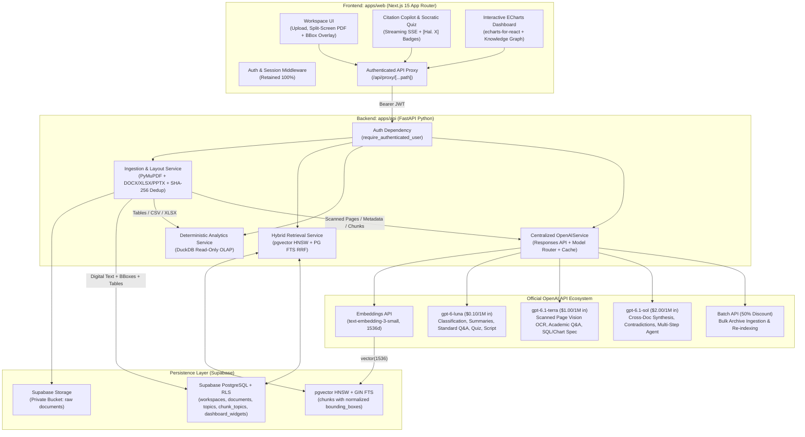
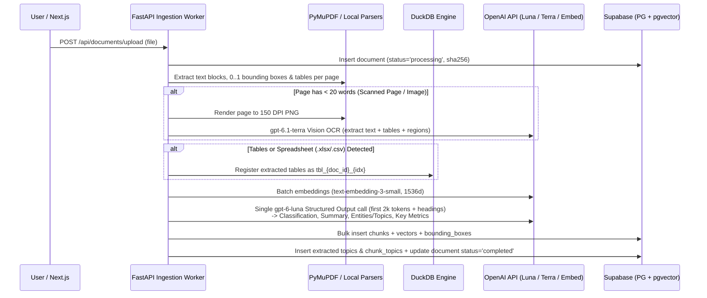
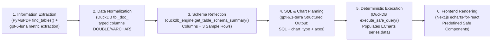

# Phase 4 & Phase 5 — Target DocuMind AI Architecture & OpenAI Integration Strategy

**Document Date:** November 14, 2026  
**Project:** DocuMind (`WAICY` Monorepo)

---

## 4.1 High-Level Target Architecture Overview

The proposed target architecture modernizes DocuMind into a modular, multi-tenant, zero-hallucination document intelligence platform powered by the **official OpenAI Python SDK (`openai`)**, the **OpenAI Responses API (`/v1/responses`)**, **`text-embedding-3-small`**, and the **GPT-6 model family (`gpt-6-luna`, `gpt-6.1-terra`, `gpt-6.1-sol`)**, while retaining DocuMind's best existing assets (**Next.js 15 Auth & Proxy**, **PyMuPDF coordinate extraction**, **DuckDB deterministic OLAP**, and **Supabase PostgreSQL + `pgvector`**).



---

## 4.2 End-to-End Document Lifecycle Design

### A. Document Ingestion (`POST /api/documents/upload`)

When a user uploads a file, the ingestion pipeline performs strict validation, deduplication, and multi-format routing before invoking any AI model:

1. **Authentication & Ownership Enforcement:**
   - Every route in `documents.py` requires `user = Depends(require_authenticated_user)`.
   - The document is bound to `user_id` and a valid `workspace_id` UUID owned by that user in `public.workspaces`.
2. **File Validation & Security Checks:**
   - **Supported Formats:** `.pdf`, `.docx`, `.xlsx`, `.csv`, `.pptx`, `.txt`, `.md`, `.png`, `.jpg`, `.webp`.
   - **Magic-Byte MIME Verification:** Verify file header bytes (e.g., `%PDF-` for PDF, PK zip signature for `.docx`/`.xlsx`/`.pptx`) rather than trusting `file.filename.endswith(...)`.
   - **File Size Limits:** Enforce configurable maximums (e.g., `50 MB` per document in standard interactive upload).
3. **SHA-256 Content Deduplication:**
   - Compute `sha256_hash = hashlib.sha256(file_bytes).hexdigest()` on upload.
   - If a document with the same `(workspace_id, sha256_hash)` already exists in `public.documents` with `processing_status = 'completed'`, reuse the existing parsed chunks, embeddings, metadata, and dashboard tables immediately (**$0 API cost**).
4. **Storage & Lifecycle Status:**
   - Store the raw file in a private Supabase Storage bucket (`documents/{workspace_id}/{doc_id}/{safe_filename}`) with a local disk cache (`./uploads`) for fast PyMuPDF/DuckDB access.
   - Track state transitions in `public.documents.processing_status`: `pending` $\rightarrow$ `extracting` $\rightarrow$ `indexing` $\rightarrow$ `completed` (or `failed` with sanitized error details).

---

### B. Document Processing Pipeline (Local First, AI Where Needed)

To keep API costs minimal, **DocuMind never sends an entire digital document through an expensive LLM just to read its text.** Instead, processing follows an 8-stage hybrid pipeline:



1. **Stage 1 — Local Structure, Text & Coordinate Extraction ($0 API Cost):**
   - **Digital PDFs:** `pdf_service.py` uses PyMuPDF (`page.get_text("blocks")`) to extract text blocks with normalized top-left `0.0–1.0` `BoundingBox` coordinates (`left`, `top`, `width`, `height`, `page_number`). Upgrade chunking from a naive 250-word accumulator to a **structure-aware chunker** (300–400 words target, 50-word overlap, breaking cleanly on section headings) while preserving the list of `BoundingBox` rectangles for each chunk.
   - **PDF Tables:** Call `page.find_tables()` in PyMuPDF to deterministically extract tabular grids on each page into JSON records and register them in DuckDB.
   - **Office & Text Files:** Use `python-docx` (`.docx`), `python-pptx` (`.pptx`), and native DuckDB readers (`.csv`, `.xlsx`) to extract text chunks and tables locally at $0 token cost.
2. **Stage 2 — Selective Scanned-Page OCR via `gpt-6.1-terra` Vision:**
   - Only when a PDF page yields `< 20` words of embedded text (indicating a scanned page or full-page diagram), render that specific page via `page.get_pixmap(dpi=150)` and send it to **`gpt-6.1-terra`** (`$1.00/1M` input) with a Structured Output schema returning transcribed paragraphs, markdown tables, and coarse normalized bounding boxes.
3. **Stage 3 — Single-Pass Document Classification, Metadata & Insight Extraction (`gpt-6-luna`):**
   - Make **one** call to **`gpt-6-luna`** (`$0.10/1M` input, `$0.50/1M` output) passing the first ~2,000 tokens + section headings of the document with a strict Pydantic schema (`DocumentIngestionAnalysis`) that extracts in a single shot:
     - `document_type`: `"academic_paper" | "textbook_module" | "financial_report" | "administrative_record" | "legal_contract" | "general"`
     - `language`: `"id" | "en" | ...`
     - `executive_summary`: 3-paragraph structured summary
     - `key_findings`: list of 5–8 core takeaways with `page_number`
     - `entities_and_topics`: list of `{name, category, description}` (inserted into `public.topics` and `public.chunk_topics`)
     - `extracted_metrics`: list of `{metric_name, category, numeric_value, unit, period_or_label}` (so even qualitative/semi-structured documents without formal grid tables yield structured rows for DuckDB dashboard generation!)
4. **Stage 4 — Batch Embedding Generation (`text-embedding-3-small`):**
   - Send all extracted chunk strings in a single batched array call `client.embeddings.create(model="text-embedding-3-small", input=[c.content for c in chunks])` (`$0.02 / 1M` tokens).
   - Bulk-insert chunks, `bounding_boxes`, and `1536`-d vectors into Supabase `public.chunks`.

---

### C. Intelligent Document Search Architecture

#### Architectural Tradeoff Evaluation: OpenAI Hosted File Search vs. Custom Hybrid Search (`text-embedding-3-small` + Supabase `pgvector` & FTS)

| Evaluation Dimension | Option 1: OpenAI Hosted File Search (`/v1/vector_stores`) | Option 2: DocuMind Hybrid Search (`text-embedding-3-small` + Supabase `pgvector` HNSW + PG FTS) | Winner for DocuMind |
|---|---|---|---|
| **Cost** | **$2.50 per 1,000 queries** + **$0.10 / GB / day** storage (over 1 GB) + model input tokens for injected chunks (default 20 chunks = up to 16,000 tokens/query). | **$0.000002 per 100-token query** (`text-embedding-3-small` at $0.02/1M) + **$0 per-search tool fee** + included in existing Supabase PostgreSQL database. | **Option 2 (1,250x cheaper per search query)** |
| **Visual Citations & Bounding Boxes** | **Not Supported.** OpenAI Vector Stores strip PDF spatial coordinates (`x0, y0, x1, y1`) during ingestion; cannot highlight cited sentences on the PDF canvas. | **100% Supported.** Every chunk row in `public.chunks` stores `bounding_boxes JSONB` (`0.0–1.0` coordinates) alongside `embedding vector(1536)`. | **Option 2 (Essential for DocuMind's core UX)** |
| **Search Quality (Hybrid Dense + Lexical)** | Built-in dense + keyword ranking with optional score threshold. | Custom **Reciprocal Rank Fusion (RRF)** combining `pgvector` HNSW cosine similarity (`<=>`) and PostgreSQL GIN Full-Text Search (`to_tsvector` / `websearch_to_tsquery`) with exact acronym/formula matching. | **Tie / Option 2 (Tunable for Indonesian + English academic terms)** |
| **Permission & Tenant Isolation** | Coarse metadata filtering (`attributes`), or managing thousands of separate Vector Stores per user/workspace. | Native PostgreSQL `WHERE workspace_id = $1 AND user_id = $2` + Row-Level Security (RLS) enforced at the database engine level. | **Option 2** |
| **Data Ownership & ZDR** | Files and Vector Stores persist on OpenAI servers outside Zero Data Retention (ZDR) until manually deleted. | All chunks and vectors live in DocuMind's own Supabase database; OpenAI only sees stateless embedding requests. | **Option 2** |
| **Operational Complexity** | Low setup, but requires syncing file deletions across both Supabase and OpenAI Vector Stores. | Already 70% built in [`20261113000001_initial_schema.sql`](file:///c:/Users/arief/Downloads/WAICY/supabase/migrations/20261113000001_initial_schema.sql) and [`supabase_client.py`](file:///c:/Users/arief/Downloads/WAICY/apps/api/app/db/supabase_client.py); just needs RRF SQL upgrade and wiring. | **Option 2** |

#### Proposed Hybrid RRF Search SQL Function (`match_document_chunks_hybrid`)
We upgrade the existing `match_document_chunks` RPC in Supabase to perform **Reciprocal Rank Fusion (RRF)** over both the existing `idx_chunks_embedding_hnsw` index and a multi-language (`simple` + `indonesian`) GIN full-text index:
- **Dense Semantic Branch:** Top 30 chunks ordered by `c.embedding <=> query_embedding`.
- **Lexical Keyword Branch:** Top 30 chunks matching `websearch_to_tsquery('simple', query_text)` ordered by `ts_rank_cd`.
- **RRF Score Combination:**
  $$\text{RRF\_Score}(c) = \frac{w_{\text{vec}}}{60 + \text{rank}_{\text{vec}}(c)} + \frac{w_{\text{fts}}}{60 + \text{rank}_{\text{fts}}(c)}$$
- Filtered strictly by `c.workspace_id = filter_workspace_id`, optional `filter_document_ids`, and optional `metadata` filters (e.g., `page_number`, `document_type`).

---

### D. Document Intelligence Assistant (`/api/chat/message` & `/api/chat/quiz`)

1. **Retrieval & Context Assembly:**
   - Embed the user's question with `text-embedding-3-small`.
   - Retrieve the top $k = 8$ chunks via `match_document_chunks_hybrid` (scoped to `document_id` or the entire `workspace_id` for multi-document Q&A).
   - Format the context block with explicit, deterministic identifiers:
     `[CHUNK_ID: <uuid> | DOC: <title> | PAGE: <page_number>]\n<content>`
2. **Model Routing by Cognitive Depth (`CognitiveDepth`):**
   - `CognitiveDepth.ELI5` and `CognitiveDepth.HIGH_SCHOOL` $\rightarrow$ **`gpt-6-luna`** (`reasoning={"effort": "low"}`, `$0.10/1M` in, `$0.50/1M` out).
   - `CognitiveDepth.ACADEMIC` or multi-document workspace queries $\rightarrow$ **`gpt-6.1-terra`** (`reasoning={"effort": "medium"}`, `$1.00/1M` in, `$5.00/1M` out).
3. **Grounded Structured Output & Deterministic Coordinate Resolution:**
   - Call `client.responses.parse` with a strict Pydantic schema `LLMChatGeneration`:
     ```python
     class LLMCitedChunk(BaseModel):
         chunk_id: str
          verbatim_quote: str

     class LLMChatGeneration(BaseModel):
         answer_markdown: str
         has_sufficient_context: bool
         cited_chunks: List[LLMCitedChunk]
         suggested_followups: List[str]
     ```
   - **Zero Hallucinated Coordinates:** The backend maps each returned `cited_chunk.chunk_id` against the retrieved chunk dictionary in Python and attaches that chunk's genuine PyMuPDF `bounding_boxes: List[BoundingBox]` and `page_number`. If `has_sufficient_context` is `False`, the assistant explicitly informs the user that the uploaded documents do not contain the answer rather than fabricating claims.
4. **Adaptive Quiz Generation (`POST /api/chat/quiz`):**
   - Uses **`gpt-6-luna`** (or **`gpt-6.1-terra`**) via Structured Outputs where each `QuizQuestion` specifies `source_chunk_id: str` and `proof_quote: str`. Python resolves `source_chunk_id` $\rightarrow$ `source_page` and `bounding_boxes`, eliminating the current bug where the LLM invents bounding-box coordinates.

---

### E. Automatic Insight Extraction

During ingestion (and on-demand via `GET /api/documents/{id}/insights`), DocuMind extracts a validated `DocumentInsights` structure stored in `public.documents.metadata`:
- **Executive Summary** (`executive_summary`)
- **Key Findings & Claims** (`key_findings: List[{claim, importance, chunk_id, page_number}]`)
- **Dates, Deadlines & Timeline Events** (`timeline_events: List[{date_str, event_description, page_number}]`)
- **Named Entities & Concepts** (`entities: List[{name, category, frequency, description}]` — synced to `public.topics` & `public.chunk_topics`)
- **Important Figures & Quantitative Metrics** (`metrics: List[{label, value, unit, context, page_number}]`)
- **Internal Inconsistencies or Warnings** (`inconsistencies: List[{description, page_a, page_b, severity}]`)

Because this runs **once at ingestion** using **`gpt-6-luna`** (`~$0.002` per document) and is persisted in PostgreSQL, rendering the Insights tab in the UI requires **zero additional OpenAI API calls**.

---

### F. Automatic Dashboard Generation (`/api/analytics/widget` & Auto-Dashboard)

DocuMind's differentiating feature—turning uploaded documents into interactive, zero-hallucination Apache ECharts dashboards—is redesigned into a clean **6-stage pipeline**:



1. **Stage 1 & 2 — Information Extraction & Data Normalization into DuckDB:**
   - **Quantitative Documents (Financial reports, lab tables, spreadsheets):** Tables extracted via PyMuPDF `page.find_tables()` or uploaded `.csv`/`.xlsx` files are normalized and registered into DuckDB via `duckdb_engine.register_table_from_records(f"tbl_{doc_id}_{idx}", records)`.
   - **Qualitative / Semi-Structured Documents (Textbooks, research papers, administrative docs):** The `extracted_metrics` and `chunk_topics` distributions extracted during Stage 3 of ingestion are registered into DuckDB as `tbl_{doc_id}_metrics` and `tbl_{doc_id}_topics`. This guarantees **every document has real, queryable analytical tables in DuckDB**, eliminating the hardcoded `demo_data` in [`analytics.py:23-29`](file:///c:/Users/arief/Downloads/WAICY/apps/api/app/routers/analytics.py#L23-L29).
2. **Stage 3 & 4 — Metric Identification, SQL Generation & Chart Selection (`gpt-6.1-terra`):**
   - Call `duckdb_engine.get_table_schema_summary(table_name)` (which already exists in [`duckdb_service.py:54-68`](file:///c:/Users/arief/Downloads/WAICY/apps/api/app/services/duckdb_service.py#L54-L68)!) to get column names, types, and 3 sample rows.
   - Send only the schema summary + user query to **`gpt-6.1-terra`** with a strict Pydantic schema `DashboardQueryPlan`:
     ```python
     class DashboardQueryPlan(BaseModel):
         title: str
         description: str
         chart_type: Literal["bar", "line", "pie", "radar", "scatter"]
         sql_query: str  # Read-only DuckDB SELECT returning category_col and 1..3 numeric value_cols
         x_axis_column: str
         series_columns: List[str]
         insight_summary: str
     ```
3. **Stage 5 — Deterministic DuckDB Execution & Spec Assembly:**
   - Execute `sql_query` via hardened `duckdb_engine.execute_safe_query(plan.sql_query)`.
   - Programmatically populate `EChartsOption(xAxis={"type": "category", "data": ...}, series=[...])` from the exact rows returned by DuckDB. **The LLM never writes raw data arrays into the chart.**
   - Persist the generated `DashboardWidget` in `public.dashboard_widgets`.
4. **Stage 6 — Frontend Rendering:**
   - The Next.js frontend renders `widget.echarts_spec` using the already-installed `echarts-for-react` library inside predefined widget cards—never executing arbitrary LLM-generated JavaScript or HTML.

---

### G. Document Relationship Discovery & Cross-Document Synthesis

Instead of introducing an external graph database (like Neo4j), DocuMind can deliver full cross-document relationship discovery and synthesis using its **existing Supabase PostgreSQL + `pgvector` schema** (`public.topics`, `public.chunk_topics`, and `public.chunks`):

1. **Three-Layer Relationship Discovery:**
   - **Layer 1 — Shared Entities & Topics (Relational Graph in PostgreSQL):** During ingestion, `gpt-6-luna` extracts normalized entities/concepts (`category` in `['concept', 'organization', 'person', 'project', 'date_event', 'metric']`) into `public.topics` and links them via `public.chunk_topics`. A simple SQL self-join on `chunk_topics` finds all document pairs sharing entities, ranked by shared topic count and confidence.
   - **Layer 2 — Semantic Document & Chunk Similarity (`pgvector`):** Compute document-level mean-pooled embedding vectors (or query top cross-document chunk pairs via `idx_chunks_embedding_hnsw` where `c1.document_id != c2.document_id` and cosine similarity $> 0.78$).
   - **Layer 3 — Model-Based Relationship & Contradiction Classification (`gpt-6.1-sol`):**
     - Fix [`synthesis.py`](file:///c:/Users/arief/Downloads/WAICY/apps/api/app/routers/synthesis.py#L25-L79) so `POST /api/synthesis/matrix` retrieves the executive summary, shared topics, and top-matching chunks from each selected document (`doc_ids`), and passes that real evidence to **`gpt-6.1-sol`** (`reasoning={"effort": "medium"}`) with `SynthesisMatrixResponse` Structured Outputs to classify relationships (`complementary`, `methodology_difference`, `contradiction`, `temporal_update`) with exact chunk/page citations.

---

## 5. OpenAI API Key Management & Integration Strategy (Phase 5)

### 5.1 Current Credential & Provider Audit
- **Where Credentials Are Currently Managed:**
  - Backend: [`apps/api/app/core/config.py`](file:///c:/Users/arief/Downloads/WAICY/apps/api/app/core/config.py#L13-L16) loads `apps/api/.env` via `pydantic_settings.BaseSettings`. Currently, `GEMINI_API_KEY` is defined (and empty in `apps/api/.env`), while `SUPABASE_URL` and `SUPABASE_SERVICE_ROLE_KEY` are populated.
  - Frontend: [`apps/web/.env.local`](file:///c:/Users/arief/Downloads/WAICY/apps/web/.env.local) holds Supabase URLs/keys and `FASTAPI_URL=http://localhost:8000`.
- **Current Provider Coupling Issues:**
  - `google-genai` is imported not only inside [`gemini_service.py`](file:///c:/Users/arief/Downloads/WAICY/apps/api/app/services/gemini_service.py#L28) but also directly inside route handlers [`synthesis.py:42`](file:///c:/Users/arief/Downloads/WAICY/apps/api/app/routers/synthesis.py#L42) and [`audio.py:33`](file:///c:/Users/arief/Downloads/WAICY/apps/api/app/routers/audio.py#L33).
  - No `openai` client or `OPENAI_API_KEY` variable currently exists in `apps/api`.

### 5.2 Centralized `OpenAIService` Architecture

Instead of scattering SDK calls across routers, all OpenAI interactions must be encapsulated in a single server-side service (`apps/api/app/services/openai_service.py`) driven by centralized configuration in `apps/api/app/core/config.py`:

```python
# Proposed additions to apps/api/app/core/config.py (Design Specification Only)
class Settings(BaseSettings):
    # OpenAI Official API Configuration (Server-Side Only)
    openai_api_key: str = ""
    openai_org_id: Optional[str] = None
    openai_project_id: Optional[str] = None
    openai_timeout_seconds: float = 60.0
    openai_max_retries: int = 3

    # Task-Based Model Routing Configuration (Easy to swap via .env)
    openai_model_fast: str = "gpt-6-luna"          # Classification, summaries, standard Q&A, quizzes, scripts
    openai_model_vision: str = "gpt-6.1-terra"     # Scanned PDF OCR, academic Q&A, DuckDB SQL + ECharts planner
    openai_model_reasoning: str = "gpt-6.1-sol"    # Cross-document synthesis, contradictions, complex analysis
    openai_model_frontier: str = "gpt-6-astra"     # Optional escalation tier
    openai_model_embedding: str = "text-embedding-3-small"
    openai_embedding_dimensions: int = 1536
```

#### Key Design Principles for `OpenAIService`:
1. **Single Async Client Instance (`AsyncOpenAI`):** Initialize one `AsyncOpenAI(api_key=settings.openai_api_key, timeout=settings.openai_timeout_seconds, max_retries=settings.openai_max_retries)` instance so FastAPI `async def` routes never block the event loop on synchronous HTTP calls (fixing a flaw in the current `gemini_service.py`, which uses synchronous calls inside `async def` endpoints!).
2. **Router Isolation:** FastAPI routers (`chat.py`, `documents.py`, `analytics.py`, `synthesis.py`, `audio.py`) never import `openai` directly. They call typed domain methods on `openai_service` (`embed_texts`, `extract_document_metadata`, `ocr_scanned_page`, `generate_grounded_answer`, `generate_quiz`, `plan_dashboard_widget`, `synthesize_documents`, `generate_podcast_script`).
3. **Safe Connection Health Check:** Expose an internal readiness check that verifies `bool(settings.openai_api_key)` and can optionally test `await client.models.retrieve(settings.openai_model_fast)` without ever logging or returning any portion of `OPENAI_API_KEY`.

### 5.3 Strict Credential Security Requirements
1. **Backend-Only Secret Storage:** `OPENAI_API_KEY` must exist **only** in `apps/api/.env` (or deployment secret manager). It must **never** be placed in `apps/web/.env.local`, **never** prefixed with `NEXT_PUBLIC_`, and **never** sent to the browser. All browser AI interactions flow through Next.js `/api/proxy/[...path]` $\rightarrow$ FastAPI.
2. **Create Root `.gitignore` Immediately Before Git Operations:** Because the audit discovered that no `.gitignore` exists at the repository root, a root `.gitignore` excluding `.env`, `.env.*`, `!.env.example`, `apps/api/venv/`, `apps/web/.next/`, and `apps/api/uploads/*.pdf` must be in place before any commit.
3. **Log & Error Sanitization:** Catch `openai.APIError`, `openai.RateLimitError`, and `openai.AuthenticationError` inside `openai_service.py` and return sanitized error codes to the client so raw upstream headers or keys never leak in HTTP 500 tracebacks (`chat.py:32` currently leaks raw exception strings `detail=f"Gemini AI processing error: {str(e)}"`).
