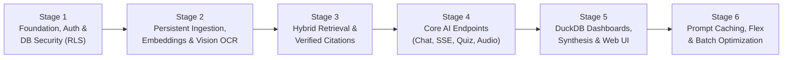

# Phase 8: Staged OpenAI Migration & Modernization Roadmap

> **Scope:** Actionable, step-by-step engineering roadmap to transform DocuMind from its current prototype state (hardcoded Gemini fallbacks, volatile in-memory dictionaries, disconnected database, and mocked dashboard UI) into a production-grade OpenAI-powered document intelligence platform.  
> **Note:** Per **Phase 10 (Strict Analysis-Only Mode)**, this roadmap is an architectural specification. No application code has been modified in this task.

---

## 1. Migration Overview & Architectural Staging

To minimize regression risk and deliver incremental, testable value at every milestone, the modernization is structured into **6 sequential stages**:

---

## 2. Detailed Stage-by-Stage Engineering Plan

### Stage 1 — Foundation, Security Hardening & OpenAI Service Layer

| Dimension | Specification |
|---|---|
| **1. What to Implement** | • Create root `.gitignore` protecting `.env`, `.env.local`, `apps/api/uploads/`, `venv/`, and `.next/`. • Update `apps/api/requirements.txt` to add `openai>=1.65.0` and `openpyxl>=3.1.2`. • Update `apps/api/app/core/config.py` with verified OpenAI model settings (`OPENAI_API_KEY`, `OPENAI_MODEL_FAST="gpt-6-luna"`, `OPENAI_MODEL_VISION="gpt-6.1-terra"`, `OPENAI_MODEL_REASONING="gpt-6.1-sol"`, `OPENAI_MODEL_EMBEDDING="text-embedding-3-small"`, `OPENAI_STORE_RESPONSES=False`). • Create `apps/api/app/services/openai_service.py` (`OpenAIRouterService` wrapping `AsyncOpenAI` with `responses.parse()`, `responses.create(stream=True)`, `embeddings.create()`, automatic retries, token logging, and `store=False` enforcement). • Attach `Depends(require_authenticated_user)` to all FastAPI routers (`documents.py`, `chat.py`, `analytics.py`, `synthesis.py`, `audio.py`). • Add migration `supabase/migrations/20261115000002_security_and_hybrid_search.sql` adding `owner_id`/`user_id` columns, `file_sha256`, `summary`, Row-Level Security (RLS) policies, and `match_document_chunks_hybrid` RRF RPC. |
| **2. Existing Files to Modify** | • [apps/api/requirements.txt](file:///c:/Users/arief/Downloads/WAICY/apps/api/requirements.txt) • [apps/api/.env.example](file:///c:/Users/arief/Downloads/WAICY/apps/api/.env.example) • [apps/api/app/core/config.py](file:///c:/Users/arief/Downloads/WAICY/apps/api/app/core/config.py) • [apps/api/app/routers/documents.py](file:///c:/Users/arief/Downloads/WAICY/apps/api/app/routers/documents.py), [chat.py](file:///c:/Users/arief/Downloads/WAICY/apps/api/app/routers/chat.py), [analytics.py](file:///c:/Users/arief/Downloads/WAICY/apps/api/app/routers/analytics.py), [synthesis.py](file:///c:/Users/arief/Downloads/WAICY/apps/api/app/routers/synthesis.py), [audio.py](file:///c:/Users/arief/Downloads/WAICY/apps/api/app/routers/audio.py) |
| **3. Existing Components to Reuse** | • [apps/api/app/core/security.py](file:///c:/Users/arief/Downloads/WAICY/apps/api/app/core/security.py) (`require_authenticated_user`, `AuthenticatedUser`) • [apps/api/app/db/supabase_client.py](file:///c:/Users/arief/Downloads/WAICY/apps/api/app/db/supabase_client.py) (`supabase_db` singleton) • [supabase/migrations/20261113000001_initial_schema.sql](file:///c:/Users/arief/Downloads/WAICY/supabase/migrations/20261113000001_initial_schema.sql) |
| **4. Components to Remove** | • Fake model identifiers in `config.py` (`gemini-3.8-flash`, `gemini-3.5-flash-lite`, `gemini-3.8-live`). |
| **5. OpenAI APIs / Models Required** | • `AsyncOpenAI` SDK (`POST /v1/responses`, `POST /v1/embeddings`). |
| **6. Dependencies & Risks** | • Applying Supabase SQL migration requires active Supabase database access. • Adding `require_authenticated_user` to all routers means `test_all_endpoints.py` must pass a valid test JWT or mock dependency override. |
| **7. Estimated Complexity** | **Low–Medium** (1–2 engineering days). |
| **8. Expected Benefits** | • Eliminates critical unauthenticated API exposure and cross-tenant data leakage. • Establishes a clean, type-safe OpenAI client layer with zero data retention (`store=False`) by default. |

---

### Stage 2 — Persistent Document Ingestion, Coordinate Chunks, Embeddings & Vision OCR

| Dimension | Specification |
|---|---|
| **1. What to Implement** | • Replace volatile `DOCUMENTS_STORE` and `CHUNKS_STORE` in `documents.py` with persistent reads/writes to Supabase PostgreSQL (`public.documents`, `public.chunks`, `public.topics`, `public.chunk_topics`) and Supabase Storage (`documents` bucket). • Compute `file_sha256` on upload to deduplicate identical uploads within a workspace. • Enhance `pdf_service.py` to support layout-aware block merging (300–600 tokens per chunk while preserving exact union/per-line normalized `[x0, y0, x1, y1]` bounding boxes) and add `.csv`/`.xlsx` ingestion support. • Add selective Vision OCR fallback in `pdf_service.py`: when a PDF page has `< 20` extracted words, render page pixmap at 150 DPI and call `gpt-6.1-terra` (`POST /v1/responses`) to extract markdown text and table structures. • Generate batch vector embeddings for all extracted chunks in a single `POST /v1/embeddings` call using `text-embedding-3-small` (`1536` dimensions) and store in `public.chunks.embedding`. • Execute a single-pass `gpt-6-luna` Structured Output extraction (`DocumentMetadataExtraction`) to populate `documents.summary`, `documents.metadata`, `public.topics`, and `public.chunk_topics`. |
| **2. Existing Files to Modify** | • [apps/api/app/services/pdf_service.py](file:///c:/Users/arief/Downloads/WAICY/apps/api/app/services/pdf_service.py) • [apps/api/app/routers/documents.py](file:///c:/Users/arief/Downloads/WAICY/apps/api/app/routers/documents.py) • [apps/api/app/models/schemas.py](file:///c:/Users/arief/Downloads/WAICY/apps/api/app/models/schemas.py) |
| **3. Existing Components to Reuse** | • `PDFService.extract_chunks_with_Prev_Coordinates()` in `pdf_service.py` (core PyMuPDF coordinate normalization logic `x0/width, y0/height, x1/width, y1/height`). • `BoundingBox` and `DocumentChunk` schemas in `schemas.py`. |
| **4. Components to Remove** | • Global `DOCUMENTS_STORE` and `CHUNKS_STORE` dictionaries in `documents.py`. • Ephemeral local-only `./uploads` storage reliance. |
| **5. OpenAI APIs / Models Required** | • `text-embedding-3-small` (`POST /v1/embeddings`, `dimensions=1536`) • `gpt-6-luna` (`POST /v1/responses`, `service_tier="flex"`, Structured Outputs for metadata/summary/topics) • `gpt-6.1-terra` (`POST /v1/responses`, multimodal image input for scanned pages). |
| **6. Dependencies & Risks** | • Depends on Stage 1 (`openai_service.py` and Supabase schema migration). • Large PDFs (>100 pages) should process embeddings and Vision OCR asynchronously via FastAPI `BackgroundTasks` so the upload HTTP request returns `status="processing"` within `<2s`. |
| **7. Estimated Complexity** | **Medium** (2–3 engineering days). |
| **8. Expected Benefits** | • Documents survive server restarts. • Scanned PDFs and charts become fully searchable. • Summaries, classifications, and topic graphs are computed once at ingestion time for **\$0.0007–\$0.0035 per document**. |

---

### Stage 3 — Hybrid Search (`pgvector` + FTS) & Deterministic Citation Resolution

| Dimension | Specification |
|---|---|
| **1. What to Implement** | • Create `apps/api/app/services/retrieval_service.py` implementing `retrieve_hybrid_chunks(workspace_id, query, doc_ids, top_k=8)`. • Embed the user query via `text-embedding-3-small` (~50 tokens = \$0.000001) and invoke the Supabase PostgreSQL RPC `match_document_chunks_hybrid` (which fuses `pgvector` HNSW cosine similarity `1 - (embedding <=> query_embedding)` with PostgreSQL GIN full-text search `ts_rank_cd` using Reciprocal Rank Fusion, `k=60`). • Implement deterministic citation verification: parse `cited_chunk_ids` from the LLM's structured output or `[cite:CHUNK_ID]` markers, look up the exact `chunk_id` in the retrieved chunk map, and attach its real PyMuPDF `page_number` and `BoundingBox` coordinates (`[x0, y0, x1, y1]`). |
| **2. Existing Files to Modify** | • [apps/api/app/db/supabase_client.py](file:///c:/Users/arief/Downloads/WAICY/apps/api/app/db/supabase_client.py) • [apps/api/app/models/schemas.py](file:///c:/Users/arief/Downloads/WAICY/apps/api/app/models/schemas.py) |
| **3. Existing Components to Reuse** | • Existing HNSW index (`chunks_embedding_idx`) and GIN FTS index (`chunks_fts_idx`) defined in [20261113000001_initial_schema.sql](file:///c:/Users/arief/Downloads/WAICY/supabase/migrations/20261113000001_initial_schema.sql#L51-L55). |
| **4. Components to Remove** | • Naive `doc_chunks[:15]` slicing in [chat.py](file:///c:/Users/arief/Downloads/WAICY/apps/api/app/routers/chat.py#L22). • Fake `context_chunks[:2]` citation attachment in [gemini_service.py](file:///c:/Users/arief/Downloads/WAICY/apps/api/app/services/gemini_service.py#L84-L99). |
| **5. OpenAI APIs / Models Required** | • `text-embedding-3-small` (`POST /v1/embeddings`). |
| **6. Dependencies & Risks** | • Depends on Stage 1 (RRF SQL function migration) and Stage 2 (populated `chunks.embedding` column). |
| **7. Estimated Complexity** | **Low–Medium** (1–2 engineering days). |
| **8. Expected Benefits** | • Replaces fake page-1 citations with 100% deterministic, verifiable PDF bounding-box highlights. • Combines semantic understanding with exact keyword/formula matching at 1,250x lower cost than OpenAI hosted `file_search`. |

---

### Stage 4 — Core AI Intelligence Endpoints (`chat.py`, `audio.py`, SSE Streaming & Quizzes)

| Dimension | Specification |
|---|---|
| **1. What to Implement** | • **RAG Chat (`POST /api/chat/message` & `POST /api/chat/stream`):** Wire [chat.py](file:///c:/Users/arief/Downloads/WAICY/apps/api/app/routers/chat.py) to `retrieval_service.py` and `openai_service.py`. Route standard single-doc queries to `gpt-6-luna` (`reasoning={"effort": "low"}`) and complex academic queries to `gpt-6.1-terra` (`reasoning={"effort": "medium"}`). Add Server-Sent Events (SSE) streaming (`response.output_text.delta`) followed by a final citation event containing verified `Citation` bounding boxes. • **Adaptive Quiz (`POST /api/chat/quiz`):** Modify `QuizItem` schema so the LLM (`gpt-6.1-terra`) outputs `source_chunk_id: str` instead of raw `BoundingBox` floats; resolve `source_bbox` and `source_page` deterministically in Python from the retrieved chunk. • **Audio Briefing Script (`POST /api/audio/briefing-script`):** Wire [audio.py](file:///c:/Users/arief/Downloads/WAICY/apps/api/app/routers/audio.py) to `gpt-6-luna` with `text_format=PodcastScript` using the document's pre-computed summary and top chunks. Optionally expose `POST /api/audio/transcribe` using `gpt-transcribe` (\$0.0045/min) for uploaded lecture audio notes. |
| **2. Existing Files to Modify** | • [apps/api/app/routers/chat.py](file:///c:/Users/arief/Downloads/WAICY/apps/api/app/routers/chat.py) • [apps/api/app/routers/audio.py](file:///c:/Users/arief/Downloads/WAICY/apps/api/app/routers/audio.py) • [apps/api/app/models/schemas.py](file:///c:/Users/arief/Downloads/WAICY/apps/api/app/models/schemas.py) |
| **3. Existing Components to Reuse** | • `ChatRequest`, `ChatResponse`, `Citation`, `QuizResponse`, and `PodcastScript` Pydantic contracts in `schemas.py` (preserving frontend API compatibility with `index.html` and `main.js`). |
| **4. Components to Remove** | • [apps/api/app/services/gemini_service.py](file:///c:/Users/arief/Downloads/WAICY/apps/api/app/services/gemini_service.py) (and `google-genai` dependency in `requirements.txt`). • All hardcoded Carnot thermodynamics / R-134a fallback strings in `chat.py`, `audio.py`, and `gemini_service.py`. |
| **5. OpenAI APIs / Models Required** | • `gpt-6-luna` (`POST /v1/responses`, SSE streaming & Structured Outputs) • `gpt-6.1-terra` (`POST /v1/responses`, Structured Outputs for `QuizResponse` and complex Q&A) • Optional: `gpt-transcribe` (`POST /v1/audio/transcriptions`). |
| **6. Dependencies & Risks** | • Depends on Stages 1–3. • Ensure `index.html` / `main.js` quiz click-to-highlight handler continues receiving `source_page` and `source_bbox` in the serialized JSON response (populated by backend chunk lookup). |
| **7. Estimated Complexity** | **Medium** (2 engineering days). |
| **8. Expected Benefits** | • Eliminates hallucinated quiz coordinates and hardcoded thermodynamics responses. • Delivers real-time token streaming and grounded academic Q&A for <0.1 cents per query. |

---

### Stage 5 — Deterministic DuckDB Dashboards, Cross-Document Synthesis & Next.js Dashboard Wiring

| Dimension | Specification |
|---|---|
| **1. What to Implement** | • **Harden DuckDB (`duckdb_service.py`):** Execute `SET enable_external_access = false` before running any user/LLM query and replace `.split()` keyword check with strict regex/AST validation. • **Real Document-to-DuckDB Analytics (`analytics.py`):** On document upload (or `.csv`/`.xlsx` upload), register extracted tables and KPI metrics as `doc_<id>_table_<n>` in `duckdb_engine`. In `POST /api/analytics/generate-dashboard`, pass `duckdb_engine.get_table_schema_summary()` + sample rows + user query to `gpt-6.1-terra` (`text_format=DashboardGenerationPlan`), execute the generated SQL in DuckDB, inject the real result rows into the ECharts `dataset.source`, persist to `public.dashboard_widgets`, and return `DashboardWidget`. • **Real Cross-Document Synthesis (`synthesis.py`):** Replace the broken `Dokumen 1 (doc_a)` filename-only prompt in [synthesis.py](file:///c:/Users/arief/Downloads/WAICY/apps/api/app/routers/synthesis.py#L43). Fetch `documents.summary`, shared `public.topics`, and top-12 hybrid chunks across all selected `doc_ids`, and call `gpt-6.1-sol` (`reasoning={"effort": "medium"}`, `text_format=SynthesisResponse`) to produce real cross-document connections and contradiction analyses with chunk citations. • **Next.js Frontend Integration (`apps/web/app/dashboard/page.tsx`):** Replace the fake `650ms` `setTimeout` studio mockup with real `fetch('/api/proxy/...')` calls to `/api/documents`, `/api/chat/message`, `/api/analytics/generate-dashboard`, and `/api/synthesis/connect`, rendering returned `DashboardWidget.echarts_config` via `echarts-for-react` (already installed in `apps/web/package.json`). |
| **2. Existing Files to Modify** | • [apps/api/app/services/duckdb_service.py](file:///c:/Users/arief/Downloads/WAICY/apps/api/app/services/duckdb_service.py) • [apps/api/app/routers/analytics.py](file:///c:/Users/arief/Downloads/WAICY/apps/api/app/routers/analytics.py) • [apps/api/app/routers/synthesis.py](file:///c:/Users/arief/Downloads/WAICY/apps/api/app/routers/synthesis.py) • [apps/web/app/dashboard/page.tsx](file:///c:/Users/arief/Downloads/WAICY/apps/web/app/dashboard/page.tsx) and components in `apps/web/components/dashboard/*` |
| **3. Existing Components to Reuse** | • `DuckDBAnalyticsEngine.register_dataframe()` and `get_table_schema_summary()` in `duckdb_service.py`. • Next.js authenticated proxy [apps/web/app/api/proxy/[...path]/route.ts](file:///c:/Users/arief/Downloads/WAICY/apps/web/app/api/proxy/%5B...path%5D/route.ts). • `echarts`, `echarts-for-react`, `lucide-react`, and `framer-motion` in [apps/web/package.json](file:///c:/Users/arief/Downloads/WAICY/apps/web/package.json). |
| **4. Components to Remove** | • Hardcoded 5-row `demo_data` and static bar chart in `analytics.py`. • Filename-only prompt and hardcoded R-134a synthesis fallback in `synthesis.py`. • Fake `setTimeout` simulation in `apps/web/app/dashboard/page.tsx`. |
| **5. OpenAI APIs / Models Required** | • `gpt-6.1-terra` (`POST /v1/responses`, Structured Outputs for `DashboardGenerationPlan`) • `gpt-6.1-sol` (`POST /v1/responses`, `reasoning={"effort": "medium"}`, Structured Outputs for `SynthesisResponse`). |
| **6. Dependencies & Risks** | • Depends on Stages 1–3. • Include a 1-step automatic SQL self-correction retry if DuckDB raises a binder/column error on LLM-generated SQL. |
| **7. Estimated Complexity** | **Medium–High** (3–4 engineering days). |
| **8. Expected Benefits** | • Turns both the Automated Analytics Dashboard and Cross-Document Synthesis into genuine, data-driven intelligence features. • Connects the Next.js authenticated frontend to the live FastAPI backend. |

---

### Stage 6 — Cost Optimization, Prompt Caching, Flex Tier & Batch Archive Operations

| Dimension | Specification |
|---|---|
| **1. What to Implement** | • Enforce deterministic static-prefix prompt ordering and `prompt_cache_key=f"documind:ws:{workspace_id}:doc:{doc_id}"` across all `/v1/responses` calls in `openai_service.py` to achieve 60%–85% cache hit rates (90%–95% input token discount). • Route non-urgent background ingestion tasks (metadata/summary extraction and scanned-page OCR) through `service_tier="flex"` (50% token discount) with automatic fallback to `service_tier="auto"` on `429`. • Add `POST /api/documents/batch-archive` using OpenAI's Batch API (`POST /v1/batches`) for institutional bulk PDF imports at 50% discount. • Add an `ai_usage_logs` table in Supabase recording `model`, `input_tokens`, `cached_tokens`, `output_tokens`, `reasoning_tokens`, and `estimated_cost_usd` per request for real-time cost observability. |
| **2. Existing Files to Modify** | • `apps/api/app/services/openai_service.py` • [apps/api/app/routers/documents.py](file:///c:/Users/arief/Downloads/WAICY/apps/api/app/routers/documents.py) |
| **3. Existing Components to Reuse** | • `OpenAIRouterService` created in Stage 1. |
| **4. Components to Remove** | • None (pure optimization & telemetry layer). |
| **5. OpenAI APIs / Models Required** | • Prompt Caching (`prompt_cache_key`, `prompt_cache_retention="in_memory"`), Flex Processing (`service_tier="flex"`), and Batch API (`POST /v1/batches`). |
| **6. Dependencies & Risks** | • Depends on Stages 1–5. |
| **7. Estimated Complexity** | **Low–Medium** (1–2 engineering days). |
| **8. Expected Benefits** | • Cuts ongoing token expenditure by an additional 40%–60% via caching and Flex/Batch tiers. • Provides per-user and per-workspace cost governance. |

---

## 3. Decision Matrix: Low-Risk Immediate Changes vs. Architectural Decisions Requiring Approval

### 3.1 Low-Risk Immediate Changes (Ready to Execute Upon Authorization)
1. **Create Root `.gitignore`:** Prevents accidental git commits of `apps/api/.env` and `apps/web/.env.local`.
2. **Enforce `Depends(require_authenticated_user)` on FastAPI Routers:** Immediately closes the unauthenticated API vulnerability using the already-written `security.py` middleware.
3. **Lock Down DuckDB (`SET enable_external_access = false`) & Regex Guard:** Immediately patches the local filesystem read and `.split()` SQL filter bypass in `duckdb_service.py`.
4. **Replace `gemini_service.py` with `openai_service.py` (`AsyncOpenAI` + `/v1/responses`):** Direct drop-in replacement of the broken `gemini-3.8-*` calls while preserving the exact Pydantic response schemas (`ChatResponse`, `QuizResponse`, `SynthesisResponse`, `PodcastScript`, `DashboardWidget`).
5. **Fix `QuizItem` Coordinate Resolution & `synthesis.py` Document Context:** Stops asking the LLM to invent bounding-box floats and stops passing only filenames to `/api/synthesis/connect`.

### 3.2 Major Architectural Decisions Requiring Stakeholder Approval
1. **Frontend Consolidation (`index.html` vs. `apps/web/`):**
   - Currently, the functional PDF/chat/quiz/synthesis UI lives in the standalone root [index.html](file:///c:/Users/arief/Downloads/WAICY/index.html) + [main.js](file:///c:/Users/arief/Downloads/WAICY/main.js), whereas `apps/web/` has the production Supabase Auth + Next.js App Router shell with a mocked studio canvas (`apps/web/app/dashboard/page.tsx`).
   - **Decision Needed:** Should Stage 5 port the PDF reader, citation highlighter, quiz modal, and synthesis view from `index.html`/`main.js` into Next.js (`apps/web/app/dashboard/page.tsx`), or keep `index.html` as a lightweight demo alongside Next.js? *(Recommendation: Port the PDF/RAG/ECharts views into `apps/web/app/dashboard` so all API calls flow through the authenticated `/api/proxy/[...path]` route).*
2. **Audio Briefing Delivery Mode (Free Browser TTS vs. Paid `gpt-realtime-2.1-mini` Audio):**
   - **Decision Needed:** Should `/api/audio/briefing-script` continue returning a structured `PodcastScript` JSON played via the browser's free `window.speechSynthesis` API (\$0.0007/script), or should it also generate downloadable stereo MP3 files via `gpt-realtime-2.1-mini` (~\$0.06 per 2-minute audio file)? *(Recommendation: Keep browser TTS as default and offer `gpt-realtime-2.1-mini` audio generation as an on-demand "Download Studio MP3" button).*
3. **Zero Data Retention (ZDR) & Regional Residency Tier:**
   - **Decision Needed:** Is setting `store: false` on `/v1/responses` (30-day abuse monitoring logs only, zero dashboard storage, zero model training) sufficient for initial launch, or do target institutional customers require submitting an OpenAI ZDR agreement and/or regional data residency (+10% token pricing)?
