# 00 — START HERE: DocuMind Master Blueprint & Orientation Guide

> **Document ID:** `DOC-00`  
> **Status:** **`DECIDED`** — Final Selected Target Architecture & Master Orientation Guide  
> **Last Updated:** November 15, 2026  
> **Audience:** AI Coding Agents, Software Architects, Frontend/Backend Engineers, and Product Stakeholders  
> **Execution Rule:** This directory (`docs/documind-blueprint/`) is the **Permanent Source of Truth** for DocuMind. Any AI agent or developer resuming work on DocuMind **MUST** read **[30-FINAL-SELECTED-ARCHITECTURE-AND-DECISIONS.md](file:///c:/Users/arief/Downloads/WAICY/docs/documind-blueprint/30-FINAL-SELECTED-ARCHITECTURE-AND-DECISIONS.md)**, this document (`00-START-HERE.md`), and **[29-AGENT-CONTEXT-AND-WORKING-PROTOCOL.md](file:///c:/Users/arief/Downloads/WAICY/docs/documind-blueprint/29-AGENT-CONTEXT-AND-WORKING-PROTOCOL.md)** before writing a single line of code.

---

## 1. What Is DocuMind?

**DocuMind** is an AI-powered **Document Intelligence Workspace** designed for students, academic researchers, educational institutions, and companies/professionals.

### The Core Problem DocuMind Solves
Individuals and organizations accumulate dozens to thousands of PDFs, reports, research papers, and spreadsheets, but static file folders fail when users need to:
1. **Locate specific evidence** buried across hundreds of pages using natural language or exact technical terms.
2. **Understand complex documents quickly** with structured summaries, topic classifications, entity lists, and extracted tables.
3. **Discover hidden connections and contradictions** across multiple documents without reading every page manually.
4. **Transform unstructured document collections into personalized, verifiable analytical dashboards** (KPIs, trends, charts, and corpus insights) where every number is computed deterministically and traced back to its exact page and bounding box.

DocuMind is **not** a generic file-storage drive with a chatbot bolted on. It is an integrated **Document Intelligence Workspace** built around **Three Fundamental Product Pillars**:

```mermaid
flowchart TB
    subgraph DM["DocuMind — Document Intelligence Workspace"]
        direction LR
        subgraph PA["Pillar A: Document Repository"]
            A1["Centralized User Document Library"]
            A2["Multi-Format Upload & SHA-256 Dedup"]
            A3["15-Stage AI + Deterministic Ingestion"]
            A4["Search, Filter, Tag, Preview & Lifecycle"]
        end

        subgraph PB["Pillar B: Personalized Dashboard"]
            B1["Per-User Adaptive Intelligence Home"]
            B2["Corpus Telemetry & Topic Distribution"]
            B3["Auto-Discovered KPIs & DuckDB Charts"]
            B4["100% Source-Traceable Widgets"]
        end

        subgraph PC["Pillar C: Document Intelligence"]
            C1["Hybrid Search (pgvector HNSW + FTS)"]
            C2["Evidence-Grounded AI Assistant + PDF BBox Citations"]
            C3["Document Relationship Graph"]
            C4["Cross-Document Synthesis & Contradiction Detection"]
        end
    end

    PA -->|"Structured Metadata, Tables & Vectors"| PB
    PA -->|"Coordinate Chunks, Embeddings & Entities"| PC
    PC -->|"Pin Insights & Analytical Charts"| PB
    PB -->|"Click Source Citation -> Jump to PDF Page"| PC
```

---

## 2. Explicit Epistemic & Decision Status Labels

Throughout this 31-document blueprint, every technical claim, product requirement, and architectural design carries an explicit status label to prevent future agents or engineers from confusing current prototype behavior with the final selected architecture:

| Label | Meaning | Action Rule for Agents & Developers |
|---|---|---|
| **`DECIDED`** | Final, authoritative architectural or technical decision selected in Autonomous Architectural Decision Mode (`30-FINAL-SELECTED-ARCHITECTURE-AND-DECISIONS.md` & `26-ARCHITECTURE-DECISIONS.md`). | **Follow directly during implementation.** Do not re-debate unless a documented Revisit Condition is triggered. |
| **`RECOMMENDED — AWAITING OPTIONAL APPROVAL`** | Default decision has been selected and will be used automatically unless the project owner prefers an alternative (`28-OPEN-QUESTIONS-AND-DECISIONS.md`). | Safe to build against the selected default immediately. |
| **`HUMAN DECISION REQUIRED`** | Business, legal, or billing policy decision that cannot be responsibly inferred from technical analysis alone (`HD-001`–`HD-003` in `28-OPEN-QUESTIONS-AND-DECISIONS.md`). | Enforce the safe configurable default until stakeholder specifies policy. |
| **`[VERIFIED]`** | Confirmed directly from actual repository source code (`apps/api`, `apps/web`, `supabase`) or official OpenAI documentation (verified Nov 14–15, 2026). | Treat as ground-truth fact. |
| **`[OBSERVED]`** | Observed runtime or structural behavior in the current repository (including mocked, broken, or incomplete code). | Understand before refactoring; do not mistake for intended final behavior. |
| **`[DEPRECATED]`** | Superseded API (e.g., OpenAI Assistants API), retired model (`gemini-3.8-*`, `o1`, `gpt-5`), or legacy prototype artifact. | Do **not** use in any new code; remove during migration. |

---

## 3. Source-of-Truth Priority Hierarchy

When analyzing or implementing any feature in DocuMind, resolve conflicts using this strict priority order:

1. **Priority 1 — Final Selected Architecture & Decisions (`30-FINAL-SELECTED-ARCHITECTURE-AND-DECISIONS.md` & `26-ARCHITECTURE-DECISIONS.md`, `ADR-001`–`ADR-022`):** The authoritative `DECIDED` target architecture, `AIGateway` provider abstraction, Quality-Optimized OpenAI model routing, and Railway + Supabase Pro deployment topology.
2. **Priority 2 — Explicit Product Requirements in `docs/documind-blueprint/` (`02-PRODUCT-REQUIREMENTS.md`, `PR-001`–`PR-048`):** The Three Product Pillars (Repository, Personalized Dashboard, Document Intelligence) and strict multi-tenant user isolation.
3. **Priority 3 — `[VERIFIED]` Facts from Actual Repository Source Code:** What physically exists in `apps/api/`, `apps/web/`, `supabase/migrations/`, and root files.
4. **Priority 4 — `[VERIFIED]` Official OpenAI Documentation (Nov 2026 Baseline):** Real API endpoints (`POST /v1/responses`, `POST /v1/embeddings`), verified model IDs (`gpt-6.1-terra`, `gpt-6.1-sol`, `gpt-6-luna`, `text-embedding-3-large`), and pricing.
5. **Priority 5 — Historical Migration Research (`docs/ai-migration/`):** Valuable baseline research, superseded wherever refined by `docs/documind-blueprint/`.
6. **Priority 6 — Legacy `docs/ARCHITECTURE.md`:** `[DEPRECATED]` Contains numerous references to files (`pdf_parser.py`, `rag_service.py`, `dashboard_agent.py`, LightRAG) that were never built.

---

## 4. Current State of the Repository (`[VERIFIED]` Reality Check)

A new agent inspecting the repository for the first time must understand what is **real** versus what is **mocked or broken** right now:

| Subsystem | Actual Repository Location | Current Status | Key Findings (`[VERIFIED]`) |
|---|---|---|---|
| **Next.js Auth & BFF Proxy** | `apps/web/app/(auth)/*`, `apps/web/app/api/auth/*` (10 routes), `apps/web/app/api/proxy/[...path]/route.ts`, `apps/web/middleware.ts`, `apps/web/lib/server/*` | **`[VERIFIED]` Working** | Production-quality Supabase Auth (`login`, `signup`, `logout`, `me`, `oauth/google`, `callback`, `forgot-password`, `reset-password`, `recovery-session`, `resend-verification`), HTTP-only cookie management (`ACCESS_COOKIE`, `REFRESH_COOKIE`, `PKCE_COOKIE`, `RECOVERY_COOKIE`), bot/rate-limit/CSRF guards, and authenticated proxy forwarding Bearer JWTs to `FASTAPI_URL`. |
| **Next.js `/dashboard` UI** | `apps/web/app/dashboard/page.tsx`, `apps/web/components/dashboard/*` | **`[OBSERVED]` Pure Mockup** | Renders a monochrome graphic-design studio mockup ("Layer 01 — Primary Render", "Shadow Pass") with a `650ms` `setTimeout` and **zero network calls**. |
| **Standalone Prototype UI** | Root `index.html`, `main.js`, `scripts/build_standalone_index_html.py` | **`[OBSERVED]` Legacy Prototype** | Contains a working PDF.js viewer, bounding-box overlay, chat panel, quiz modal, and Web Speech TTS talking directly to `localhost:8000`, bypassing Next.js. |
| **FastAPI Auth Middleware** | `apps/api/app/core/security.py`, `apps/api/app/routers/auth.py` | **`[OBSERVED]` Partially Wired** | `require_authenticated_user` properly validates Supabase JWTs, but is **only** attached to `GET /api/auth/session`. All other 5 routers are **100% unauthenticated**. |
| **Database & Storage** | `supabase/migrations/20261113000001_initial_schema.sql`, `apps/api/app/db/supabase_client.py` | **`[OBSERVED]` Disconnected** | SQL schema defines `workspaces`, `documents`, `chunks` (`vector(1536)` HNSW + GIN FTS), `topics`, `dashboard_widgets`. However, `supabase_db` is **never imported anywhere**. All documents/chunks live in volatile RAM dicts (`DOCUMENTS_STORE`, `CHUNKS_STORE`) in `documents.py`. Also lacks `user_id` columns and RLS policies. |
| **PDF Coordinate Extraction** | `apps/api/app/services/pdf_service.py` | **`[VERIFIED]` Working (Digital PDFs Only)** | Uses PyMuPDF (`fitz`) `page.get_text("blocks")` and normalizes `[x0/w, y0/h, x1/w, y1/h]` into `0.0–1.0` coordinates. Fails silently on scanned PDFs (`0` chunks) and does not extract structured tables. |
| **AI Service Layer** | `apps/api/app/core/config.py`, `apps/api/app/services/gemini_service.py` | **`[OBSERVED]` Broken / Mocked** | `config.py` specifies fictional model names (`gemini-3.8-flash`, `gemini-3.5-flash-lite`, `gemini-3.8-live`) with an empty API key. Every endpoint (`chat.py`, `synthesis.py`, `audio.py`) falls back to hardcoded Indonesian strings about **Carnot thermodynamic cycles and R-134a refrigeration**. |
| **RAG, Citations, Quiz & Synthesis** | `apps/api/app/routers/chat.py`, `synthesis.py`, `gemini_service.py` | **`[OBSERVED]` Broken Logic** | Zero embeddings are generated. `chat.py` slices `doc_chunks[:15]`. `gemini_service.py` ignores `[cite:CHUNK_ID]` and hardcodes `context_chunks[:2]` (Page 1) as citations. Quiz asks the LLM to invent `BoundingBox` floats from raw text. `synthesis.py:43` passes **only filenames** (`Dokumen 1 (doc_a)`) to the LLM without any document text. |
| **Analytics & DuckDB** | `apps/api/app/services/duckdb_service.py`, `apps/api/app/routers/analytics.py` | **`[OBSERVED]` Mocked + Vulnerable** | `analytics.py` ignores uploaded documents and runs a hardcoded SQL query over a 5-row mock array (`[120, 150, 180, 140, 210]`). `duckdb_service.py` uses `.split()` for keyword filtering (bypassable via `COPY(SELECT...)`) and leaves `enable_external_access` enabled (allowing `read_text('.env')`). |

---

## 5. Revalidation & Refinements Over Previous `docs/ai-migration/` Research

Per Section 2 of the Master Task, we revalidated every technical and product claim in `docs/ai-migration/`. While the OpenAI model catalog, pricing, and core RAG/DuckDB recommendations in `docs/ai-migration/` are `[VERIFIED]`, **five critical architectural and product refinements** have been established in `docs/documind-blueprint/`:

1. **Product Architecture Elevated to the Three Pillars (`Pillar A`, `Pillar B`, `Pillar C`):**
   - *Previous `docs/ai-migration/` limitation:* Treated the system primarily as a set of API endpoints mirroring the prototype (`chat`, `quiz`, `synthesis`, `analytics`, `audio`) without specifying a dedicated **Centralized Document Repository (`Pillar A`)** or an adaptive **Personalized User Dashboard (`Pillar B`)**.
   - *Blueprint Correction (`01`, `09`, `14`, `15`):* Establishes first-class specifications for the **Centralized Document Repository (`/app/repository`)** and the **Personalized Dashboard (`/app/dashboard`)** that dynamically adapts to whether a user's corpus is quantitative (financial/operational reports), qualitative (academic papers/legal docs), mixed, or empty.
2. **Feature Reprioritization (Preventing Feature Bloat):**
   - *Previous `docs/ai-migration/` limitation:* Treated `Quiz Generation` and `Audio Briefing / Podcast` as primary core workflows alongside RAG and Analytics because those endpoints existed in the prototype.
   - *Blueprint Correction (`04-PRODUCT-SCOPE-AND-PRIORITIES.md`, `ADR-015`):* Elevates Repository Management, Multi-Tenant Isolation, Hybrid Search, Grounded AI Assistant, Document Understanding, Personalized Dashboards, and Cross-Document Insights/Relationships to **P0/P1 Core Requirements**, while scoping Quiz Generation and Audio Briefings as **P2 Secondary Learning Tools** inside the Document Studio.
3. **Critical Security Correction — The `SUPABASE_SERVICE_ROLE_KEY` RLS Bypass Trap:**
   - *Previous `docs/ai-migration/` limitation:* Recommended adding PostgreSQL Row-Level Security (RLS) policies while continuing to use `supabase_db` initialized with `SUPABASE_SERVICE_ROLE_KEY`.
   - *Blueprint Correction (`08-MULTI-TENANCY-AND-DATA-ISOLATION.md`, `ADR-003`):* `[VERIFIED]` In Supabase PostgreSQL, the `service_role` key has the `BYPASSRLS` privilege—meaning PostgreSQL RLS policies alone are **completely ignored** when queried via a `service_role` client unless the client either forwards the user's Supabase JWT (`postgrest.auth(user_jwt)`) OR enforces mandatory `.eq("workspace_id", verified_workspace_id)` filters in a dedicated Repository Data Access Layer. This blueprint mandates **both** (defense-in-depth).
4. **Critical Persistence & Isolation Correction — Ephemeral Workspace-Scoped DuckDB Over Global `:memory:` Singleton:**
   - *Previous `docs/ai-migration/` limitation:* Proposed registering extracted PDF/Excel tables directly into the global in-memory `duckdb_engine` singleton (`duckdb.connect(':memory:')`) at upload time.
   - *Blueprint Correction (`15-DASHBOARD-GENERATION-ENGINE.md`, `ADR-011`):* A global `:memory:` DuckDB singleton loses all tables whenever FastAPI restarts or scales horizontally, and mixes tables from different users in shared memory. This blueprint specifies persisting extracted structured tables and KPI metrics in **Supabase PostgreSQL (`public.document_tables` and `public.extracted_metrics`)** and hydrating an **isolated, read-only, ephemeral DuckDB cursor (`SET enable_external_access = false`)** per workspace analytics execution.
5. **Handling Insufficient or Non-Numerical Data on the Personalized Dashboard:**
   - *Previous `docs/ai-migration/` limitation:* Assumed every dashboard request would run a SQL query over numerical tables to produce a bar/line chart.
   - *Blueprint Correction (`14-PERSONALIZED-DASHBOARD.md`, `15-DASHBOARD-GENERATION-ENGINE.md`):* When a user's repository consists solely of qualitative text documents (e.g., philosophy essays or legal statutes without quantitative tables), the Personalized Dashboard **never invents arbitrary numerical charts**. Instead, it renders deterministic **Corpus Intelligence Widgets** (Document Category Breakdown, Topic Cluster Distribution, Publication/Document Timeline, Key Extracted Findings Cards, and Cross-Document Relationship Summary) and clearly communicates when quantitative tabular data is required for numerical charting (`PR-034`, `PR-038`).

---

## 6. Complete Documentation Map & Reading Order

All 31 documents in `docs/documind-blueprint/` are organized into 7 logical domains:

### Domain I — Orientation, Final Selected Architecture, Product Vision & Scope (Read First)
| File | Title | Primary Subject |
|---|---|---|
| **[30-FINAL-SELECTED-ARCHITECTURE-AND-DECISIONS.md](file:///c:/Users/arief/Downloads/WAICY/docs/documind-blueprint/30-FINAL-SELECTED-ARCHITECTURE-AND-DECISIONS.md)** | **Master Final Selected Architecture (`DECIDED`)** | **Read First:** Authoritative end-to-end architecture, `AIGateway` provider abstraction, Quality-First OpenAI model routing, Railway 4-service + Supabase Pro topology, and TCO. |
| **[00-START-HERE.md](file:///c:/Users/arief/Downloads/WAICY/docs/documind-blueprint/00-START-HERE.md)** | **Start Here & Master Index** | Project overview, status labels, source-of-truth hierarchy, audit reality check, and reading guide. |
| **[01-PRODUCT-VISION.md](file:///c:/Users/arief/Downloads/WAICY/docs/documind-blueprint/01-PRODUCT-VISION.md)** | **Product Vision & Three Pillars** | Deep definition of DocuMind, Pillar A (Repository), Pillar B (Personalized Dashboard), and Pillar C (Document Intelligence). |
| **[02-PRODUCT-REQUIREMENTS.md](file:///c:/Users/arief/Downloads/WAICY/docs/documind-blueprint/02-PRODUCT-REQUIREMENTS.md)** | **Master Product Requirements (`PR-001`–`PR-048`)** | Traceable requirement registry mapped to specs, ADRs, acceptance criteria, and roadmap stages. |
| **[03-PERSONAS-AND-USE-CASES.md](file:///c:/Users/arief/Downloads/WAICY/docs/documind-blueprint/03-PERSONAS-AND-USE-CASES.md)** | **User Personas & Use Cases** | Student/Academic vs. Corporate/Professional workflows and how one unified architecture serves both. |
| **[04-PRODUCT-SCOPE-AND-PRIORITIES.md](file:///c:/Users/arief/Downloads/WAICY/docs/documind-blueprint/04-PRODUCT-SCOPE-AND-PRIORITIES.md)** | **Product Scope & Prioritization** | P0 Core MVP, P1 Essential Intelligence, P2 Persona Extensions, P3 Future Org Sharing, and Out-of-Scope boundaries. |

### Domain II — User Experience, Navigation & End-to-End Journeys
| File | Title | Primary Subject |
|---|---|---|
| **[05-INFORMATION-ARCHITECTURE.md](file:///c:/Users/arief/Downloads/WAICY/docs/documind-blueprint/05-INFORMATION-ARCHITECTURE.md)** | **Information Architecture & Navigation** | Route map, unified workspace topology, page-by-page component/data/state specs. |
| **[06-USER-JOURNEYS.md](file:///c:/Users/arief/Downloads/WAICY/docs/documind-blueprint/06-USER-JOURNEYS.md)** | **End-to-End User Journeys (Journeys A–E)** | Detailed sequence & flow diagrams, alternative paths, error recovery, and backend state transitions. |

### Domain III — Identity, Multi-Tenancy & Pillar A (Document Repository & Ingestion)
| File | Title | Primary Subject |
|---|---|---|
| **[07-AUTHENTICATION-AND-IDENTITY.md](file:///c:/Users/arief/Downloads/WAICY/docs/documind-blueprint/07-AUTHENTICATION-AND-IDENTITY.md)** | **Authentication & User Identity** | Registration, login, OAuth, password recovery, session bridging, FastAPI JWT enforcement, and account deletion. |
| **[08-MULTI-TENANCY-AND-DATA-ISOLATION.md](file:///c:/Users/arief/Downloads/WAICY/docs/documind-blueprint/08-MULTI-TENANCY-AND-DATA-ISOLATION.md)** | **Multi-Tenancy & Data Isolation** | Personal vs. Org workspace model, PostgreSQL RLS + service-layer guards, storage isolation, and vector/DuckDB scoping. |
| **[09-DOCUMENT-REPOSITORY.md](file:///c:/Users/arief/Downloads/WAICY/docs/documind-blueprint/09-DOCUMENT-REPOSITORY.md)** | **Pillar A: Document Repository Spec** | Centralized library UI (Table/Grid), upload validation, SHA-256 deduplication, filtering, preview drawer, and deletion lifecycle. |
| **[10-DOCUMENT-INGESTION-PIPELINE.md](file:///c:/Users/arief/Downloads/WAICY/docs/documind-blueprint/10-DOCUMENT-INGESTION-PIPELINE.md)** | **15-Stage Document Ingestion Pipeline** | Deterministic vs. AI stages, `arq` + Redis worker execution, PyMuPDF coordinate extraction, selective `gpt-6.1-terra` OCR, table extraction, chunking, `text-embedding-3-large` (`1536d`), and single-pass `gpt-6.1-terra` extraction. |

### Domain IV — Pillar C (Search, Citations, AI Assistant, Relationships & Insights)
| File | Title | Primary Subject |
|---|---|---|
| **[11-PDF-VIEWER-AND-CITATIONS.md](file:///c:/Users/arief/Downloads/WAICY/docs/documind-blueprint/11-PDF-VIEWER-AND-CITATIONS.md)** | **PDF Viewer & Deterministic Citations** | PDF.js canvas rendering, `[x0, y0, x1, y1]` coordinate math, multi-box highlighting, and `chunk_id` citation verification. |
| **[12-SEARCH-AND-RETRIEVAL.md](file:///c:/Users/arief/Downloads/WAICY/docs/documind-blueprint/12-SEARCH-AND-RETRIEVAL.md)** | **Intelligent Search & Hybrid Retrieval** | Keyword (GIN FTS), Vector (`pgvector` HNSW with `text-embedding-3-large` at `1536d`), Hybrid RRF (`match_document_chunks_hybrid`), metadata filtering, and ranking. |
| **[13-AI-ASSISTANT.md](file:///c:/Users/arief/Downloads/WAICY/docs/documind-blueprint/13-AI-ASSISTANT.md)** | **Evidence-Grounded AI Assistant** | Single-doc, multi-doc, and repository-wide Q&A (`gpt-6.1-terra` default, `gpt-6.1-sol` deep synthesis), SSE streaming, grounding rules, abstention, and memory compaction. |
| **[16-DOCUMENT-RELATIONSHIPS.md](file:///c:/Users/arief/Downloads/WAICY/docs/documind-blueprint/16-DOCUMENT-RELATIONSHIPS.md)** | **Document Relationship Engine** | Topic, entity, semantic centroid, citation, and contradiction links stored in PostgreSQL without external graph DB bloat. |
| **[17-INSIGHT-AND-CROSS-DOCUMENT-ANALYSIS.md](file:///c:/Users/arief/Downloads/WAICY/docs/documind-blueprint/17-INSIGHT-AND-CROSS-DOCUMENT-ANALYSIS.md)** | **Insight Discovery & Cross-Document Synthesis** | Automated document/corpus insights, `gpt-6.1-sol` comparative synthesis matrices, contradiction detection, and P2 study extensions. |

### Domain V — Pillar B (Personalized Dashboard & Analytical Engine)
| File | Title | Primary Subject |
|---|---|---|
| **[14-PERSONALIZED-DASHBOARD.md](file:///c:/Users/arief/Downloads/WAICY/docs/documind-blueprint/14-PERSONALIZED-DASHBOARD.md)** | **Pillar B: Personalized Dashboard UX & Logic** | Corpus-adaptive dashboard layouts, Tier 1/2/3 widgets, traceability drawers, customization, and honest insufficient-data states. |
| **[15-DASHBOARD-GENERATION-ENGINE.md](file:///c:/Users/arief/Downloads/WAICY/docs/documind-blueprint/15-DASHBOARD-GENERATION-ENGINE.md)** | **Dashboard Generation & DuckDB Engine** | Structured table/metric persistence, sandboxed DuckDB execution, `gpt-6.1-sol` SQL/ECharts planner, numerical & unit/currency validation. |

### Domain VI — OpenAI Strategy, Cost, Data Model, Contracts & Security
| File | Title | Primary Subject |
|---|---|---|
| **[18-OPENAI-AND-MODEL-STRATEGY.md](file:///c:/Users/arief/Downloads/WAICY/docs/documind-blueprint/18-OPENAI-AND-MODEL-STRATEGY.md)** | **OpenAI Ecosystem & Provider-Flexible `AIGateway`** | Verified Nov 2026 GPT-6 catalog, `/v1/responses`, Quality-Optimized model routing (`terra`/`sol`/`large`/`luna`), and `AIGateway` adapter architecture. |
| **[19-API-COST-AND-PERFORMANCE.md](file:///c:/Users/arief/Downloads/WAICY/docs/documind-blueprint/19-API-COST-AND-PERFORMANCE.md)** | **API Cost, Infrastructure TCO & Performance** | Per-feature token math, Quality-Optimized operating cost profile, Railway 4-service + Supabase Pro TCO breakdown, and latency SLAs. |
| **[20-DATA-MODEL-AND-ERD.md](file:///c:/Users/arief/Downloads/WAICY/docs/documind-blueprint/20-DATA-MODEL-AND-ERD.md)** | **Complete Data Model & ERD (19 Entities)** | Full Mermaid ERD, table/column schemas, HNSW/GIN indexes, ownership rules, cascade deletion, and retention policies. |
| **[21-API-AND-SYSTEM-CONTRACTS.md](file:///c:/Users/arief/Downloads/WAICY/docs/documind-blueprint/21-API-AND-SYSTEM-CONTRACTS.md)** | **API & System Contracts** | Complete REST & SSE endpoint specifications, Pydantic/JSON payloads, job contracts, and error codes. |
| **[22-SECURITY-AND-PRIVACY.md](file:///c:/Users/arief/Downloads/WAICY/docs/documind-blueprint/22-SECURITY-AND-PRIVACY.md)** | **Security, Privacy & Threat Model** | STRIDE threat model, tenant isolation, storage security, indirect prompt injection defense, DuckDB sandbox, and OpenAI `store: false` governance. |

### Domain VII — Edge Cases, Resilience, Testing, ADRs, Roadmap & Agent Protocol
| File | Title | Primary Subject |
|---|---|---|
| **[23-UI-STATES-AND-EDGE-CASES.md](file:///c:/Users/arief/Downloads/WAICY/docs/documind-blueprint/23-UI-STATES-AND-EDGE-CASES.md)** | **UI States & Edge Case Catalog (`EC-001`–`EC-042`)** | Loading/empty/error states and 42 failure/edge scenarios across Upload, Processing, Search/AI, Dashboard, and Multi-User Concurrency. |
| **[24-FAILURE-RECOVERY-AND-RESILIENCE.md](file:///c:/Users/arief/Downloads/WAICY/docs/documind-blueprint/24-FAILURE-RECOVERY-AND-RESILIENCE.md)** | **Failure Recovery & System Resilience** | Durable `arq` + Redis worker queues, idempotent job checkpoints, retry/backoff state machines, and race condition locks. |
| **[25-TESTING-AND-ACCEPTANCE-CRITERIA.md](file:///c:/Users/arief/Downloads/WAICY/docs/documind-blueprint/25-TESTING-AND-ACCEPTANCE-CRITERIA.md)** | **Testing Strategy & Acceptance Criteria (`AC-001`–`AC-048`)** | Security isolation tests, coordinate accuracy tests, SQL safety tests, AI grounding evals, and requirement acceptance gates. |
| **[26-ARCHITECTURE-DECISIONS.md](file:///c:/Users/arief/Downloads/WAICY/docs/documind-blueprint/26-ARCHITECTURE-DECISIONS.md)** | **Architecture Decision Log (`ADR-001`–`ADR-022`)** | 22 finalized `DECIDED` ADRs documenting context, chosen solutions, alternatives, costs, and revisit conditions across the entire platform. |
| **[27-IMPLEMENTATION-ROADMAP.md](file:///c:/Users/arief/Downloads/WAICY/docs/documind-blueprint/27-IMPLEMENTATION-ROADMAP.md)** | **6-Stage Implementation Roadmap** | Dependency-ordered build sequence, reuse vs. replace matrix, stage risks, and exit criteria. |
| **[28-OPEN-QUESTIONS-AND-DECISIONS.md](file:///c:/Users/arief/Downloads/WAICY/docs/documind-blueprint/28-OPEN-QUESTIONS-AND-DECISIONS.md)** | **Decision Classification Register (`DECIDED` / `RECOMMENDED` / `HUMAN`)** | 3-Tier classification resolving technical questions (`DECIDED`) and isolating the 3 human policy items (`HD-001`–`HD-003`). |
| **[29-AGENT-CONTEXT-AND-WORKING-PROTOCOL.md](file:///c:/Users/arief/Downloads/WAICY/docs/documind-blueprint/29-AGENT-CONTEXT-AND-WORKING-PROTOCOL.md)** | **Permanent Agent Context & Working Protocol** | Mandatory rules, invariants, pre-flight checklists, and documentation maintenance protocol for future AI coding agents. |
