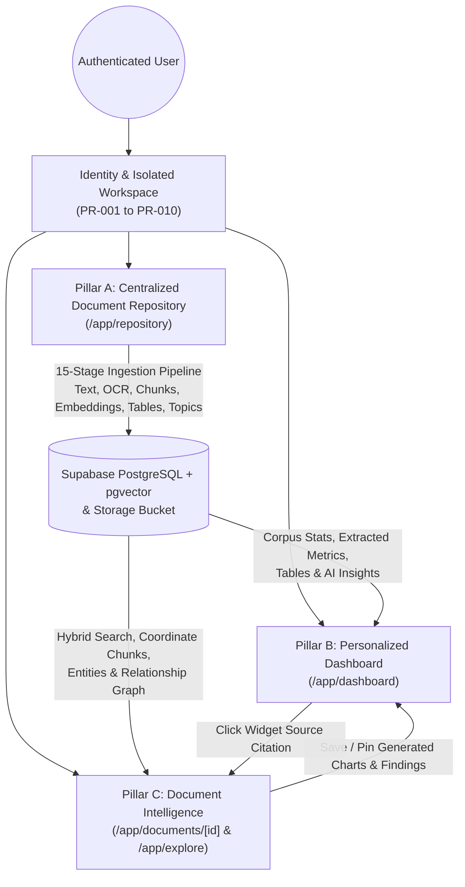

# 01 — Product Vision & The Three Fundamental Pillars

> **Document ID:** `DOC-01`  
> **Status:** `[PROPOSED]` Core Product Definition (Aligned with Master Task Section 1)  
> **Related Documents:** [00-START-HERE.md](file:///c:/Users/arief/Downloads/WAICY/docs/documind-blueprint/00-START-HERE.md), [02-PRODUCT-REQUIREMENTS.md](file:///c:/Users/arief/Downloads/WAICY/docs/documind-blueprint/02-PRODUCT-REQUIREMENTS.md), [03-PERSONAS-AND-USE-CASES.md](file:///c:/Users/arief/Downloads/WAICY/docs/documind-blueprint/03-PERSONAS-AND-USE-CASES.md), [04-PRODUCT-SCOPE-AND-PRIORITIES.md](file:///c:/Users/arief/Downloads/WAICY/docs/documind-blueprint/04-PRODUCT-SCOPE-AND-PRIORITIES.md)

---

## 1. Purpose & Core Vision

**DocuMind** is an AI-powered **Document Intelligence Workspace** built for students, researchers, educators, and corporate professionals who need to turn static collections of PDFs and structured files into an organized, searchable, interconnected, and analytically actionable knowledge base.

### 1.1 Why Traditional Tools Fail
Users managing large document collections currently face a fragmented workflow:
- **Cloud Drives (Google Drive, Dropbox):** Store files reliably but treat PDFs as opaque binary blobs. Finding a specific table, methodology, or contradiction across 40 PDFs requires opening files one by one.
- **Generic Chat-with-PDF Tools:** Allow single-document Q&A, but lack a centralized repository management experience, hallucinate numbers when asked to aggregate tables, provide vague or unverified page citations, and cannot synthesize insights across a user's entire knowledge base.
- **BI & Dashboard Tools (Tableau, PowerBI):** Require clean SQL databases or CSV exports and cannot automatically discover, extract, validate, and chart metrics embedded inside unstructured PDF reports alongside qualitative document insights.

### 1.2 What Makes DocuMind Different
DocuMind unifies document management, automated understanding, verifiable RAG citations, cross-document relationship discovery, and deterministic data analytics into a single cohesive platform governed by **Five Core Product Principles**:

1. **Evidence-First Grounding (`PR-027`, `PR-028`):** Every AI answer, extracted insight, relationship link, and dashboard widget must trace back to verifiable source documents, page numbers, and normalized `[x0, y0, x1, y1]` bounding boxes.
2. **Zero Hallucinated Math (`PR-035`, `PR-036`):** Language models interpret language and write queries; deterministic engines (DuckDB and PostgreSQL) compute numbers. No chart or KPI card ever displays a number guessed by an LLM.
3. **Corpus-Adaptive Personalization (`PR-033`, `PR-034`):** Every user's dashboard reflects the actual contents and domain of *their* uploaded documents—never a static template filled with placeholder charts.
4. **Honest Epistemic Boundaries (`PR-029`, `PR-038`):** When a user's documents do not contain the answer to a question or lack sufficient numerical data for a chart, DocuMind explicitly states what is missing rather than fabricating content.
5. **Strict Multi-Tenant Isolation (`PR-006`–`PR-010`):** Every user's documents, chunks, embeddings, conversations, and dashboards are strictly isolated at the database, storage, vector search, and analytical engine layers.

---

## 2. The Three Fundamental Product Pillars

The entire product architecture—frontend navigation, backend services, database schema, and AI pipelines—is structured around **Three Fundamental Product Pillars**:

---

### 2.1 Pillar A — Centralized Document Repository (`/app/repository`)

**Concept:** Every user has a single, dedicated, centralized document library where all of their uploaded documents live, are organized, and are monitored through processing (`[PROPOSED]`, `PR-011`–`PR-018`).

- **Why Centralization Matters:** In the existing repository (`[OBSERVED]`), document listing was reduced to a tiny sidebar list in `index.html` and completely absent from `apps/web/app/dashboard/page.tsx`. In a real Document Intelligence Workspace, users managing 20 to 500+ PDFs need a dedicated command center to see what is in their library, which files have finished processing, what categories/topics were detected, and which files contain extractable tables.
- **Core Capabilities of Pillar A:**
  1. **Unified Library Interface:** Toggle between a high-density **Table View** (showing title, AI-detected document type, topic tags, page count, extracted table count, upload date, and processing badge) and a visual **Grid View** (showing page-1 thumbnail, executive summary snippet, and key badges).
  2. **Transparent Processing Lifecycle:** Granular real-time status tracking (`Queued` $\rightarrow$ `Extracting Text` $\rightarrow$ `Running Vision OCR` $\rightarrow$ `Generating Embeddings` $\rightarrow$ `Extracting Insights & Tables` $\rightarrow$ `Ready` / `Failed`) so users never wonder if a file is usable.
  3. **Smart Organization & Discovery:** Instant filter by AI-inferred category (e.g., *Academic Paper*, *Financial Report*, *Lab Report*, *Contract*, *Lecture Notes*), user-defined tags, processing state, or date range.
  4. **Quick Preview Drawer:** Clicking a row once opens a slide-over preview panel displaying the AI-generated executive summary, key extracted entities/dates, detected tables, and related documents—without forcing a full page transition.
  5. **Bulk Operations & Hygiene:** Select multiple documents to launch a **Cross-Document Synthesis**, apply tags in bulk, reprocess failed files, or delete files with full cascade cleanup.

*(Full specification in [09-DOCUMENT-REPOSITORY.md](file:///c:/Users/arief/Downloads/WAICY/docs/documind-blueprint/09-DOCUMENT-REPOSITORY.md) and [10-DOCUMENT-INGESTION-PIPELINE.md](file:///c:/Users/arief/Downloads/WAICY/docs/documind-blueprint/10-DOCUMENT-INGESTION-PIPELINE.md)).*

---

### 2.2 Pillar B — Personalized Dashboard (`/app/dashboard`)

**Concept:** Every user has a dynamic, personalized analytical and knowledge dashboard synthesized strictly from the documents in *their* repository (`[PROPOSED]`, `PR-033`–`PR-040`).

- **How Pillar B Adapts to Different Users:**
  - **User A (AI Researcher — 25 ML Papers):** Dashboard surfaces a *Research Corpus Overview*, *Topic & Architecture Distribution Chart* (e.g., Transformers vs. SSMs vs. Diffusion), *Benchmark Accuracy Comparison Table* extracted from paper evaluation sections, *Key Methodological Findings Cards*, and *Contradictory Claims Alerts*.
  - **User B (Financial Analyst — 12 Quarterly Reports & Excel Sheets):** Dashboard surfaces *Extracted Financial KPI Cards* (Revenue, Operating Margin, YoY Growth with source badges), *Multi-Quarter Revenue & Expense Trend Charts* computed via DuckDB over extracted financial tables, and *Risk Factor Insights*.
  - **User C (University Student — 15 Biology Lab Reports & Lecture PDFs):** Dashboard surfaces *Course Topic Coverage*, *Experimental Results Comparison Chart* (from lab report data tables), *Key Definitions & Mechanisms Summary*, and *Recent Document Insights*.
  - **User D (Operations Manager — 30 SOPs & Policy PDFs with zero numerical tables):** Because SOPs contain qualitative procedures rather than financial time series, DocuMind **does not fabricate meaningless numerical bar charts**. Instead, it adapts the dashboard to show *Operational Domain Coverage*, *Department/Entity Frequency*, *Critical Compliance Dates & Deadlines*, *Cross-Policy Overlap/Conflict Alerts*, and an explicit note explaining that quantitative charts will automatically activate if tabular data or spreadsheets are uploaded.
- **Three-Tier Widget Architecture (`ADR-010`):**
  1. **Tier 1 — Deterministic Corpus Telemetry:** Always available as soon as $\ge 1$ document is processed (Total Documents, Pages Indexed, Tables Extracted, Category Breakdown, Topic Distribution, Ingestion Health). Computed via fast PostgreSQL queries at **\$0.00 LLM cost**.
  2. **Tier 2 — Auto-Discovered Domain & Analytical Widgets:** Generated automatically when ingestion detects structured tables/metrics (`public.document_tables`, `public.extracted_metrics`) or multi-document themes. Planned by `gpt-6.1-terra` and calculated deterministically by **DuckDB**.
  3. **Tier 3 — User-Created & Pinned Custom Widgets:** Users can ask in natural language (*"Plot average battery cycle degradation by temperature across all lab reports"*) or pin any chart/synthesis table generated during an AI exploration session directly to their Personalized Dashboard.
- **Mandatory Source Traceability:** Every KPI card and chart widget has an **"Inspect Source Evidence"** button that reveals the exact documents, page numbers, highlighted PDF bounding boxes, and the underlying DuckDB SQL query that produced the numbers.

*(Full specification in [14-PERSONALIZED-DASHBOARD.md](file:///c:/Users/arief/Downloads/WAICY/docs/documind-blueprint/14-PERSONALIZED-DASHBOARD.md) and [15-DASHBOARD-GENERATION-ENGINE.md](file:///c:/Users/arief/Downloads/WAICY/docs/documind-blueprint/15-DASHBOARD-GENERATION-ENGINE.md)).*

---

### 2.3 Pillar C — Document Intelligence (`/app/documents/[docId]` & `/app/explore`)

**Concept:** An interactive environment for searching, reading, questioning, connecting, and synthesizing knowledge inside single documents and across the entire repository (`[PROPOSED]`, `PR-025`–`PR-032`).

Pillar C encompasses six tightly integrated capabilities:

1. **Intelligent Hybrid Search (`12-SEARCH-AND-RETRIEVAL.md`):**
   - Combines semantic vector search (`text-embedding-3-small` + `pgvector` HNSW) with exact keyword/phrase matching (PostgreSQL GIN Full-Text Search) via **Reciprocal Rank Fusion (RRF)**, plus metadata filters (category, date, tags, document subset).
2. **Evidence-Grounded AI Document Assistant (`13-AI-ASSISTANT.md`):**
   - Operates at three explicit scopes selectable by the user:
     - **Single-Document Scope:** Deep reading companion alongside the interactive PDF canvas.
     - **Selected-Subset Scope:** Focused comparative Q&A over 2–10 user-checked documents.
     - **Repository-Wide Scope:** Global Q&A across all permitted documents in the user's workspace.
   - Answers strictly from retrieved evidence chunks, streams tokens via SSE, attaches clickable `[Document • Page X]` citation pills that highlight the exact `[x0, y0, x1, y1]` region on the PDF canvas, and explicitly abstains when the documents do not contain the answer.
3. **Automatic Document Understanding (`10-DOCUMENT-INGESTION-PIPELINE.md`):**
   - Every processed document automatically exposes a structured **Intelligence Brief**: Executive Summary, Document Type & Domain Classification, Main Topics, Named Entities (People, Organizations, Locations, Technical Terms), Key Dates/Timeline Events, and Extracted Tables/Metrics.
4. **Proactive Insight Discovery (`17-INSIGHT-AND-CROSS-DOCUMENT-ANALYSIS.md`):**
   - Identifies high-value findings within and across documents: key empirical conclusions, repeated themes, notable statistical outliers, trends across time-ordered reports, and missing/unanswered research gaps.
5. **Document Relationship Engine (`16-DOCUMENT-RELATIONSHIPS.md`):**
   - Automatically maps how documents in a user's workspace connect to one another based on **Shared Topics**, **Shared Entities**, **High Semantic Similarity**, **Explicit Citations/References**, and **Contradictory Claims**—complete with confidence scores and human-readable explanations.
6. **AI-Powered Cross-Document Analytics & Synthesis (`15-DASHBOARD-GENERATION-ENGINE.md`, `17-INSIGHT-AND-CROSS-DOCUMENT-ANALYSIS.md`):**
   - Enables users to compare multiple documents side-by-side in a structured **Synthesis Matrix** (`gpt-6.1-sol`) or run ad-hoc analytical queries across multi-document tables (`gpt-6.1-terra` + DuckDB) and pin the resulting charts to Pillar B.

---

## 3. How the Three Pillars Connect Into One Cohesive Product

Unlike fragmented tools where file storage, chat, and BI dashboards are isolated silos, DocuMind's three pillars form a continuous **Knowledge Flywheel**:

| Transition | User Action | System Behavior Across Pillars |
|---|---|---|
| **Pillar A $\rightarrow$ Pillar B & C** | User uploads 5 PDF reports in the **Document Repository** (`/app/repository`). | Ingestion pipeline extracts text, bounding boxes, embeddings, topics, entities, tables, and relationships. The **Personalized Dashboard** (`/app/dashboard`) automatically updates its corpus telemetry and domain widgets, and the files become immediately searchable in **Document Intelligence**. |
| **Pillar B $\rightarrow$ Pillar C** | User sees an unexpected spike or contradiction card on their **Personalized Dashboard** and clicks *"Inspect Source Evidence"*. | System opens the **Traceability Drawer** showing the exact cited quote and SQL query; clicking the citation opens the **PDF Studio** (`/app/documents/[docId]?page=7&chunk=chk_42`) scrolled and highlighted at the exact paragraph or table. |
| **Pillar C $\rightarrow$ Pillar B** | While exploring 4 documents in **Document Intelligence**, the user asks the AI Assistant to chart a metric comparison or generate a synthesis matrix, then clicks *"Pin to Dashboard"*. | The validated `DashboardWidget` (ECharts JSON + DuckDB SQL + source citations) is saved to `public.dashboard_widgets` and appears permanently on the user's **Personalized Dashboard**. |
| **Pillar A $\rightarrow$ Cascade Cleanup in B & C** | User deletes an outdated document in the **Document Repository**. | Storage blob, chunks, embeddings, and relationships are purged; any **Personalized Dashboard** widget that depended on that document is automatically recalculated (or flagged for refresh if it was the sole data source). |
