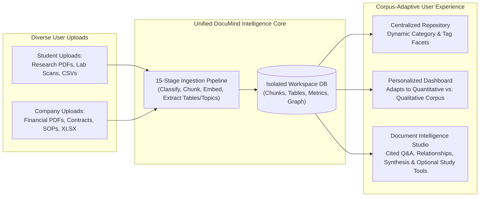

# 03 — User Personas, Contexts & Unified Use Cases

> **Document ID:** `DOC-03`  
> **Status:** `[PROPOSED]` Product Discovery Specification (Master Task Section 3.1)  
> **Related Documents:** [01-PRODUCT-VISION.md](file:///c:/Users/arief/Downloads/WAICY/docs/documind-blueprint/01-PRODUCT-VISION.md), [04-PRODUCT-SCOPE-AND-PRIORITIES.md](file:///c:/Users/arief/Downloads/WAICY/docs/documind-blueprint/04-PRODUCT-SCOPE-AND-PRIORITIES.md), [06-USER-JOURNEYS.md](file:///c:/Users/arief/Downloads/WAICY/docs/documind-blueprint/06-USER-JOURNEYS.md), [14-PERSONALIZED-DASHBOARD.md](file:///c:/Users/arief/Downloads/WAICY/docs/documind-blueprint/14-PERSONALIZED-DASHBOARD.md)

---

## 1. Purpose & Design Philosophy

DocuMind serves two primary user contexts—**Student / Academic / Individual Researchers** and **Company / Professional Analysts**—plus an emerging **Institutional / Team Lead** context.

A critical product architecture requirement (Master Task Section 3.1) is:
> *"Investigate what should be shared between these user contexts and what might require different workflows. Do not unnecessarily create two different applications. The product should ideally have a common foundation with flexible use cases."*

This document analyzes each persona's document types, pain points, and goals, and specifies how **one unified platform architecture** adapts naturally to each user without splitting DocuMind into separate "Student Edition" and "Enterprise Edition" codebases.

---

## 2. Deep Persona Analysis

### 2.1 Persona A — Student, Academic Researcher & Educator ("Rina, Graduate Researcher")

- **Typical Document Collection:**
  - 20–150 peer-reviewed journal papers (`.pdf`, two-column IEEE/ACM/Nature layouts with complex equations and benchmark tables).
  - Scanned textbook chapters, handwritten or camera-scanned laboratory notebooks (`.pdf`), and lecture slide decks exported to PDF.
  - Experimental lab measurement logs (`.csv`, `.xlsx`).
- **Core Pain Points:**
  1. **Literature Overload:** Cannot remember which of 40 downloaded papers used a specific dataset, hyperparameter, or experimental temperature.
  2. **Unsearchable Scanned Notes:** Camera-scanned lab reports and older textbook PDFs return zero results in standard `Ctrl+F` search.
  3. **Synthesizing Literature Reviews:** Needs to compare methodologies, sample sizes, and conflicting conclusions across 10 papers for a thesis chapter, with exact page citations.
  4. **Active Exam & Defense Preparation:** Wants to test comprehension of dense reading material and verify every answer against the original paragraph.
- **What Rina Needs from Each Pillar:**
  - **Pillar A (Repository):** Filter papers by research topic, methodology, or publication year; preview abstract/summary and key findings without opening 30 browser tabs.
  - **Pillar B (Personalized Dashboard):** See topic clusters across her thesis library, benchmark metric comparisons extracted from paper tables, a timeline of studied literature, and recent contradiction alerts between papers.
  - **Pillar C (Document Intelligence):** Ask technical questions with equations/acronyms, click citations to jump directly to the two-column paragraph or table in the PDF, run **Cross-Document Synthesis Matrices**, and optionally generate **Adaptive Quizzes** or **Audio Briefings** (`PR-047`) for study review.

---

### 2.2 Persona B — Company / Business / Operations Analyst ("Budi, Corporate Strategy & Finance Analyst")

- **Typical Document Collection:**
  - 30–300 corporate documents: quarterly financial reports (`.pdf`), vendor contracts, Standard Operating Procedures (SOPs), market research reports, audit filings, and board decks.
  - Financial models, sales ledgers, and operational KPI exports (`.xlsx`, `.csv`).
- **Core Pain Points:**
  1. **Buried Quantitative Metrics:** Key financial figures (revenue by segment, CAPEX, SLA breach rates) are trapped inside 80-page PDF tables across 8 quarterly filings.
  2. **Distrust of AI Hallucinations:** Cannot present an AI-generated chart or summary to executives unless every number is 100% mathematically accurate and links directly to the source page and table in the official filing.
  3. **Cross-Report Discrepancy Detection:** Needs to know immediately if a vendor contract's SLA clause contradicts the internal operations manual, or if Q3's restated revenue differs from Q2's forecast.
  4. **Strict Confidentiality:** Financial and operational PDFs must never leak across accounts or be used to train external AI models.
- **What Budi Needs from Each Pillar:**
  - **Pillar A (Repository):** Filter by document type (*Financial Report*, *Contract*, *SOP*, *Audit*), fiscal period, department tag, and whether the file contains extracted quantitative tables.
  - **Pillar B (Personalized Dashboard):** Executive KPI cards (with YoY/QoQ deltas computed by DuckDB), multi-report financial trend charts, contract renewal/compliance date alerts, and pinned analytical views.
  - **Pillar C (Document Intelligence):** Hybrid search for exact contract clauses or account codes + semantic concepts, multi-document comparison of terms/metrics, and natural-language chart creation (*"Compare operating margin across Q1–Q4 filings"*). Budi rarely uses Quiz Mode, so study tools should remain unobtrusive secondary tabs inside the Document Studio.

---

### 2.3 Persona C — Educational Institution / Department Lead (Future Organization Context)

- **Typical Document Collection:**
  - Curated departmental archives (accreditation portfolios, curriculum syllabi, shared research repositories, institutional policy handbooks).
- **What They Need:**
  - All capabilities of Personas A and B, plus the ability (in a future P3 milestone) to invite workspace members with role-based permissions (`owner`, `editor`, `viewer`) while maintaining strict workspace-level isolation (`PR-005`, `ADR-004`).

---

## 3. Shared Foundation vs. Context-Adaptive Behavior

Rather than hardcoding "Student Mode" vs. "Company Mode", DocuMind uses a **Unified Core Architecture** where behavior adapts automatically based on **what documents the user uploads** and **which tools they invoke**:

| System Dimension | Shared Common Foundation (100% Identical Codebase) | How It Adapts Automatically to Student (Persona A) | How It Adapts Automatically to Company (Persona B) |
|---|---|---|---|
| **1. Authentication & Isolation (`DOC-08`)** | Every user gets a secure, isolated `workspace_id` protected by JWT + PostgreSQL RLS + service-layer guards. | Protects personal thesis drafts, unpublished lab data, and study notes. | Protects confidential financial reports, contracts, and operational records. |
| **2. Ingestion & Classification (`DOC-10`)** | 15-stage pipeline (`PyMuPDF` + `gpt-6.1-terra` OCR + `text-embedding-3-small` + `gpt-6-luna` single-pass metadata/table extraction). | Classifies PDFs as `Academic Paper`, `Lab Report`, `Lecture Notes`, `Textbook`; extracts experimental tables & citations. | Classifies PDFs as `Financial Report`, `Contract`, `SOP`, `Market Report`; extracts financial statements, KPIs & effective dates. |
| **3. Document Repository (`DOC-09`)** | Single centralized `/app/repository` with Table/Grid toggle, search, dynamic facet filters, and preview drawer. | Facet filters dynamically populate with the user's detected categories (e.g., *Academic Paper*, *Lab Report*) and research tags. | Facet filters dynamically populate with the user's detected categories (e.g., *Financial Report*, *Contract*) and business tags. |
| **4. Personalized Dashboard (`DOC-14`, `DOC-15`)** | 3-Tier Adaptive Dashboard Engine powered by PostgreSQL telemetry + DuckDB SQL + ECharts. | Surfaces research topic distributions, methodology/benchmark comparisons, and cross-paper contradiction cards. | Surfaces financial/operational KPI cards, multi-period revenue/cost trend charts, and compliance/contract insights. |
| **5. Hybrid Search & AI Assistant (`DOC-12`, `DOC-13`)** | RRF Hybrid Search (`pgvector` + GIN FTS) + Cited SSE Assistant + PDF.js bounding-box highlighter. | Excels at finding equations, citations, and theoretical proofs alongside semantic concepts. | Excels at finding exact contract clauses, invoice IDs, and financial line items alongside policy questions. |
| **6. Cross-Document Analysis (`DOC-16`, `DOC-17`)** | Relationship graph (`public.document_relationships`) + `gpt-6.1-sol` Synthesis Matrix. | Compares research hypotheses, experimental setups, and conflicting academic findings. | Compares vendor proposals, quarterly performance shifts, and conflicting policy clauses. |
| **7. Secondary Studio Tools (`PR-047`)** | Modular tool tabs inside the right-hand drawer of `/app/documents/[docId]`. | Student actively uses **Quiz Mode** and **Audio Briefing** tabs for exam prep. | Professional uses **Chat**, **Tables/Analytics**, and **Compare** tabs; Quiz/Audio tabs sit quietly as optional tools without cluttering the main dashboard. |

---

## 4. User-Centric Workflow Matrix

### Key Takeaway for Implementation
Never build separate routes, separate database tables, or separate AI pipelines for "students" vs. "companies". Build **one schema-driven, corpus-adaptive pipeline** (`DOC-10`, `DOC-14`, `DOC-15`) where the AI classification (`document_type`, `domain_tags`) and extracted data structures (`document_tables`, `extracted_metrics`, `topics`) automatically tailor the Repository filters and Personalized Dashboard widgets to the user's actual collection.
