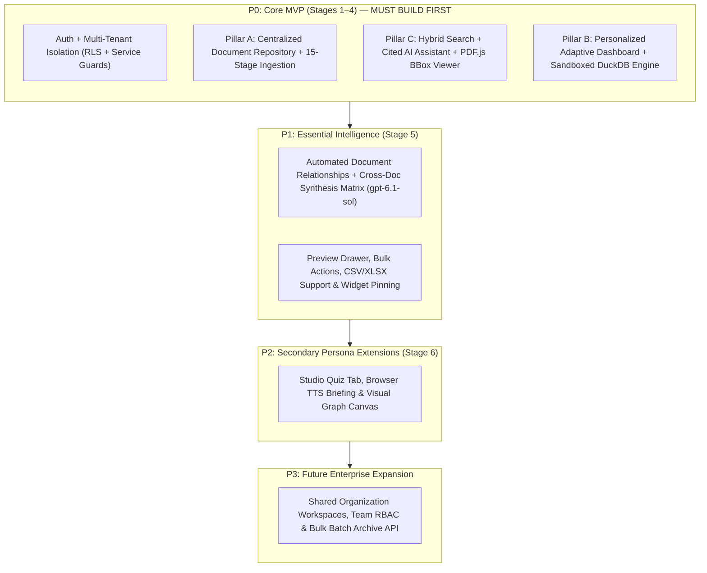

# 04 — Product Scope, Feature Prioritization & Anti-Bloat Boundaries

> **Document ID:** `DOC-04`  
> **Status:** `[PROPOSED]` Product Scope Specification (Master Task Section 3.3)  
> **Related Documents:** [01-PRODUCT-VISION.md](file:///c:/Users/arief/Downloads/WAICY/docs/documind-blueprint/01-PRODUCT-VISION.md), [02-PRODUCT-REQUIREMENTS.md](file:///c:/Users/arief/Downloads/WAICY/docs/documind-blueprint/02-PRODUCT-REQUIREMENTS.md), [26-ARCHITECTURE-DECISIONS.md](file:///c:/Users/arief/Downloads/WAICY/docs/documind-blueprint/26-ARCHITECTURE-DECISIONS.md), [27-IMPLEMENTATION-ROADMAP.md](file:///c:/Users/arief/Downloads/WAICY/docs/documind-blueprint/27-IMPLEMENTATION-ROADMAP.md)

---

## 1. Purpose & Anti-Proliferation Philosophy

A common failure mode of early-stage AI platforms—and a flaw `[OBSERVED]` in DocuMind's current repository—is **unfocused feature proliferation**: building flashy demo endpoints (such as podcast script generators, quiz modals, and a decorative graphic-design layer mockup in `apps/web/app/dashboard/page.tsx`) while the **core foundation** (persistent database storage, user isolation, centralized document repository, real vector search, and data-driven dashboards) remains disconnected or mocked.

Per Master Task Section 3.3:
> *"I do not want feature proliferation without a clear product benefit. The core document repository, user isolation, personalized dashboard, and document intelligence experience must remain the main priorities."*

This specification establishes a strict **Five-Tier Prioritization Framework** (`P0` through `Out-of-Scope`) so engineering effort focuses relentlessly on the Three Fundamental Product Pillars first.

---

## 2. Five-Tier Feature Classification Matrix

### 2.1 Tier P0 — Core Product Requirements (Non-Negotiable Foundation)

These capabilities define DocuMind's minimum viable product. Without every `P0` feature working end-to-end, DocuMind cannot fulfill its core value proposition.

| Capability | Pillar | Requirement IDs | Why It Is Core (`P0`) |
|---|---|---|---|
| **Authentication, Identity & Protected Routes** | Foundation | `PR-001`–`PR-003` | Multi-user isolation is impossible without verified user identity across Next.js and FastAPI. |
| **Strict Multi-Tenant Workspace Isolation (RLS + Backend Guards)** | Foundation | `PR-006`–`PR-010` | Prevents cross-user document, vector, and dashboard data leakage (`ADR-003`). |
| **Centralized Document Repository (Table/Grid, Search, Filter, Sort, Delete)** | **Pillar A** | `PR-011`–`PR-015`, `PR-018` | Provides the single unified library where users manage their uploaded PDFs and monitor processing status. |
| **15-Stage Deterministic + AI Ingestion Pipeline** | **Pillar A / C** | `PR-019`–`PR-024`, `PR-046` | Extracts digital text & normalized `[x0, y0, x1, y1]` coordinates (`PyMuPDF`), runs selective Vision OCR (`gpt-6.1-terra`), extracts tables, embeds chunks (`text-embedding-3-small`), and extracts summary/metadata/topics (`gpt-6-luna`). |
| **Interactive PDF Viewer with Deterministic Citation Highlighting** | **Pillar C** | `PR-026`, `PR-028` | Connects AI answers and dashboard metrics directly to visual proof on the PDF page (`ADR-009`). |
| **Hybrid Search (`pgvector` HNSW + PostgreSQL GIN FTS)** | **Pillar C** | `PR-025` | Enables fast, accurate semantic + keyword retrieval across single documents or the user's entire repository. |
| **Evidence-Grounded AI Assistant (Single-Doc, Multi-Doc, Repo-Wide)** | **Pillar C** | `PR-027`, `PR-029` | Answers questions strictly from retrieved document evidence and explicitly abstains when evidence is missing. |
| **Personalized Adaptive Dashboard & Sandboxed DuckDB Engine** | **Pillar B** | `PR-033`–`PR-038`, `PR-040` | Gives every user an isolated, source-traceable dashboard tailored to their own document collection (`ADR-010`, `ADR-011`). |
| **OpenAI Cost Routing, `store: false` Privacy & Prompt Injection Defenses** | Foundation | `PR-041`, `PR-044`, `PR-045` | Keeps unit economics sustainable and protects user data privacy from day one. |

---

### 2.2 Tier P1 — Important Secondary Capabilities (High-Leverage Depth)

Once `P0` is solid, `P1` features elevate DocuMind from a single-document reader + dashboard into a connected multi-document intelligence platform:

| Capability | Pillar | Requirement IDs | Justification & Placement |
|---|---|---|---|
| **Repository Quick Preview Drawer & Bulk Actions** | **Pillar A** | `PR-016`, `PR-017` | Allows users to inspect summaries/metadata and trigger multi-PDF synthesis directly from the repository table. |
| **Spreadsheet (`.csv`, `.xlsx`) Ingestion into `document_tables`** | **Pillar A / B** | `PR-012`, `PR-024` | High-value addition for both corporate analysts and lab researchers uploading raw datasets alongside PDFs. |
| **Persistent Multi-Turn Conversation History & Follow-ups** | **Pillar C** | `PR-030` | Allows users to resume research threads across sessions without re-asking questions. |
| **Automated Document Relationship Discovery (`public.document_relationships`)** | **Pillar C** | `PR-031` | Automatically surfaces how documents connect via shared topics, shared entities, semantic similarity, and citations (`ADR-013`). |
| **Cross-Document Comparative Synthesis & Contradiction Detection (`gpt-6.1-sol`)** | **Pillar C** | `PR-032` | Core differentiator for literature reviews and corporate audit comparisons: structured comparison matrices + dual-cited contradiction alerts. |
| **Dashboard Customization, Widget Pinning & Reactive Refresh** | **Pillar B** | `PR-039` | Lets users save custom AI-generated charts to their Personalized Dashboard and keeps widgets in sync when files change. |
| **Prompt Caching (`prompt_cache_key`), `flex` Tier & Usage Telemetry** | Foundation | `PR-042`, `PR-043` | Cuts ongoing OpenAI token spend by an additional 40%–60% and provides cost observability. |
| **Self-Service Account Deletion Cascade** | Foundation | `PR-004` | Complete GDPR / right-to-erasure compliance. |

---

### 2.3 Tier P2 — Optional Persona-Specific Extensions (Scoped Inside Document Studio)

In the existing prototype (`[OBSERVED]`), Quiz Generation (`chat.py`) and Audio Briefing (`audio.py`) were already stubbed out. Rather than deleting their product value or letting them dominate the main UI, we classify them as **P2 Secondary Studio Extensions** (`ADR-015`):

| Capability | Target Persona | Evaluation & Scoping Rule |
|---|---|---|
| **Adaptive Quiz Generation (`PR-047`)** | Student / Educator (Persona A) | **Keep as P2 Studio Tab:** High pedagogical value for students studying academic PDFs. Must be refactored so `gpt-6.1-terra` outputs `source_chunk_id` (resolved deterministically to `BoundingBox`) instead of hallucinating floats. Placed as a clean tab inside `/app/documents/[docId]`, never cluttering `/app/dashboard` or `/app/repository`. |
| **Audio Briefing / Podcast Script (`PR-047`)** | Student / Busy Executive | **Keep as P2 Studio Tab (Browser TTS Default):** Uses `gpt-6-luna` (\$0.0007/script) + free Browser Web Speech API (`window.speechSynthesis`) by default so it costs virtually nothing to maintain. Optional studio MP3 rendering via `gpt-realtime-2.1-mini` is deferred to an opt-in quota-gated button. |
| **Interactive Force-Directed Knowledge Graph Visualization** | Researcher / Analyst | **Keep as P2 View inside `/app/explore`:** While the underlying relationship data (`PR-031`) is **P1** (powering "Related Documents" cards and synthesis suggestions), a full 2D force-directed graph canvas is a **P2** visual enhancement over the structured Relationship List/Matrix. |

---

### 2.4 Tier P3 — Future Expansion Capabilities (Schema-Ready, Deferred Implementation)

| Capability | Architectural Preparation Now (`Stage 1`) | Why Deferred to `P3` |
|---|---|---|
| **Organization / Team Shared Workspaces & RBAC (`owner`, `editor`, `viewer`)** | `public.workspaces` and `public.workspace_members` tables are included in the data model (`PR-005`, `ADR-004`). | Personal workspaces (`1 user : 1 default workspace`) satisfy 100% of initial individual student and professional workflows without requiring complex invitation emails, billing seats, or permission conflict UIs in MVP. |
| **Bulk Institutional Archive Ingestion via OpenAI Batch API (`/v1/batches`)** | `OpenAIRouterService` includes batch JSONL helpers. | Only needed when onboarding institutional archives of $500+$ PDFs simultaneously. |
| **Real-Time Voice Conversation (`gpt-live-1` / `gpt-realtime-2.1` WebRTC)** | None required now. | High cost (\$0.05/min + \$32/\$64 audio tokens) with low return compared to text/citation RAG. |

---

### 2.5 Unjustified / Out-of-Scope Features (Explicitly Rejected)

To protect engineering focus and architectural simplicity, the following features are **explicitly excluded**:

| Rejected Feature | Why It Is Unjustified for DocuMind |
|---|---|
| **1. The Existing Graphic-Design Mockup in `apps/web/app/dashboard/page.tsx` ("Layer 01–03", "Shadow Pass", "Lighting Ref")** | `[OBSERVED]` Completely unrelated to document intelligence. Appears to be a leftover UI template for a 3D/image rendering tool. **Must be completely replaced** by the DocuMind Personalized Dashboard and Repository UI. |
| **2. External Graph Databases (Neo4j, Memgraph, or Separate LightRAG Server)** | `[DEPRECATED]` Mentioned in legacy `docs/ARCHITECTURE.md` but never built. PostgreSQL relational join tables (`topics`, `entities`, `chunk_topics`, `document_relationships`) + `pgvector` cosine similarity handle 100% of DocuMind's relationship discovery needs inside a single ACID database (`ADR-013`). |
| **3. In-Browser PDF Editing / Annotation Drawing Tools (Freehand Ink, PDF Text Editing)** | DocuMind is a **Document Intelligence & Analytics Workspace**, not Adobe Acrobat. Highlights are driven deterministically by AI citations and search matches. |
| **4. Unconstrained Python Code Execution (`exec()` / Hosted Code Interpreter) for Charts** | High security risk and unnecessary \$0.03+/session container cost. Sandboxed DuckDB SQL + declarative ECharts JSON (`ADR-011`, `ADR-012`) is faster (`<10ms`), deterministic, and free. |

---

## 3. Visual Scope Hierarchy

