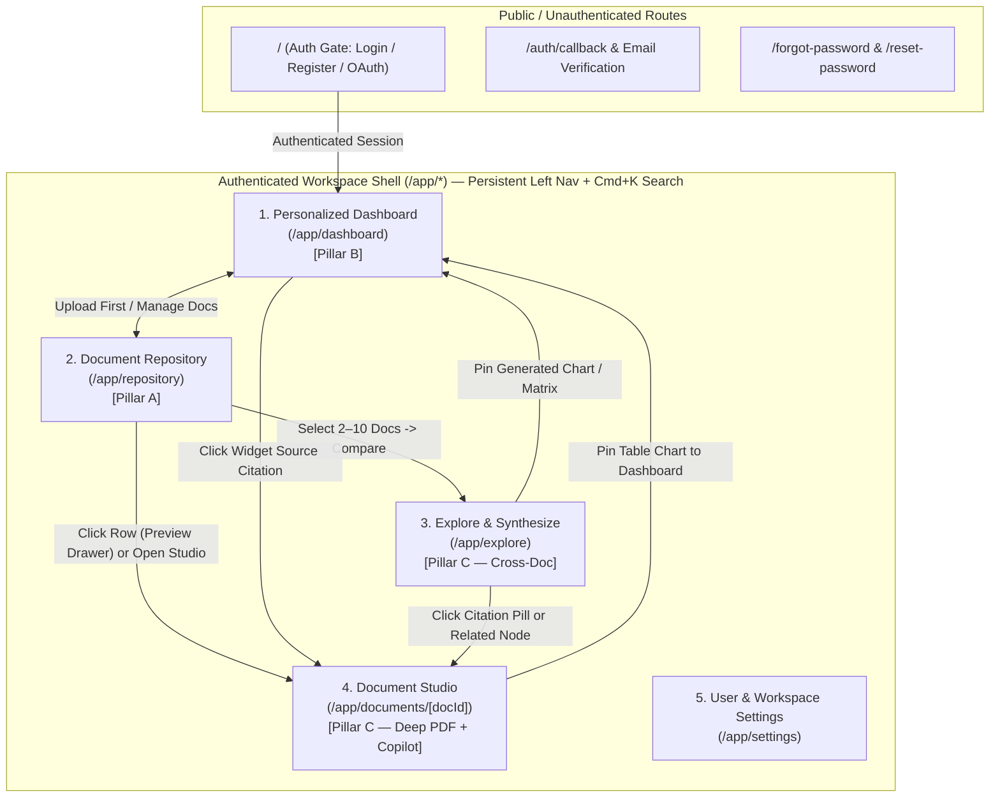

# 05 — Information Architecture, Navigation & Page Specifications

> **Document ID:** `DOC-05`  
> **Status:** `[PROPOSED]` UX & Frontend Architecture Specification (Master Task Section 5)  
> **Related Documents:** [01-PRODUCT-VISION.md](file:///c:/Users/arief/Downloads/WAICY/docs/documind-blueprint/01-PRODUCT-VISION.md), [04-PRODUCT-SCOPE-AND-PRIORITIES.md](file:///c:/Users/arief/Downloads/WAICY/docs/documind-blueprint/04-PRODUCT-SCOPE-AND-PRIORITIES.md), [06-USER-JOURNEYS.md](file:///c:/Users/arief/Downloads/WAICY/docs/documind-blueprint/06-USER-JOURNEYS.md), [23-UI-STATES-AND-EDGE-CASES.md](file:///c:/Users/arief/Downloads/WAICY/docs/documind-blueprint/23-UI-STATES-AND-EDGE-CASES.md)

---

## 1. Architectural Evaluation: Unified Workspace vs. Fragmented Pages

Master Task Section 5 asks us to:
> *"Avoid redundant navigation. Investigate whether some features should be integrated into a unified workspace rather than distributed into too many separate pages."*

### 1.1 Why Too Many Separate Pages Hurt UX
If we created 8 separate top-level pages (one for Repository, one for PDF Viewer, one for AI Chat, one for Search, one for Insights, one for Relationships, one for Analytics, one for Settings), users would constantly lose context—switching back and forth between a chat page and a PDF viewer page just to verify a citation.

### 1.2 Why Cramming Everything Into One Single Screen Also Fails
Conversely, the legacy `index.html` prototype tried to cram file upload, file list, PDF viewer, chat, synthesis, analytics, and audio into a single screen. As soon as a user has 50+ documents or 8 dashboard charts, a tiny 240px sidebar becomes unusable for repository management, and the PDF viewer leaves no room for a full Personalized Dashboard.

### 1.3 Recommended Solution: **The 4-View Unified Workspace Shell (`ADR-001`)**
DocuMind consolidates the entire authenticated experience into **four purposeful, non-redundant workspace views** inside a persistent application shell (`/app/*`), plus a **Global Command & Search Bar (`Ctrl+K` / `Cmd+K`)** accessible from anywhere:

| Primary Navigation Item | Route | Pillar Served | Why It Exists as a Distinct View (and What It Consolidates) |
|---|---|---|---|
| **1. Dashboard** | `/app/dashboard` | **Pillar B (Personalized Dashboard)** | The user's personalized intelligence home. Consolidates Corpus Telemetry, Auto-Discovered KPI Cards & DuckDB ECharts, Pinned Analytical Widgets, Recent Insights, and the Natural-Language Chart Builder. |
| **2. Repository** | `/app/repository` | **Pillar A (Document Repository)** | The centralized document library. Consolidates Drag-and-Drop Upload, Processing Progress Tracker, Table/Grid Library, Faceted Filtering, Bulk Actions, and the slide-over **Quick Preview Drawer**. |
| **3. Document Studio** *(Contextual View)* | `/app/documents/[docId]` | **Pillar C (Single-Doc Intelligence)** | Opens when clicking any document from Repository, Dashboard, or Search. Consolidates **Interactive PDF.js Viewer + BBox Highlighter** (Left/Center) with the **Contextual AI Copilot** (Right: Summary/Entities, Cited Chat, Extracted Tables, Related Docs, and P2 Quiz/Audio tabs). |
| **4. Explore & Synthesize** | `/app/explore` | **Pillar C (Cross-Doc Intelligence)** | Repository-wide intelligence hub. Consolidates **Hybrid Search**, **Multi-Document AI Assistant**, **Cross-Document Synthesis & Contradiction Matrix**, and the **Document Relationship Explorer**. |
| **5. Settings** *(Footer/Avatar Menu)* | `/app/settings` | **Identity & Governance** | Consolidates Account Profile, Security/Password, Workspace Preferences, AI Usage & Cost Telemetry, and Account Deletion. |

---

## 2. Global Navigation Topology Diagram

---

## 3. Page-by-Page Detailed Specification

### 3.1 Page 1: Authentication Gate (`/`, `/forgot-password`, `/reset-password`)
1. **Main Purpose:** Authenticate returning users, register new accounts, handle Google OAuth 2.0, and provide password recovery (`PR-001`–`PR-003`).
2. **Primary Components:**
   - Tabbed `AuthCard` (`Sign In` / `Create Account`), Email/Password inputs with real-time validation (`lib/auth-validation.ts`), Google OAuth button, Forgot Password modal/view, and Email Verification status banner.
3. **Available Interactions:** Submit login/signup, trigger Google OAuth redirect, request password reset link, resend verification email.
4. **Data Dependencies:** `POST /api/auth/login`, `POST /api/auth/signup`, `POST /api/auth/oauth/google`, `GET /api/auth/callback`, `POST /api/auth/forgot-password`.
5. **Loading State:** Disabled submit button with spinner and `"Memverifikasi kredensial..."` status.
6. **Empty State:** Clean initial form with clear password strength checklist on Sign Up.
7. **Error State:** Inline field validation errors; rate-limit banner (`429 Too Many Attempts — wait X seconds`); explicit message for unverified email or invalid credentials.
8. **Permission Requirements:** Public (redirects authenticated users automatically to `/app/dashboard`).
9. **Relationship with Other Pages:** Entry gate to `/app/dashboard` (or `?next=` deep link).

---

### 3.2 Page 2: Personalized Dashboard (`/app/dashboard` — Pillar B)
1. **Main Purpose:** Provide every user with an individualized, source-traceable analytical and corpus overview derived strictly from their own uploaded documents (`PR-033`–`PR-040`).
2. **Primary Components:**
   - **Top Header Bar:** Workspace summary badge (`X Documents • Y Pages • Z Tables Indexed`), `"Upload Documents"` CTA button, and `"Refresh Insights"` button.
   - **Natural-Language Analytics Prompt Bar:** Input box (*"Ask a question or generate a chart from your document data..."*) with suggested prompts tailored to the user's corpus.
   - **Tier 1 — Corpus Telemetry Strip:** 4 compact stat cards (*Total Documents & Categories*, *Knowledge Coverage / Topics*, *Extracted Quantitative Tables & Metrics*, *Cross-Document Connections / Contradictions*).
   - **Tier 2 & 3 — Adaptive Analytical & Insight Grid:**
     - *For Quantitative/Mixed Corpora:* DuckDB-computed KPI Cards (with units, deltas, and source badges) and interactive **Apache ECharts** widgets (Bar, Line, Stacked Area, Scatter, Pie/Donut).
     - *For Qualitative/Textual Corpora:* Topic Cluster Distribution chart, Document Category & Timeline breakdown, Top Extracted Entities table, and High-Priority Document Finding / Contradiction Cards.
   - **Source Traceability Drawer (Slide-Over):** Opens when clicking `"Inspect Source"` on any KPI or chart; displays the exact SQL query executed, the raw DuckDB result table, and clickable citation cards (`[Document Title • Page X]`) that jump straight to `/app/documents/[docId]`.
3. **Available Interactions:** Filter dashboard by document category/tag or date range; generate a new custom chart via natural language; inspect source evidence & SQL for any widget; pin/unpin, reorder, resize, or delete custom widgets; click any citation to open the PDF Studio.
4. **Data Dependencies:** `GET /api/proxy/dashboard/overview`, `POST /api/proxy/analytics/generate-dashboard`, `PATCH /api/proxy/dashboard/widgets/{id}`, `DELETE /api/proxy/dashboard/widgets/{id}`.
5. **Loading State:** Shimmer skeleton cards matching the 4-card telemetry strip and 2x2 chart grid; streaming progress indicator when generating a new custom widget (`"Inspecting schema -> Generating SQL -> Validating numbers in DuckDB..."`).
6. **Empty State (Zero Documents Uploaded):** Welcoming onboarding canvas explaining the Three Pillars with a prominent drag-and-drop PDF upload zone (*"Upload your first PDF or spreadsheet to generate your personalized intelligence dashboard"*).
7. **Error / Insufficient-Data State:**
   - If a user requests a numerical chart that the uploaded documents cannot support, renders an **Insufficient Structured Data Card** explaining why (e.g., *"Your 4 uploaded papers discuss transformer architectures qualitatively but do not contain comparable latency tables in ms"*) and offering related qualitative synthesis instead (`PR-038`).
   - If a source document for a saved widget was deleted, shows a `"Source Updated — Click to Refresh"` badge (`PR-018`, `PR-039`).
8. **Permission Requirements:** Authenticated user (`PR-001`); queries strictly scoped to user's `workspace_id` (`PR-010`).
9. **Relationship with Other Pages:** Links directly to `/app/repository` (to upload/manage files) and `/app/documents/[docId]` (when inspecting widget source citations).

---

### 3.3 Page 3: Centralized Document Repository (`/app/repository` — Pillar A)
1. **Main Purpose:** Serve as the single centralized command center for uploading, organizing, searching, filtering, previewing, and managing all user documents (`PR-011`–`PR-018`).
2. **Primary Components:**
   - **Upload Dropzone & Active Processing Queue Banner:** Collapsible multi-file dropzone at top; when files are processing, displays a live per-document stepper (`Extracting Text` $\rightarrow$ `Vision OCR` $\rightarrow$ `Embedding` $\rightarrow$ `Extracting Insights` $\rightarrow$ `Ready`).
   - **Repository Control Bar:** Search input (matches title, summary, filename, entities), Facet Filter pills (*Status*, *AI Category*, *Tags*, *Has Tables*, *Upload Date*), Sort selector, and **Table / Grid View Toggle**.
   - **Document Table / Grid Canvas:**
     - *Table Columns:* Checkbox, Document Title & Filename, Status Badge, AI Category Badge, Top 3 Topic Pills, Page Count, Extracted Tables Count, Upload Date, and Quick Actions (`Preview`, `Open Studio`, `Reprocess`, `Delete`).
   - **Bulk Action Floating Bar:** Appears when $\ge 2$ documents are checked: `"Compare & Synthesize Selected (N)"`, `"Ask AI About Selected (N)"`, `"Tag Selected"`, `"Delete Selected"`.
   - **Quick Preview Drawer (Right Slide-Over):** Displays document metadata, AI Executive Summary, detected Topics & Named Entities, list of extracted tables, related documents, and a button to `"Open Full PDF Studio"`.
3. **Available Interactions:** Drag-and-drop upload, resolve duplicate file prompts, filter/sort/search library, toggle Table/Grid, open Quick Preview Drawer, double-click to open Document Studio, select multiple files to launch Cross-Document Synthesis, retry failed ingestion, delete documents.
4. **Data Dependencies:** `GET /api/proxy/documents`, `POST /api/proxy/documents/upload`, `GET /api/proxy/documents/{id}/status`, `POST /api/proxy/documents/{id}/reprocess`, `DELETE /api/proxy/documents/{id}`.
5. **Loading State:** Table row skeletons during initial fetch; real-time progress bar per uploading/processing row.
6. **Empty State:**
   - *No documents in workspace:* Full-width interactive dropzone with supported format badges (`.pdf`, `.csv`, `.xlsx`, max 50 MB).
   - *No documents match active filter:* `"No documents match your filter criteria"` with a `"Clear Filters"` button.
7. **Error State:** Clear inline error badge on failed document rows (`Failed: Password-Protected PDF` or `Failed: OCR Timeout`) with a one-click `"Retry"` or `"Remove"` button.
8. **Permission Requirements:** Authenticated user; strictly scoped to `workspace_id` (`PR-007`, `PR-008`).
9. **Relationship with Other Pages:** Clicking `"Open Studio"` navigates to `/app/documents/[docId]`; selecting multiple documents and clicking `"Compare & Synthesize"` navigates to `/app/explore?docs=id1,id2,...`.

---

### 3.4 Page 4: Unified Document Intelligence Studio (`/app/documents/[docId]` — Pillar C Single-Doc)
1. **Main Purpose:** Deep reading, verification, and AI interaction workspace for an individual document (`PR-026`–`PR-030`, `PR-047`).
2. **Primary Components:**
   - **Left/Center Pane (60% width, resizable) — Interactive PDF.js Canvas & Table Viewer:**
     - Top toolbar: Breadcrumb (`Repository / Document Title`), Page jumper (`Page X of Y`), Zoom controls (`Fit Width`, `50%–200%`), Search-in-PDF input, and toggle between `PDF Canvas View` and `Extracted Structured Tables View`.
     - Normalized SVG/Canvas Highlight Overlay Layer (`[x0, y0, x1, y1]`) that highlights cited paragraphs or tables in real time with pulsing focus rings.
   - **Right Pane (40% width, resizable) — Contextual AI Copilot with 5 Modular Tabs:**
     1. **`Overview & Entities` Tab:** Executive Summary, Document Classification, Key Findings list (each with clickable `[p.X]` badge), Extracted Entities/Dates, and **Related Documents in Your Repository** (`PR-031`).
     2. **`AI Chat` Tab (Default):** Multi-turn SSE streaming conversation scoped to this document (with a quick toggle to expand scope to related documents), inline `[cite:CHUNK_ID]` pills that scroll/highlight the PDF on click, and suggested follow-up chips.
     3. **`Data & Charts` Tab:** Lists all structured tables and metrics extracted from this document; lets the user click `"Generate Chart"` on any table (via DuckDB + ECharts) and `"Pin to Personalized Dashboard"`.
     4. **`Study Quiz` Tab (`P2`):** Generates comprehension questions with `"Locate Proof in PDF"` buttons that highlight the exact source paragraph.
     5. **`Audio Briefing` Tab (`P2`):** Generates and plays the dual-host conversational audio briefing with synchronized transcript highlighting.
3. **Available Interactions:** Scroll/zoom PDF, click any citation in Chat/Overview/Quiz to jump & highlight the exact PDF coordinates, select text on the PDF to ask `"Explain this selection"`, generate charts from document tables, pin insights/charts to `/app/dashboard`.
4. **Data Dependencies:** `GET /api/proxy/documents/{id}`, `GET /api/proxy/documents/{id}/file` (streamed PDF binary), `GET /api/proxy/documents/{id}/chunks`, `POST /api/proxy/chat/stream`, `GET /api/proxy/documents/{id}/relationships`, `POST /api/proxy/chat/quiz`, `POST /api/proxy/audio/briefing-script`.
5. **Loading State:** PDF page shimmer placeholder while streaming binary; SSE typing indicator during AI response generation.
6. **Empty / Partial State:** If the document is in `partial_ready` state (e.g., digital pages ready, scanned pages still running OCR), displays a banner `"Pages 1–12 ready; OCR completing on 3 scanned pages..."` while allowing immediate reading.
7. **Error State:** Graceful fallback if PDF binary fails to load (retry button) or if an AI call hits a transient timeout (preserving user message input for 1-click retry).
8. **Permission Requirements:** Authenticated user who owns/has access to `docId`'s `workspace_id`.
9. **Relationship with Other Pages:** Reached from `/app/repository`, `/app/dashboard` citations, or `/app/explore`; pins widgets back to `/app/dashboard`.

---

### 3.5 Page 5: Explore, Search & Cross-Document Synthesis (`/app/explore` — Pillar C Multi-Doc)
1. **Main Purpose:** Enable repository-wide hybrid search, multi-document AI Q&A, cross-document comparison matrices, contradiction detection, and relationship exploration (`PR-025`, `PR-027`, `PR-031`, `PR-032`).
2. **Primary Components:**
   - **Document Scope Selector Bar:** Switch between `"All Repository Documents (N)"` or `"Selected Document Subset (M)"` with quick filter chips by category or tag.
   - **Mode Switcher Tabs:**
     1. **`Hybrid Search & Ask` Mode:** Unified search bar returning ranked evidence passages (showing semantic score + keyword match highlights + document/page badge) alongside a multi-document AI Assistant answer synthesized across the top retrieved chunks.
     2. **`Comparative Synthesis & Contradictions` Mode (`gpt-6.1-sol`):** Side-by-side structured comparison table across selected documents, **Consensus Findings**, **Contradiction Alert Cards** (showing Document A's claim vs. Document B's claim with dual clickable citations), and **Research/Operational Gaps**.
     3. **`Relationship Map` Mode:** Interactive list and visual network of document connections (`Shared Topics`, `Shared Entities`, `Semantic Similarity`, `Explicit References`, `Contradictions`) with confidence scores and evidence explanations.
3. **Available Interactions:** Run hybrid search queries, filter by document metadata, ask comparative questions across multiple PDFs, run a full Cross-Document Synthesis, inspect contradiction pairs, click any citation to open `/app/documents/[docId]` at the exact page/bbox, or pin a synthesis matrix to `/app/dashboard`.
4. **Data Dependencies:** `POST /api/proxy/search/hybrid`, `POST /api/proxy/chat/stream` (multi-doc scope), `POST /api/proxy/synthesis/compare`, `GET /api/proxy/relationships/graph`.
5. **Loading State:** Multi-step progress indicator during `gpt-6.1-sol` synthesis (`"Retrieving cross-document evidence -> Comparing methodologies & claims -> Verifying citations..."`).
6. **Empty State:** Prompts user to select 2+ documents or enter a repository-wide query; displays suggested comparative prompts based on detected topic overlaps in the user's library.
7. **Error State:** Handles low-overlap selections gracefully (e.g., if a user compares a cooking recipe PDF with a quantum physics paper, explains that the documents share no common domain entities/topics and presents individual summaries instead).
8. **Permission Requirements:** Authenticated user; retrieval strictly bounded by `workspace_id`.
9. **Relationship with Other Pages:** Launched from `/app/repository` bulk selection or main sidebar; deep-links into `/app/documents/[docId]` for citation inspection.

---

### 3.6 Page 6: User & Workspace Settings (`/app/settings`)
1. **Main Purpose:** Manage user profile, authentication security, workspace preferences, AI usage/cost transparency, and account deletion (`PR-004`, `PR-043`).
2. **Primary Components:** Profile Card (Email, Display Name, Auth Provider badges), Password Change form, Workspace Storage & Token Usage Summary (`ai_usage_logs` breakdown), and Danger Zone (`Delete All Workspace Documents` / `Delete Account Permanently`).
3. **Permission Requirements:** Authenticated user (`owner` of personal workspace).
