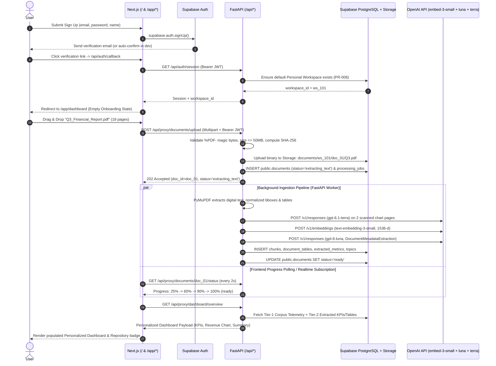
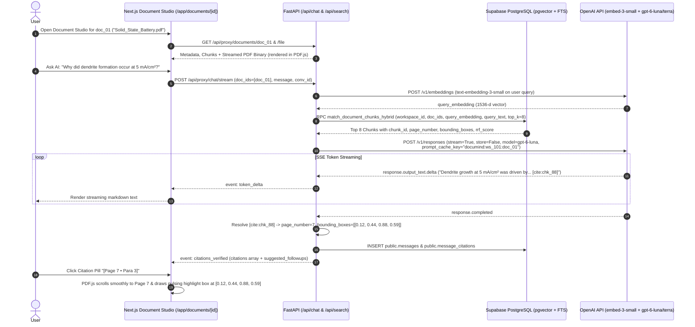
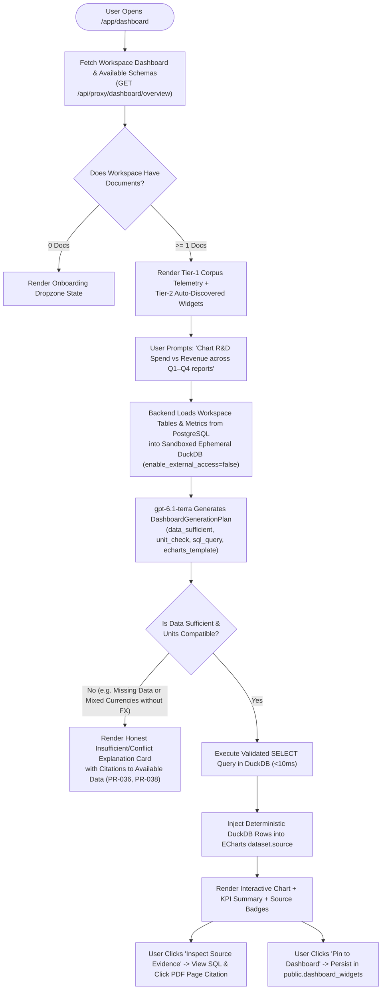
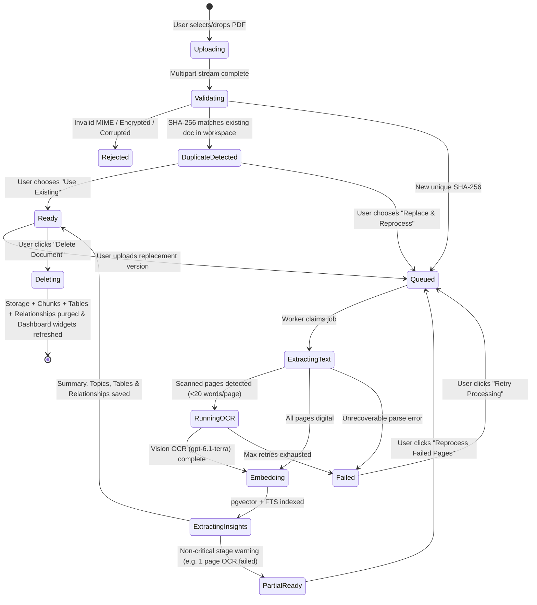

# 06 — End-to-End User Journeys & System Interaction Flows

> **Document ID:** `DOC-06`  
> **Status:** `[PROPOSED]` End-to-End Behavioral Specification (Master Task Section 5)  
> **Related Documents:** [05-INFORMATION-ARCHITECTURE.md](file:///c:/Users/arief/Downloads/WAICY/docs/documind-blueprint/05-INFORMATION-ARCHITECTURE.md), [09-DOCUMENT-REPOSITORY.md](file:///c:/Users/arief/Downloads/WAICY/docs/documind-blueprint/09-DOCUMENT-REPOSITORY.md), [10-DOCUMENT-INGESTION-PIPELINE.md](file:///c:/Users/arief/Downloads/WAICY/docs/documind-blueprint/10-DOCUMENT-INGESTION-PIPELINE.md), [14-PERSONALIZED-DASHBOARD.md](file:///c:/Users/arief/Downloads/WAICY/docs/documind-blueprint/14-PERSONALIZED-DASHBOARD.md), [23-UI-STATES-AND-EDGE-CASES.md](file:///c:/Users/arief/Downloads/WAICY/docs/documind-blueprint/23-UI-STATES-AND-EDGE-CASES.md)

---

## 1. Purpose

This document traces **five complete end-to-end user journeys (`Journey A` through `Journey E`)** across the user interface, Next.js BFF proxy, FastAPI backend, Supabase PostgreSQL/Storage, DuckDB analytical engine, and OpenAI APIs. Every journey specifies its **Main Flow**, **Alternative Flows**, **Error Conditions**, **Loading & Feedback Behavior**, **Data Mutations**, **Security Controls**, and **AI Operations**.

---

## 2. Journey A — New User Onboarding to First Personalized Dashboard

**Scenario:** A new user registers an account, verifies their identity, lands on an empty Personalized Dashboard, uploads their first PDF document, watches it process, and sees both their Repository and Personalized Dashboard come alive.

### 2.1 End-to-End Sequence Diagram

### 2.2 Journey A Specification Matrix

| Aspect | Specification |
|---|---|
| **Alternative Flows** | • **Google OAuth Sign-In:** Skips manual email verification (`email_confirmed_at` already verified by Google); immediately provisions `ws_101` and redirects to `/app/dashboard`. • **Purely Qualitative First Document (e.g., Literature Review PDF with 0 tables):** Dashboard initializes with Tier-1 Corpus Stats, Topic Distribution Chart, Extracted Key Findings Cards, and Entities list—without rendering empty numerical charts (`PR-034`). |
| **Error Conditions** | • **Invalid/Corrupted PDF or Password-Protected PDF:** Rejected synchronously with `400 Bad Request` (`ERR_PDF_ENCRYPTED` or `ERR_INVALID_FORMAT`) before consuming storage or OpenAI tokens. • **Transient OpenAI Timeout During Ingestion:** `processing_jobs` retries stage from checkpoint up to 3 times; if Vision OCR fails on 1 scanned page while 17 digital pages succeed, document enters `partial_ready` state so user is not blocked (`EC-011`). |
| **Loading & User Feedback** | • Upload progress bar (`0–100%` network transfer) transitions smoothly into a 5-step ingestion stepper (`Validating` $\rightarrow$ `Extracting Layout & Text` $\rightarrow$ `Vision OCR (2 pages)` $\rightarrow$ `Generating Embeddings` $\rightarrow$ `Synthesizing Insights & Dashboard`). |
| **Data Changes** | • Creates `auth.users` row, `public.workspaces` row (`owner_id = user.id`), `public.workspace_members` row (`role='owner'`), Storage object, `public.documents` row, `public.document_pages`, `public.chunks`, `public.document_tables`, `public.extracted_metrics`, `public.topics`, `public.chunk_topics`, and `public.dashboards`. |
| **Security Requirements** | • Origin CSRF check on `/api/auth/signup`; JWT verification on `/api/documents/upload`; Storage path prefixed by `ws_101/doc_01/`. |
| **AI Operations** | • `gpt-6.1-terra` (only on pages with `< 20` words or charts), `text-embedding-3-small` (1 batch call for all chunks), `gpt-6-luna` (1 structured metadata/summary/KPI call). |

---

## 3. Journey B — Document Exploration, Hybrid Search & Cited Q&A

**Scenario:** A user opens `/app/repository`, searches for a specific concept across their library, opens a matching PDF in the **Document Studio** (`/app/documents/[docId]`), asks the AI Assistant a detailed question, receives a streamed answer with citations, clicks a citation badge to verify the exact paragraph on the PDF canvas, and asks a follow-up question.

### 3.1 End-to-End Sequence Diagram

### 3.2 Journey B Specification Matrix

| Aspect | Specification |
|---|---|
| **Alternative Flows** | • **Escalation to `gpt-6.1-terra`:** If the query classifier detects complex multi-step mathematical derivation or cross-table comparison inside the document, `OpenAIRouterService` routes the call to `gpt-6.1-terra` (`reasoning={"effort": "medium"}`). • **Unsupported Question / Missing Evidence (`PR-029`):** User asks *"What was the manufacturing cost in Berlin?"* when the paper never mentions Berlin or manufacturing costs. The assistant responds: *"Based on 'Solid_State_Battery.pdf', there is no mention of manufacturing costs or facilities in Berlin. The document only covers laboratory cell fabrication metrics on Pages 3–4 [cite:chk_14]."* |
| **Error Conditions** | • **LLM Outputs Invalid `[cite:chk_999]` ID:** Backend citation verifier strips unverified chunk IDs so the UI never crashes or highlights a wrong page (`EC-024`). • **SSE Stream Interrupted Mid-Response:** Frontend retains partial streamed text and displays `"Connection interrupted — Retry response"`. |
| **Loading & User Feedback** | • Displays subtle stage pill (`"Searching document..."` $\rightarrow$ `"Reading 8 passages on pages 4, 7, 11..."` $\rightarrow$ live token stream). |
| **Data Changes** | • Creates/updates `public.conversations`, inserts `public.messages` (user + assistant), inserts `public.message_citations`, and logs token usage in `public.ai_usage_logs`. |
| **Security Requirements** | • `match_document_chunks_hybrid` enforces `c.workspace_id = verified_workspace_id` and `c.doc_id = ANY(permitted_doc_ids)`. Document chunks wrapped in `<untrusted_document_chunk>` tags. |
| **AI Operations** | • 1 embedding call (`text-embedding-3-small`, ~30 tokens) + 1 streamed `/v1/responses` call (`gpt-6-luna` or `gpt-6.1-terra` with `prompt_cache_key` hitting cached document prefix). |

---

## 4. Journey C — Personalized Dashboard Discovery, Custom Charting & Source Verification

**Scenario:** A user opens `/app/dashboard`, reviews automatically discovered KPIs and charts from their uploaded financial/research documents, requests a custom comparative chart in natural language, inspects the underlying DuckDB SQL and PDF table sources, and saves the widget to their dashboard.

### 4.1 End-to-End Flowchart

### 4.2 Journey C Specification Matrix

| Aspect | Specification |
|---|---|
| **Alternative Flows** | • **Auto-SQL Self-Correction:** If `gpt-6.1-terra` generates a SQL query with a minor column alias syntax error in DuckDB, the backend catches the `duckdb.Error`, feeds the error + `DESCRIBE` schema back to `gpt-6.1-terra` once (max 1 retry), and executes the corrected SQL transparently. |
| **Error Conditions** | • **Currency / Unit Mismatch (`EC-031`):** Document A reports revenue in `USD ($)` and Document B reports revenue in `IDR (Rp)`. The validation gate blocks summing them into a single bar series and either plots them on separate grouped series labeled by currency or displays a unit-mismatch warning. |
| **Data Changes** | • Persists validated widget configuration (`title`, `widget_type`, `sql_query`, `echarts_config`, `source_doc_ids`, `source_chunk_ids`) in `public.dashboard_widgets`. |
| **Security Requirements** | • Ephemeral DuckDB connection executes `SET enable_external_access = false; SET lock_configuration = true;` before running any SQL, and only hydrates rows from `public.document_tables` / `public.extracted_metrics` where `workspace_id = user.workspace_id`. |

---

## 5. Journey D — Cross-Document Comparative Synthesis & Contradiction Analysis

**Scenario:** A user selects 4 documents in `/app/repository` (or `/app/explore`), clicks **"Compare & Synthesize"**, and asks DocuMind to identify common conclusions, methodological differences, and contradictory claims across the 4 PDFs.

### 5.1 Execution Flow
1. **Selection & Scope Validation:** User selects `doc_01`, `doc_02`, `doc_03`, `doc_04` and clicks `"Synthesize Selected"`. Frontend routes to `/app/explore?mode=synthesis&docs=doc_01,doc_02,doc_03,doc_04`.
2. **Multi-Document Context Assembly:**
   - Backend verifies all 4 `doc_id`s belong to `user.workspace_id` and have `status IN ('ready', 'partial_ready')`.
   - Fetches each document's pre-computed executive summary, metadata, and top topics from `public.documents` and `public.topics` (**never** just the filenames as in the broken `synthesis.py:43` prototype!).
   - Executes stratified hybrid retrieval (`match_document_chunks_hybrid`) to pull the top $K=4$ most relevant evidence chunks per document (16 chunks total, ~6,400 tokens).
3. **Deep Comparative Reasoning (`gpt-6.1-sol`):**
   - Calls `POST /v1/responses` with `model="gpt-6.1-sol"`, `reasoning={"effort": "medium"}`, `store=False`, and `text_format=CrossDocumentSynthesisResponse`.
4. **Deterministic Dual-Citation Verification:**
   - Every row in the comparison matrix and every **Contradiction Alert Card** contains `claim_a_chunk_id` and `claim_b_chunk_id`.
   - Backend resolves both chunk IDs to their exact `(doc_id, doc_title, page_number, bounding_boxes)` coordinates.
5. **Interactive Exploration:**
   - User sees the structured synthesis matrix and contradiction cards. Clicking `Claim A [Paper 1 • p.5]` and `Claim B [Paper 3 • p.11]` opens a side-by-side evidence drawer or opens the PDF Studio at the exact highlighted lines.

---

## 6. Journey E — Complete Document Lifecycle (Upload $\rightarrow$ Replace $\rightarrow$ Reprocess $\rightarrow$ Delete)

### Key Lifecycle Guarantees (`PR-018`, `PR-039`, `PR-046`)
- **Zero Orphaned Vectors or Files:** Deleting a document executes inside a database transaction (`ON DELETE CASCADE` on `document_pages`, `chunks`, `chunk_topics`, `document_tables`, `extracted_metrics`, `document_relationships`, `message_citations`) paired with Supabase Storage object removal.
- **Dashboard Consistency on Deletion:** Any `dashboard_widgets` row whose `source_doc_ids` array contained the deleted `doc_id` is either automatically re-evaluated against remaining documents (if a multi-document widget) or marked `status = 'stale_source_deleted'` with a 1-click remove/update prompt on `/app/dashboard`.
