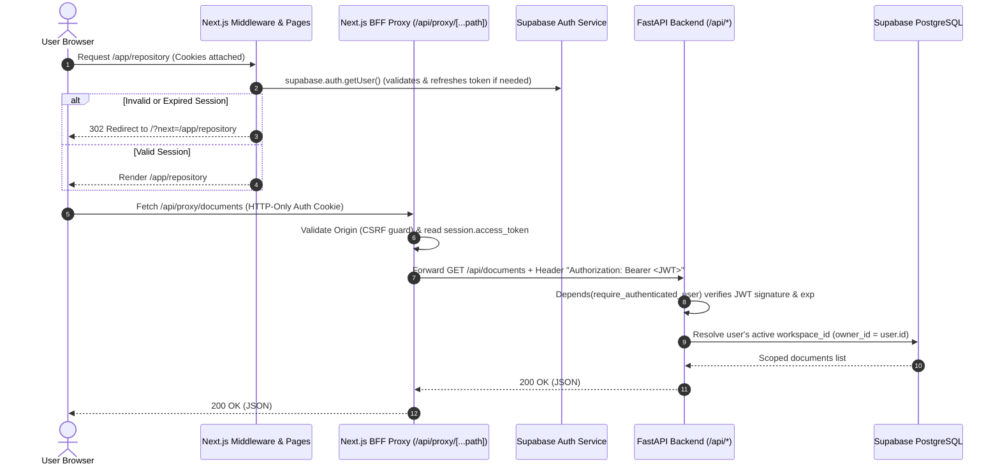

# 07 — Authentication, User Identity & Session Architecture

> **Document ID:** `DOC-07`  
> **Status:** `[VERIFIED]` Existing Next.js Auth + `[PROPOSED]` End-to-End FastAPI Enforcement (Master Task Section 4.1)  
> **Related Documents:** [02-PRODUCT-REQUIREMENTS.md](file:///c:/Users/arief/Downloads/WAICY/docs/documind-blueprint/02-PRODUCT-REQUIREMENTS.md), [08-MULTI-TENANCY-AND-DATA-ISOLATION.md](file:///c:/Users/arief/Downloads/WAICY/docs/documind-blueprint/08-MULTI-TENANCY-AND-DATA-ISOLATION.md), [22-SECURITY-AND-PRIVACY.md](file:///c:/Users/arief/Downloads/WAICY/docs/documind-blueprint/22-SECURITY-AND-PRIVACY.md)

---

## 1. Purpose & Scope

This specification defines how users register, authenticate, maintain sessions, recover passwords, access protected frontend and backend routes, and delete their accounts (`PR-001`–`PR-005`).

### 1.1 Audit Baseline: What Already Exists vs. What Is Missing
- **`[VERIFIED]` Already Implemented in `apps/web/`:**
  - `apps/web/lib/server/supabase-auth.ts`: Server-side Supabase Auth helper managing HTTP-only cookies (`ACCESS_COOKIE`, `REFRESH_COOKIE`, `PKCE_COOKIE`, `RECOVERY_COOKIE`) and direct Supabase Auth operations (`supabaseGetUser`, `supabaseRefreshSession`, `supabaseExchangePkce`, `supabaseVerifyOtp`, `supabaseRecoverPassword`, `supabaseUpdatePassword`, `supabaseResendVerification`).
  - `apps/web/lib/server/security.ts`: Origin CSRF validation (`validateTrustedOrigin`), bot honeypot checks (`checkBotSignals`), sliding-window IP/email rate limiting (`checkRateLimit`), client IP extraction, and auth error sanitization.
  - `apps/web/lib/auth-validation.ts`: Email normalization, open-redirect sanitization (`sanitizeRedirectPath`), and password policy validation (`validatePasswordPolicy`, `validatePasswordMatch`).
  - `apps/web/app/api/auth/*`: **All 10 authentication API routes are already implemented and verified**:
    - `login/route.ts`, `signup/route.ts`, `logout/route.ts`, `me/route.ts`
    - `oauth/google/route.ts`, `callback/route.ts`
    - `forgot-password/route.ts`, `reset-password/route.ts`, `recovery-session/route.ts`, `resend-verification/route.ts`
  - `apps/web/app/(auth)/*`: Dedicated auth UI pages for `/login`, `/signup`, `/forgot-password`, `/reset-password`, and `/auth/callback` (using `SignalAuthShell.tsx` and `AuthPrimitives.tsx`).
  - `apps/web/middleware.ts`: Protects `/dashboard/:path*` (verifying `emailVerified` and auto-refreshing expired access tokens via `REFRESH_COOKIE`), handles `/auth/callback` PKCE/OTP exchanges, and redirects authenticated users away from guest-only pages (`/login`, `/signup`, `/forgot-password`).
  - `apps/web/app/api/proxy/[...path]/route.ts`: Authenticated BFF proxy that extracts the user's `ACCESS_COOKIE` token and forwards it as `Authorization: Bearer <token>` to `FASTAPI_URL/api/...`.
- **`[VERIFIED]` Already Implemented in `apps/api/`:**
  - `apps/api/app/core/security.py`: `require_authenticated_user` validates Bearer tokens locally via `SUPABASE_JWT_SECRET` (`HS256`, audience `authenticated`) or via remote fallback `GET {SUPABASE_URL}/auth/v1/user`.
- **`[OBSERVED]` Critical Gaps to Close:**
  1. **Unprotected FastAPI Routers:** `require_authenticated_user` is only attached to `GET /api/auth/session` (`apps/api/app/routers/auth.py`). The 5 core routers (`documents.py`, `chat.py`, `analytics.py`, `synthesis.py`, `audio.py`) have **zero authentication enforcement**.
  2. **Middleware Prefix Expansion for Unified Workspace Routes:** `apps/web/middleware.ts` currently sets `PROTECTED_PREFIXES = ["/dashboard"]`; as new workspace routes (`/app/*` or `/dashboard/repository`, `/dashboard/documents/[id]`, `/dashboard/explore`) are added, `PROTECTED_PREFIXES` and `config.matcher` must cover all protected workspace paths.
  3. **Missing Automatic Workspace Provisioning:** Logging in does not yet automatically provision or verify a default personal `workspace_id` in `public.workspaces`.
  4. **Missing Account Deletion Cascade:** No endpoint exists yet (`DELETE /api/auth/account`) to delete a user's account and purge their storage files and workspace data.

---

## 2. End-to-End Authentication & Token Bridging Architecture

---

## 3. Specification of Every Identity Workflow

### 3.1 Registration (`POST /api/auth/signup`)
1. **Input Validation:**
   - Email normalized (`trim().toLowerCase()`), validated against RFC 5322 pattern.
   - Password validated: minimum 8 characters, at least 1 uppercase letter, 1 lowercase letter, and 1 digit (`lib/auth-validation.ts`).
   - Full Name (`1–100` chars, sanitized).
2. **Execution:**
   - Verify trusted `Origin` header (`validateTrustedOrigin`).
   - Call `supabase.auth.signUp({ email, password, options: { data: { full_name }, emailRedirectTo: `${origin}/api/auth/callback` } })`.
3. **Workspace Provisioning Trigger (`PR-006`):**
   - A PostgreSQL trigger `on_auth_user_created` on `auth.users` (plus an idempotent fallback in FastAPI's workspace resolver) automatically creates:
     - A row in `public.workspaces` (`name = "<Full Name>'s Workspace"`, `owner_id = new.id`, `is_personal = true`).
     - A row in `public.workspace_members` (`workspace_id`, `user_id = new.id`, `role = 'owner'`).
     - A row in `public.dashboards` (`workspace_id`, `user_id = new.id`).
4. **Email Verification Handling:**
   - If Supabase email confirmation is enabled (`session === null` on signup response), the UI displays a dedicated **"Check your inbox to verify your email"** screen with a `"Resend verification email"` button (rate-limited to 1 request per 60s).
   - If auto-confirmed, redirects immediately to `/app/dashboard`.

### 3.2 Login (`POST /api/auth/login` & Google OAuth `/api/auth/oauth/google`)
1. **Email/Password Login:**
   - Calls `supabase.auth.signInWithPassword({ email, password })`.
   - Sets HTTP-only, `SameSite=Lax`, `Secure` (in production) session cookies (`sb-<project>-auth-token`).
   - Returns generic `"Invalid email or password"` on credential mismatch to prevent account enumeration.
2. **Google OAuth 2.0:**
   - `POST /api/auth/oauth/google` initiates PKCE flow via `supabase.auth.signInWithOAuth({ provider: 'google', options: { redirectTo: `${origin}/api/auth/callback?next=/app/dashboard` } })`.
   - `GET /api/auth/callback` exchanges `?code=` for a session via `supabase.auth.exchangeCodeForSession(code)` and redirects to the validated internal `next` path (blocking open-redirect attacks by requiring `next.startsWith('/') && !next.startsWith('//')`).

### 3.3 Forgot Password & Password Reset (`[PROPOSED]` Addition)
1. **Request Reset (`POST /api/auth/forgot-password`):**
   - Accepts `{ email }`, validates origin, and calls `supabase.auth.resetPasswordForEmail(email, { redirectTo: `${origin}/api/auth/callback?next=/reset-password` })`.
   - Always returns `200 OK` with `"If an account exists for this email, a password reset link has been sent"` to prevent email enumeration.
2. **Complete Reset (`POST /api/auth/reset-password`):**
   - User clicks email link $\rightarrow$ `/api/auth/callback` exchanges recovery code $\rightarrow$ lands on `/reset-password`.
   - User submits `{ newPassword, confirmPassword }`.
   - Route handler validates password complexity and calls `supabase.auth.updateUser({ password: newPassword })`, then redirects to `/app/dashboard`.

### 3.4 Session Persistence & Protected Routes (`PR-001`, `PR-003`)
1. **Next.js Middleware (`apps/web/middleware.ts`):**
   - Runs on `/`, `/login`, `/signup`, `/reset-password`, and all `/app/:path*` routes ( updating legacy `/dashboard` matcher to cover `/app/:path*` and redirecting `/dashboard` $\rightarrow$ `/app/dashboard`).
   - Invokes `supabase.auth.getUser()` (not `getSession()`, because `getUser()` revalidates the token signature against Supabase Auth or refreshes expired access tokens using the refresh token cookie).
2. **FastAPI Global Router Protection:**
   - Every protected router in `apps/api/app/routers/` (`documents`, `chat`, `search`, `analytics`, `synthesis`, `relationships`, `audio`, `dashboard`) **must** declare `dependencies=[Depends(require_authenticated_user)]` at the `APIRouter` level AND accept `current_ctx: WorkspaceContext = Depends(get_verified_workspace_context)` on endpoints.
   - Furthermore, `require_authenticated_user` must pass the raw `access_token` string into `WorkspaceContext` so downstream Supabase queries can either bind the user JWT or enforce mandatory `workspace_id` filters (`DOC-08`).

### 3.5 Logout (`POST /api/auth/logout`)
- Calls `supabase.auth.signOut()`, clears all Supabase auth cookies, clears client-side query caches in the browser, and redirects to `/`.

### 3.6 Self-Service Account Deletion (`DELETE /api/auth/account`, `PR-004`)
1. **User Confirmation Gate:** User must re-enter their email address or `"DELETE"` in `/app/settings` to confirm irreversible deletion.
2. **Atomic Cascade Sequence:**
   - FastAPI verifies user's JWT.
   - Lists all `workspace_id`s where `owner_id = user.id`.
   - Removes all files in Supabase Storage bucket `documents/{workspace_id}/*`.
   - Deletes user's `public.workspaces` rows (which `ON DELETE CASCADE` purges `documents`, `document_pages`, `chunks`, `document_tables`, `extracted_metrics`, `topics`, `entities`, `document_relationships`, `conversations`, `messages`, `dashboards`, `dashboard_widgets`, and `processing_jobs`).
   - Calls Supabase Admin API `supabase_admin.auth.admin.delete_user(user.id)` to remove the identity from `auth.users`.
   - Clears session cookies and returns `200 OK`.
