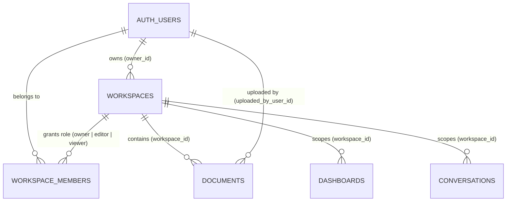

# 08 — Multi-Tenancy, Workspace Model & Data Isolation Architecture

> **Document ID:** `DOC-08`  
> **Status:** `[PROPOSED]` Security & Multi-Tenancy Specification (Master Task Sections 3.2 & 8)  
> **Related Documents:** [02-PRODUCT-REQUIREMENTS.md](file:///c:/Users/arief/Downloads/WAICY/docs/documind-blueprint/02-PRODUCT-REQUIREMENTS.md), [07-AUTHENTICATION-AND-IDENTITY.md](file:///c:/Users/arief/Downloads/WAICY/docs/documind-blueprint/07-AUTHENTICATION-AND-IDENTITY.md), [20-DATA-MODEL-AND-ERD.md](file:///c:/Users/arief/Downloads/WAICY/docs/documind-blueprint/20-DATA-MODEL-AND-ERD.md), [22-SECURITY-AND-PRIVACY.md](file:///c:/Users/arief/Downloads/WAICY/docs/documind-blueprint/22-SECURITY-AND-PRIVACY.md), [26-ARCHITECTURE-DECISIONS.md](file:///c:/Users/arief/Downloads/WAICY/docs/documind-blueprint/26-ARCHITECTURE-DECISIONS.md)

---

## 1. Purpose & Core Isolation Invariant

DocuMind is a multi-user platform where students, researchers, and corporate analysts upload private documents. The single most important security invariant of the entire system is:

> **Tenant Isolation Invariant (`PR-006`–`PR-010`):** A user (`User A`) must **never** be able to list, read, download, search, retrieve into AI context, or aggregate into a dashboard any document, chunk, embedding, topic, entity, conversation, or metric belonging to another user (`User B`) without explicit workspace membership permission.

---

## 2. Account, Personal Workspace & Future Organization Model (Section 3.2)

### 2.1 Evaluation: Personal Workspaces vs. Shared Organization Workspaces
Master Task Section 3.2 asks us to:
> *"Investigate the relationship between Users, Personal workspaces, Organizations, Company accounts, Organization members, Document ownership, Workspace sharing, Permissions and roles. Evaluate whether personal workspaces are sufficient for the initial product and whether organization-level shared workspaces should be a future capability."*

| Model Option | Description | Pros | Cons | Verdict |
|---|---|---|---|---|
| **Option 1: Direct `user_id` Ownership Only (No `workspaces` table)** | Every table (`documents`, `chunks`, `dashboards`) only has a `user_id` column. | Simplest initial query filter. | Adding team/company sharing later requires rewriting every foreign key, RLS policy, storage path, and vector search RPC across 18 tables. | **Rejected** (Creates severe schema migration debt; also ignores existing `public.workspaces` in `20261113000001_initial_schema.sql`). |
| **Option 2: Full Multi-Org Enterprise Hierarchy in MVP (Orgs, Teams, Invites, Seat Billing, Document-Level ACLs)** | Build full organization management UI, email invitation workflows, and per-document RBAC before launching core features. | Supports enterprise team collaboration on Day 1. | Massive UI/backend scope bloat that delays Pillar A, B, and C. | **Rejected for MVP** (`P3` deferred). |
| **Option 3: Personal Workspace Default with Organization-Ready Membership Schema (`ADR-004`)** | Every resource belongs to a `workspace_id`. On signup, each user gets an isolated default **Personal Workspace** (`is_personal = true`, `owner_id = user.id`) and an entry in `workspace_members` (`role = 'owner'`). | **Zero UI complexity in MVP** (1 user = 1 automatic personal workspace), yet **100% schema-ready** for future shared company workspaces (`is_personal = false`) without altering a single table or vector RPC! | Requires 1 lightweight membership lookup (cached in session/dependency). | **`[PROPOSED]` Selected Architecture (`ADR-004`, `OQ-001`)** |

### 2.2 Ownership & Permission Hierarchy (`[PROPOSED]`)



- **Roles Defined in `public.workspace_members` (`role` enum):**
  - **`owner`:** Full control over workspace settings, members, documents, dashboards, and deletion. (In `P0` Personal Workspaces, every user is `owner` of their personal workspace).
  - **`editor` *(Future P3 Org Mode)*:** Can upload, reprocess, and delete documents, run AI syntheses, and create/edit dashboard widgets within the workspace.
  - **`viewer` *(Future P3 Org Mode)*:** Can view documents, search, chat with the AI Assistant, and view dashboards, but cannot upload, modify, or delete documents.

---

## 3. Solving the Critical `SUPABASE_SERVICE_ROLE_KEY` RLS Bypass Trap (`ADR-003`)

### 3.1 `[VERIFIED]` Technical Discovery
In [apps/api/app/db/supabase_client.py](file:///c:/Users/arief/Downloads/WAICY/apps/api/app/db/supabase_client.py#L14), the FastAPI backend initializes the Supabase Python client using `settings.SUPABASE_KEY`, which in [apps/api/.env](file:///c:/Users/arief/Downloads/WAICY/apps/api/.env) is populated from `SUPABASE_SERVICE_ROLE_KEY`.

> [!CAUTION]
> **Critical PostgreSQL / Supabase Security Fact (`[VERIFIED]`):**  
> In Supabase, the `service_role` database role has the PostgreSQL `BYPASSRLS` attribute enabled (`rolbypassrls = true`). This means **PostgreSQL Row-Level Security (RLS) policies are completely bypassed** whenever a query is executed using a client authenticated with `SUPABASE_SERVICE_ROLE_KEY`!  
> If a developer merely adds `CREATE POLICY ... ON public.documents` in SQL and assumes `supabase_db.table("documents").select("*").execute()` in FastAPI will only return the current user's documents, **it will actually return ALL users' documents across the entire database!**

### 3.2 Mandatory Defense-in-Depth Architecture (`ADR-003`)
To guarantee unbreakable tenant isolation across every layer, DocuMind enforces **Two Independent Isolation Barriers simultaneously**:

#### Barrier 1: FastAPI Dependency-Injected `WorkspaceContext` & Scoped Repository Pattern
Every FastAPI endpoint must obtain database access through a mandatory dependency `get_workspace_context(user: AuthenticatedUser = Depends(require_authenticated_user))`:
1. Verifies the user's Supabase JWT (`user.id`).
2. Resolves and verifies the target `workspace_id` against `public.workspace_members` (`WHERE user_id = user.id`). If the user is not a member of `workspace_id`, immediately raises `403 Forbidden`.
3. Returns a `WorkspaceContext(user_id, workspace_id, role, user_jwt)`.
4. Every method in the backend Data Access Layer (`DocumentRepository`, `RetrievalService`, `DashboardService`) **requires** `ctx: WorkspaceContext` as its first parameter and explicitly appends `.eq("workspace_id", str(ctx.workspace_id))` to every `SELECT`, `UPDATE`, and `DELETE` query.

#### Barrier 2: PostgreSQL Row-Level Security (RLS) + User-Scoped PostgREST Auth
1. **Enable RLS on All 19 Tables in `public` Schema:**
   ```sql
   ALTER TABLE public.workspaces ENABLE ROW LEVEL SECURITY;
   ALTER TABLE public.workspace_members ENABLE ROW LEVEL SECURITY;
   ALTER TABLE public.documents ENABLE ROW LEVEL SECURITY;
   ALTER TABLE public.document_pages ENABLE ROW LEVEL SECURITY;
   ALTER TABLE public.chunks ENABLE ROW LEVEL SECURITY;
   ALTER TABLE public.document_tables ENABLE ROW LEVEL SECURITY;
   ALTER TABLE public.extracted_metrics ENABLE ROW LEVEL SECURITY;
   ALTER TABLE public.topics ENABLE ROW LEVEL SECURITY;
   ALTER TABLE public.entities ENABLE ROW LEVEL SECURITY;
   ALTER TABLE public.chunk_topics ENABLE ROW LEVEL SECURITY;
   ALTER TABLE public.document_relationships ENABLE ROW LEVEL SECURITY;
   ALTER TABLE public.conversations ENABLE ROW LEVEL SECURITY;
   ALTER TABLE public.messages ENABLE ROW LEVEL SECURITY;
   ALTER TABLE public.message_citations ENABLE ROW LEVEL SECURITY;
   ALTER TABLE public.dashboards ENABLE ROW LEVEL SECURITY;
   ALTER TABLE public.dashboard_widgets ENABLE ROW LEVEL SECURITY;
   ALTER TABLE public.processing_jobs ENABLE ROW LEVEL SECURITY;
   ALTER TABLE public.ai_usage_logs ENABLE ROW LEVEL SECURITY;
   ```
2. **Helper SQL Security Function:**
   ```sql
   CREATE OR REPLACE FUNCTION public.is_workspace_member(target_ws_id uuid)
   RETURNS boolean
   LANGUAGE sql
   SECURITY DEFINER
   STABLE
   AS $$
     SELECT EXISTS (
       SELECT 1 FROM public.workspace_members
       WHERE workspace_id = target_ws_id
         AND user_id = auth.uid()
     );
   $$;
   ```
3. **Bind User JWT on User-Facing Queries:** For all interactive request handlers in FastAPI, create a lightweight request-scoped PostgREST client initialized with `SUPABASE_ANON_KEY` + `client.postgrest.auth(ctx.user_jwt)` so PostgreSQL evaluates `auth.uid()` under the non-bypass `authenticated` role! Reserve `SUPABASE_SERVICE_ROLE_KEY` **strictly** for background ingestion workers (which still validate `job.workspace_id` explicitly).

---

## 4. Isolation Across All Five Storage & Compute Subsystems

| Subsystem | How Tenant Isolation Is Enforced (`PR-007`–`PR-010`) | Verification / Failure Mode if Violated |
|---|---|---|
| **1. Relational Metadata (`public.documents`, `dashboards`, `conversations`)** | Every table carries a non-null `workspace_id uuid references public.workspaces(id) on delete cascade`. Enforced by both RLS (`is_workspace_member(workspace_id)`) and explicit `.eq("workspace_id", ctx.workspace_id)`. | Attempting to fetch `GET /api/documents/{other_user_doc_id}` returns `404 Not Found` (never leaking whether the UUID exists). |
| **2. Vector & Full-Text Search (`match_document_chunks_hybrid`)** | `filter_workspace_id uuid` is a **mandatory non-null parameter** of the SQL RPC. The `WHERE c.workspace_id = filter_workspace_id` clause executes inside the PostgreSQL index scan before any cosine similarity or FTS ranking occurs. | If `filter_workspace_id` is null or does not match `auth.uid()`'s workspace membership, the SQL function raises an exception or returns 0 rows. |
| **3. Binary File Storage (Supabase Storage `documents` bucket)** | Bucket `documents` is configured as **Private** (`public = false`). Objects are stored at key `workspaces/{workspace_id}/documents/{doc_id}/{sanitized_filename}`. Downloads flow through `GET /api/proxy/documents/{doc_id}/file` (which verifies `workspace_id` ownership before generating a 60-second signed stream). | Direct unauthenticated URL guesses to Supabase Storage return `400/403 Unauthorized`. |
| **4. Analytical SQL Execution (DuckDB Engine)** | No global shared tables! When executing a dashboard query for `ctx.workspace_id`, the backend creates an **ephemeral in-memory DuckDB cursor**, loads **only** the `document_tables` and `extracted_metrics` rows from PostgreSQL where `workspace_id = ctx.workspace_id`, locks external access (`SET enable_external_access = false`), executes the `SELECT` query, and closes the cursor. | Zero possibility of a SQL query joining or reading another user's financial or research tables. |
| **5. OpenAI Prompt Caching (`prompt_cache_key`)** | Every `prompt_cache_key` passed to `POST /v1/responses` is namespaced by `workspace_id` (`f"dm:ws:{ctx.workspace_id}:doc:{doc_id}"`). | Prevents any prefix routing collision across tenants. |
