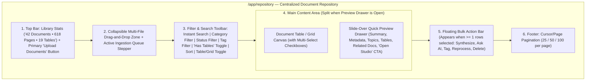

# 09 — Pillar A: Centralized Document Repository Specification

> **Document ID:** `DOC-09`  
> **Status:** `[PROPOSED]` Complete Functional & Technical Specification (Master Task Sections 1.2 & 4.2)  
> **Related Documents:** [01-PRODUCT-VISION.md](file:///c:/Users/arief/Downloads/WAICY/docs/documind-blueprint/01-PRODUCT-VISION.md), [05-INFORMATION-ARCHITECTURE.md](file:///c:/Users/arief/Downloads/WAICY/docs/documind-blueprint/05-INFORMATION-ARCHITECTURE.md), [10-DOCUMENT-INGESTION-PIPELINE.md](file:///c:/Users/arief/Downloads/WAICY/docs/documind-blueprint/10-DOCUMENT-INGESTION-PIPELINE.md), [23-UI-STATES-AND-EDGE-CASES.md](file:///c:/Users/arief/Downloads/WAICY/docs/documind-blueprint/23-UI-STATES-AND-EDGE-CASES.md)

---

## 1. Purpose & Scope

The **Document Repository (`/app/repository`)** is **Pillar A** of DocuMind (`PR-011`–`PR-018`). It provides every user with one centralized, high-clarity command center to upload, validate, track, search, filter, sort, preview, organize, reprocess, and delete their documents.

### 1.1 Why a Centralized Repository Experience Is Essential
As required in Master Task Section 1.2:
> *"Important: I want one centralized document library experience, not a fragmented system in which users must navigate multiple unrelated pages to find their PDFs."*

In DocuMind, users never have to hunt across separate "Uploads", "Processed Files", "Tables", or "Failed Jobs" pages. Every document in the user's workspace—regardless of whether it is currently uploading, running OCR, ready for AI analysis, or failed validation—lives in `/app/repository` with transparent state indicators and immediate actions.

---

## 2. UI/UX Architecture of the Document Repository

### 2.1 Table View vs. Grid View Analysis & Specification (`PR-011`)
Different user tasks benefit from different visual densities:
- **Table View (Default for > 6 Documents & Professional Analysts):**
  - High information density (~12–15 documents visible above the fold).
  - Ideal for scanning processing statuses, comparing page/table counts, sorting by upload date or file size, and selecting multiple rows via checkboxes for bulk Cross-Document Synthesis.
- **Grid View (Optional Toggle for Visual Browsing):**
  - Displays responsive cards (3–4 per row on desktop) featuring a rendered Page-1 thumbnail preview, document title, category badge, 2-line executive summary snippet, and topic pills.
  - Ideal for visually recognizing slide decks, textbooks, or distinct cover pages.
- **Persistence:** The user's preferred view mode (`table` | `grid`) persists in `localStorage` and workspace preferences.

### 2.2 Repository Layout & Component Zones

---

## 3. Document Lifecycle & Processing States (`PR-014`)

Every document in `public.documents` transitions through a well-defined state machine:

| Status Code | UI Badge & Progress | Meaning | Available User Actions |
|---|---|---|---|
| **`uploading`** | `Uploading (0–100%)` (Blue pulse) | Browser is streaming multipart binary to backend/Storage. | `Cancel Upload` |
| **`queued`** | `Queued (10%)` (Slate) | File validated and stored in Supabase Storage; waiting for ingestion worker slot. | `View Metadata`, `Delete` |
| **`extracting_text`** | `Extracting Layout (25%)` (Indigo spinner) | PyMuPDF is extracting digital text, page coordinates, and native tables. | `View Metadata`, `Cancel / Delete` |
| **`running_ocr`** | `Vision OCR (45% • Page X/Y)` (Amber spinner) | `gpt-6.1-terra` is performing Vision OCR on scanned/image-heavy pages. | `View Metadata`, `Cancel / Delete` |
| **`embedding`** | `Indexing Vectors (70%)` (Purple spinner) | `text-embedding-3-small` is generating 1,536-d vectors and indexing in `pgvector` + FTS. | `View Metadata` |
| **`extracting_insights`** | `Analyzing Insights (85%)` (Cyan spinner) | `gpt-6-luna` is extracting summary, category, topics, entities, KPIs, and relationships. | `Open PDF Reader` (Text already viewable) |
| **`ready`** | `Ready` (Emerald check) | 100% of stages complete. Available across Search, AI Assistant, Synthesis, and Dashboard. | `Preview`, `Open Studio`, `Ask AI`, `Synthesize`, `Replace`, `Delete` |
| **`partial_ready`** | `Ready (Partial Warning)` (Yellow warning) | Core text & vectors indexed, but a non-fatal sub-stage (e.g., 1 scanned page OCR or table extraction) had a warning. | All `ready` actions + `Retry Failed Pages` |
| **`failed`** | `Failed: <Reason>` (Red alert) | Ingestion halted due to unrecoverable error or exhausted retries. | `View Error Details`, `Reprocess`, `Delete` |

---

## 4. Upload Validation & Multi-Scenario Behavior (Section 4.2)

### 4.1 Validation Gate (`PR-012`)
Before any file is written to Supabase Storage or queued for OpenAI processing, both client and server enforce:
1. **Supported Extensions & MIME Types:**
   - **P0 Core:** `.pdf` (`application/pdf` — verified by reading the first 5 magic bytes `%PDF-` in Python so a renamed `.exe` or `.html` file is rejected immediately).
   - **P1 Structured Data:** `.csv` (`text/csv`), `.xlsx` (`application/vnd.openxmlformats-officedocument.spreadsheetml.sheet` — verified via ZIP/PK header + `[Content_Types].xml`).
2. **File Size & Page Limits:**
   - Default maximum file size: **`50 MB`** per file (`MAX_UPLOAD_SIZE_MB=50` in `config.py`).
   - Default maximum page count per PDF: **`300 pages`** (`MAX_PDF_PAGES=300`, configurable).
3. **Integrity & Encryption Check:**
   - PyMuPDF (`fitz.open(stream=bytes)`) opens the header in `<15ms`:
     - If `doc.is_encrypted` / `doc.needs_pass`: Rejects immediately with `422 Unprocessable Entity` (`code: "ERR_PDF_PASSWORD_PROTECTED"`, message: *"This PDF is password-protected. Please remove the password before uploading."*).
     - If `doc.page_count == 0` or stream raises `fitz.FileDataError`: Rejects immediately with `422 Unprocessable Entity` (`code: "ERR_PDF_CORRUPTED_OR_EMPTY"`).

### 4.2 Behavior Under Specific Upload Scenarios

| Upload Scenario | Exact System & UX Behavior |
|---|---|
| **1. Single Valid PDF Upload** | Computes `file_sha256`, uploads to `workspaces/{ws_id}/documents/{doc_id}/{filename}`, inserts `public.documents` (`status='queued'`), starts background ingestion pipeline, and streams real-time stage updates to the repository row. |
| **2. Multiple Documents Uploaded Simultaneously (Batch Drag-and-Drop of e.g. 10 PDFs)** | Frontend queues uploads with concurrency `3` (preventing browser network saturation) and displays an **Active Upload & Processing Tray** at the top of `/app/repository`. Each file gets an independent `doc_id` and `processing_jobs` record so one slow or failed file never blocks the other 9 files. |
| **3. Identical Document Uploaded (`file_sha256` Duplicate Detection, `PR-013`)** | If `(workspace_id, file_sha256)` already exists in `public.documents`: • **If existing status is `ready`:** Backend returns `200 OK` with `duplicate_detected: true` and the existing `document` object. UI displays a non-destructive modal/toast: *"This exact file ('Report_Q3.pdf') is already in your repository."* with buttons: **`[Open Existing Document]`** (default, \$0 API cost) or **`[Reprocess Existing]`**. • **If existing status is `failed`:** Automatically triggers a fresh reprocessing run on the existing `doc_id`. |
| **4. Updated Version of an Existing Document (Same Filename, Different SHA-256)** | UI offers **`[Keep Both as Separate Documents]`** or **`[Replace Existing Document]`**. Choosing `Replace` updates the `doc_id` in place (purging old chunks/tables, ingesting new content, and refreshing any linked Dashboard widgets so saved links don't break). |
| **5. Corrupted or Unsupported File (e.g., `.docx`, `.zip`, `.png`, or broken `.pdf`)** | Rejected synchronously before storage upload. In multi-file uploads, valid files proceed normally while invalid files show a clear red inline card (`"archive.zip — Unsupported file format. Supported: PDF, CSV, XLSX"`) with a dismiss button. |

---

## 5. Search, Filtering, Sorting & Preview Specifications (`PR-015`, `PR-016`)

### 5.1 Repository Search & Filtering (`GET /api/documents`)
- **Instant Metadata & Summary Search (`?q=`):** Matches against `documents.title`, `documents.original_filename`, `documents.summary`, and associated `topics.name` / `entities.name` using a fast GIN trigram/tsvector index (`<30ms`). *(Note: Deep full-text passage search across all chunks is also accessible via a 1-click `"Search inside all document pages for '<q>'"` link that opens `/app/explore?q=<q>`).*
- **Multi-Facet Filters:**
  1. **`status`:** `All`, `Ready`, `Processing` (`queued`|`extracting_text`|`running_ocr`|`embedding`|`extracting_insights`), `Needs Attention` (`failed`|`partial_ready`).
  2. **`category` (AI-Classified):** Dynamically populated from `documents.category` in the user's workspace (e.g., `Academic Paper`, `Financial Report`, `Lab Report`, `Contract / Legal`, `SOP / Policy`, `Presentation / Slides`, `Spreadsheet / Dataset`, `General`).
  3. **`tags`:** User-assigned custom tags (`documents.user_tags text[]`) and AI-extracted top topics.
  4. **`has_tables`:** Boolean toggle (`true` shows only documents from which quantitative tables or KPI metrics were extracted—helping users quickly see which files power numerical charts).
  5. **`date_range`:** Filter by `created_at` (`Last 7 days`, `Last 30 days`, `Custom Range`).
- **Sorting (`?sort_by=&sort_dir=`):**
  - `created_at` (`desc` default / `asc`), `title` (`asc`/`desc`), `page_count` (`desc`/`asc`), `file_size_bytes` (`desc`/`asc`), `extracted_table_count` (`desc`).

### 5.2 Slide-Over Quick Preview Drawer (`PR-016`)
When a user single-clicks a document row (or clicks the `Preview` icon), a 440px right-hand drawer slides open without leaving `/app/repository`:
- **Header:** Document Title, Category Badge, Status Badge, File Size, Page Count, Upload Timestamp, and primary CTA **`[Open in Document Studio ->]`**.
- **Section 1 — Executive Summary:** The structured summary generated by `gpt-6-luna` during ingestion.
- **Section 2 — Key Topics & Entities:** Clickable topic pills (clicking filters the repository by that topic) and named entities (Organizations, People, Dates, Metrics).
- **Section 3 — Extracted Tables & Metrics Preview:** Shows how many tables and KPI metrics were extracted (e.g., *"3 Structured Tables extracted (Pages 4, 9, 14) • Ready for Dashboard Analytics"*).
- **Section 4 — Connected Documents (`PR-031`):** Lists top 3 related documents in the repository with relationship badges (e.g., *"Shares 4 topics with Q2_Report.pdf"* or *"1 Contradiction detected with Policy_v1.pdf"*).
- **Footer Actions:** `Reprocess Document`, `Download Original File`, `Delete Document`.

---

## 6. Document Deletion & Reprocessing Rules (`PR-018`)

1. **Safe Deletion with Impact Preview:**
   - When the user clicks `Delete` on 1 or more documents, the confirmation dialog queries lightweight dependency counts and tells the user:
     > *"Deleting **'Q3_Financial_Report.pdf'** will permanently remove its 18 pages, 64 indexed search chunks, 3 extracted tables, and will affect **2 widgets** on your Personalized Dashboard. This action cannot be undone."*
   - Upon confirmation, `DELETE /api/documents/{id}` removes the Supabase Storage blob, deletes the `public.documents` row (cascading to all child tables), and triggers dashboard widget staleness/recalculation.
2. **Idempotent Reprocessing (`POST /api/documents/{id}/reprocess`):**
   - If a document is in `failed` or `partial_ready` state (or if the user requests a full re-index), the backend resets `processing_jobs` from the last failed checkpoint (or from Stage 3 if `force_full=true`), cleans up partial artifacts from the failed stage, and re-queues the job.
