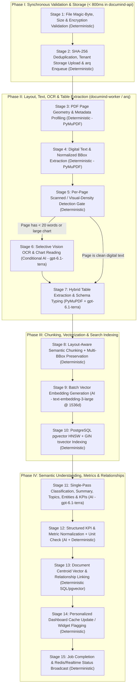

# 10 — 15-Stage Document Ingestion & Processing Pipeline

> **Document ID:** `DOC-10`  
> **Status:** **`DECIDED`** — Final Technical Pipeline Specification (`ADR-006`, `ADR-008`, `ADR-010`, `ADR-014`, `ADR-017`)  
> **Related Documents:** [30-FINAL-SELECTED-ARCHITECTURE-AND-DECISIONS.md](file:///c:/Users/arief/Downloads/WAICY/docs/documind-blueprint/30-FINAL-SELECTED-ARCHITECTURE-AND-DECISIONS.md), [09-DOCUMENT-REPOSITORY.md](file:///c:/Users/arief/Downloads/WAICY/docs/documind-blueprint/09-DOCUMENT-REPOSITORY.md), [11-PDF-VIEWER-AND-CITATIONS.md](file:///c:/Users/arief/Downloads/WAICY/docs/documind-blueprint/11-PDF-VIEWER-AND-CITATIONS.md), [18-OPENAI-AND-MODEL-STRATEGY.md](file:///c:/Users/arief/Downloads/WAICY/docs/documind-blueprint/18-OPENAI-AND-MODEL-STRATEGY.md), [24-FAILURE-RECOVERY-AND-RESILIENCE.md](file:///c:/Users/arief/Downloads/WAICY/docs/documind-blueprint/24-FAILURE-RECOVERY-AND-RESILIENCE.md)

---

## 1. Purpose & Core Engineering Principle

The Ingestion Pipeline transforms a raw uploaded file (`.pdf`, `.csv`, `.xlsx`) into a rich, multi-layered knowledge representation in Supabase PostgreSQL: **normalized coordinate chunks, 1,536-d vector embeddings, full-text search lexemes, structured analytical tables, standalone KPI metrics, executive summaries, classifications, named entities, and cross-document relationships** (`PR-019`–`PR-024`, `PR-046`). Stages 1–2 run synchronously in `documind-api` (`<800ms`), and Stages 3–15 run asynchronously in the dedicated **`documind-worker` (`arq` + Railway Redis)** process (`ADR-014`).

### Core Design Principle: Deterministic First, Quality-Optimized AI Second
Per Master Task Section 4.3 and Autonomous Decision Mode (`ADR-008`, `ADR-010`):
> *"Not every operation should necessarily use an LLM. Determine which tasks should use conventional deterministic processing and which genuinely benefit from OpenAI models."*

Sending an entire 50-page digital PDF through a vision LLM just to extract text or calculate page numbers wastes dollars and loses exact pixel bounding boxes. DocuMind uses **conventional deterministic Python libraries (`PyMuPDF`, `hashlib`, `openpyxl`, `pandas`, `PostgreSQL`) for 9 of the 15 stages**, and invokes **Quality-Optimized OpenAI models via `AIGateway` (`gpt-6.1-terra` for selective Vision OCR, complex tables, and single-pass semantic understanding/KPI extraction; `text-embedding-3-large` with `dimensions=1536` for vector embeddings) for the stages that genuinely require visual OCR, semantic vectors, or semantic synthesis**.

---

## 2. End-to-End 15-Stage Pipeline Architecture



---

## 3. Stage-by-Stage Specification: Deterministic vs. OpenAI Responsibilities

| Stage | Operation | Execution Type | Tool / Model Used | Input $\rightarrow$ Output | Failure Recovery & Checkpoint Behavior |
|---|---|---|---|---|---|
| **1. File Validation** | Verify MIME, `%PDF-` / ZIP magic bytes, size $\le 50\text{ MB}$, `not doc.is_encrypted`, `page_count > 0`. | **Deterministic** | Python `fitz` (PyMuPDF) | Multipart stream $\rightarrow$ Validated buffer + `page_count` | Synchronous rejection (`400`/`422`); zero storage or DB rows created. |
| **2. Dedup & Storage** | Compute `hashlib.sha256()`. Check `(workspace_id, file_sha256)`. Upload to private Supabase Storage `workspaces/{ws_id}/documents/{doc_id}/{name}`. | **Deterministic** | `hashlib` + Supabase Storage | Validated buffer $\rightarrow$ Storage path + `public.documents` (`queued`) + `processing_jobs` | If Storage upload fails, retry 2x with backoff; abort transaction cleanly if unavailable. |
| **3. Page Identification** | Iterate `0..page_count-1`; record page dimensions (`width_pt`, `height_pt`), rotation, image object count, and vector drawing density in `public.document_pages`. | **Deterministic** | PyMuPDF (`fitz.Page`) | PDF binary $\rightarrow$ `document_pages` rows | Checkpoint `stage='extracting_text'`. |
| **4. Digital Text & BBox Extraction** | Extract structured text blocks via `page.get_text("dict")`; normalize block & line bounding boxes `[x0/w, y0/h, x1/w, y1/h]` clamped to `[0.0, 1.0]`; strip NUL bytes (`\x00`). | **Deterministic** | PyMuPDF (`fitz`) | Digital PDF pages $\rightarrow$ Raw positioned blocks per page | **\$0.00 API cost.** Preserves sub-millimeter highlight accuracy (`PR-019`). |
| **5. Scanned-Document & Chart Detection** | Evaluate each page deterministically:<br/>• `is_scanned = (word_count < 20 and image_area_ratio > 0.35)`<br/>• `has_complex_visual = (image_area_ratio > 0.25 and vector_drawings > 50)` | **Deterministic** | Heuristic gate in `pdf_service.py` | Page stats $\rightarrow$ `ocr_required_pages: list[int]` | Avoids sending ~90% of clean digital pages to Vision LLMs (`PR-020`). |
| **6. Selective Vision OCR** | For each page in `ocr_required_pages` (batched in groups of 4 pages concurrently): render page pixmap at `150 DPI` PNG and call `gpt-6.1-terra` (`detail="high"`) with `OCRPageExtraction` schema (returning transcribed paragraphs, coarse normalized regions, and figure/chart descriptions). | **OpenAI Vision (`gpt-6.1-terra`)** | `POST /v1/responses` (`gpt-6.1-terra`, `service_tier="flex"`) | Rendered PNGs $\rightarrow$ Transcribed text blocks + visual chart summaries | Per-page checkpoint in `document_pages.ocr_status`. If 1 page fails after 3 retries, mark page `ocr_failed` and continue (`partial_ready`, `EC-011`). |
| **7. Table Extraction** | 1. **Digital PDFs:** Run `page.find_tables()` in PyMuPDF to extract cell grids and table bounding boxes.<br/>2. **Scanned/Complex Tables:** Use `gpt-6.1-terra` Structured Output (`ExtractedTableSchema`) from Stage 6.<br/>3. **CSV/XLSX:** Parse directly with `pandas` / `openpyxl`.<br/>Type-infer columns (`numeric`, `varchar`, `date`) and store in `public.document_tables`. | **Hybrid (Deterministic + `gpt-6.1-terra`)** | PyMuPDF / `openpyxl` + `gpt-6.1-terra` | Pages / Sheets $\rightarrow$ `public.document_tables` (`columns jsonb`, `rows jsonb`, `page_number`, `bbox`) | Invalid/malformed tables are logged and skipped as plain text chunks without failing document ingestion (`PR-024`). |
| **8. Layout-Aware Text Chunking** | Group adjacent blocks within the same page/section into semantic chunks of **`300–600` tokens** (`~1,200–2,400` chars) with **`15%` token overlap** across paragraph boundaries. Preserve both the **union bounding box** (`bbox`) and the **array of constituent block boxes** (`bounding_boxes jsonb`) so multi-column wraps highlight cleanly (`PR-021`). | **Deterministic** | `tiktoken` (`o200k_base`) + layout merger | Positioned blocks $\rightarrow$ `list[DocumentChunk]` | Pure in-memory deterministic transform; idempotent on retry (`DELETE FROM chunks WHERE doc_id = X` before insert). |
| **9. Embedding Generation** | Send chunk texts in batches of up to `256` chunks per API call via `AIGateway.embed_texts(task_type=AITaskType.EMBEDDING_DOCUMENT)` to `POST /v1/embeddings` (`model="text-embedding-3-large"`, `dimensions=1536`). | **OpenAI Embeddings (`ADR-006`)** | `text-embedding-3-large` (`dimensions=1536`, \$0.13/1M tokens) | Chunk strings $\rightarrow$ `list[vector(1536)]` | Checkpoint `stage='embedding'`. Exponential backoff on `429`/`5xx` (`PR-022`). |
| **10. Search Indexing** | Bulk insert chunks + `embedding` vectors into `public.chunks`. PostgreSQL automatically updates the `chunks_embedding_idx` (HNSW cosine) and `chunks_fts_idx` (GIN `to_tsvector('simple', text_content)`—using `'simple'` configuration so both Indonesian and English tokens and technical codes index cleanly). | **Deterministic** | Supabase PostgreSQL (`pgvector` + FTS) | Chunks + Vectors $\rightarrow$ Indexed `public.chunks` rows | Wrapped in a single DB transaction per batch. |
| **11. Single-Pass Document Understanding (`PR-023`)** | Assemble a representative document context (first 3 pages + section headings + table headers + evenly sampled chunks up to `12,000` tokens) and execute **one** `AIGateway.generate_structured(task_type=AITaskType.DOCUMENT_UNDERSTANDING)` call using **`gpt-6.1-terra`** with `response_model=DocumentUnderstandingPayload`. | **OpenAI Structured Output (`gpt-6.1-terra`, `ADR-008`)** | `gpt-6.1-terra` (`service_tier="flex"`, `store=False`) | Representative text $\rightarrow$ `summary`, `document_type`, `category`, `topics[]`, `entities[]`, `key_dates[]`, `key_findings[]`, `extracted_kpis[]` | Costs **~\$0.0057 per document** on `flex` (and delivers substantially higher KPI/unit/summary accuracy than `gpt-6-luna`). If `flex` returns `429`, retries on `auto` tier; if `terra` is unavailable, fails over to `gpt-6-luna`. |
| **12. Structured KPI & Metric Validation** | Validate each `extracted_kpi` from Stage 11: verify `numeric_value` actually appears in the cited `source_chunk_id` text (preventing hallucinated numbers), normalize currency/unit labels (`USD`, `IDR`, `%`, `mA/cm²`), and insert into `public.extracted_metrics`. | **Deterministic Verification** | Python regex/number verifier + PostgreSQL | Raw extracted KPIs $\rightarrow$ Verified `public.extracted_metrics` rows | Any KPI whose number cannot be verified in its `source_chunk_id` is discarded before reaching the Dashboard (`PR-035`, `PR-036`). |
| **13. Document Centroid & Relationship Discovery** | Compute the document's **mean centroid embedding** (`AVG(embedding)` across all chunks of `doc_id`), store on `public.documents.centroid_embedding`, upsert `topics` and `entities`, and run the deterministic SQL relationship matcher (`DOC-16`) to populate `public.document_relationships` (shared topics, shared entities, cosine similarity $\ge 0.78$). | **Deterministic SQL + `pgvector`** | PostgreSQL SQL function | Document vectors & entities $\rightarrow$ `public.document_relationships` edges | **\$0.00 LLM cost.** Runs in `<50ms` inside PostgreSQL (`PR-031`). |
| **14. Dashboard Refresh Hook** | Update workspace corpus telemetry counters and mark any existing auto-widgets in `public.dashboard_widgets` for incremental refresh if new compatible tables/metrics were added. | **Deterministic** | FastAPI `DashboardService` | New tables/metrics $\rightarrow$ Updated dashboard metadata | Non-blocking; never fails document ingestion. |
| **15. Completion** | Update `public.documents.status = 'ready'` (or `'partial_ready'`), set `processed_at = now()`, and mark `processing_jobs.status = 'completed'`. | **Deterministic** | PostgreSQL | Final state commit | Immediately unlocks document across Repository, Studio, Explore, and Dashboard. |

---

## 4. Single-Pass Understanding Schema (`Stage 11` Contract)

By combining classification, summarization, topic extraction, entity recognition, key findings, and standalone KPI extraction into **one single Structured Output call (`gpt-6.1-terra` via `AIGateway`)**, DocuMind eliminates 5 separate LLM round-trips while maximizing extraction precision:

```python
from pydantic import BaseModel, Field
from typing import Literal

class ExtractedEntityItem(BaseModel):
    name: str
    entity_type: Literal["organization", "person", "location", "technology", "metric_name", "regulation", "other"]
    canonical_name: str = Field(description="Lowercase normalized entity identifier for cross-document matching")

class ExtractedKPIItem(BaseModel):
    metric_name: str = Field(description="Clear label, e.g. 'Q3 2026 Total Revenue' or 'Peak Coulombic Efficiency'")
    numeric_value: float
    unit_or_currency: str = Field(description="Standardized unit, e.g. 'USD', 'IDR', '%', 'mAh/g', 'count'")
    period_or_context: str | None = Field(description="Time period or experimental condition, e.g. 'Q3 2026' or '45°C'")
    source_chunk_id: str = Field(description="Exact chunk_id where this number is stated")
    verbatim_quote: str = Field(description="Exact substring from the chunk containing the number")

class KeyFindingItem(BaseModel):
    headline: str
    explanation: str
    source_chunk_id: str

class DocumentUnderstandingPayload(BaseModel):
    inferred_title: str
    document_type: Literal[
        "academic_paper", "financial_report", "lab_report",
        "contract_legal", "sop_policy", "presentation_slides",
        "spreadsheet_dataset", "book_chapter", "general_document"
    ]
    primary_domain: str = Field(description="High-level domain, e.g. 'Battery Electrochemistry', 'Corporate Finance'")
    language_code: Literal["id", "en", "mixed", "other"]
    executive_summary: str = Field(description="Comprehensive 3-5 sentence summary of the document's core purpose and findings")
    main_topics: list[str] = Field(description="5 to 10 normalized topic tags")
    named_entities: list[ExtractedEntityItem]
    key_dates: list[str] = Field(description="ISO dates or fiscal periods mentioned, e.g. '2026-Q3'")
    key_findings: list[KeyFindingItem] = Field(description="3 to 6 most important empirical or operational findings with chunk IDs")
    extracted_kpis: list[ExtractedKPIItem] = Field(description="Up to 15 standalone quantitative metrics found in text/tables; empty list if none exist")
```
