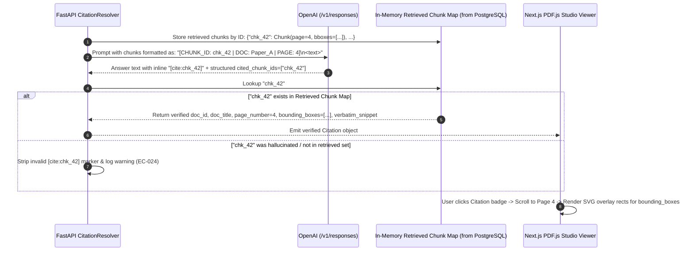

# 11 — Interactive PDF Viewer & Deterministic Citation Highlighting

> **Document ID:** `DOC-11`  
> **Status:** `[VERIFIED]` Existing PyMuPDF Normalization + `[PROPOSED]` Multi-Box & Studio Verification Architecture  
> **Related Documents:** [10-DOCUMENT-INGESTION-PIPELINE.md](file:///c:/Users/arief/Downloads/WAICY/docs/documind-blueprint/10-DOCUMENT-INGESTION-PIPELINE.md), [12-SEARCH-AND-RETRIEVAL.md](file:///c:/Users/arief/Downloads/WAICY/docs/documind-blueprint/12-SEARCH-AND-RETRIEVAL.md), [13-AI-ASSISTANT.md](file:///c:/Users/arief/Downloads/WAICY/docs/documind-blueprint/13-AI-ASSISTANT.md), [26-ARCHITECTURE-DECISIONS.md](file:///c:/Users/arief/Downloads/WAICY/docs/documind-blueprint/26-ARCHITECTURE-DECISIONS.md)

---

## 1. Purpose & Core Value Proposition

One of DocuMind's signature capabilities (`PR-019`, `PR-026`, `PR-028`, `ADR-009`) is **Deterministic Visual Source Verification**: whenever the AI Assistant answers a question, whenever Cross-Document Synthesis flags a contradiction, or whenever a Personalized Dashboard widget cites a document metric, clicking the citation pill scrolls the PDF viewer directly to the source page and draws a precise highlight box around the exact source paragraph or table.

---

## 2. Audit of Current Implementation vs. Required Fixes

1. **`[VERIFIED]` What Works in `apps/api/app/services/pdf_service.py`:**
   - `PDFService` extracts `page.rect.width` and `page.rect.height` and normalizes PyMuPDF block coordinates `(x0, y0, x1, y1)` into relative `[0.0, 1.0]` floats:
     $$x_{0,\text{norm}} = \frac{x_0}{W_{\text{page}}}, \quad y_{0,\text{norm}} = \frac{y_0}{H_{\text{page}}}, \quad x_{1,\text{norm}} = \frac{x_1}{W_{\text{page}}}, \quad y_{1,\text{norm}} = \frac{y_1}{H_{\text{page}}}$$
   - Because coordinates are stored in `[0.0, 1.0]` page-relative space, multiplying them by the rendered `<canvas>` pixel width and height in the browser (`x0 * canvas.width`, `y0 * canvas.height`) keeps highlights aligned at **any zoom level or screen resolution**.
2. **`[OBSERVED]` Three Critical Bugs in the Current Prototype That Must Be Fixed:**
   - **Bug 1 — Fake Citation Slicing (`gemini_service.py:84-99`):** The current backend ignores `[cite:CHUNK_ID]` markers in the LLM output and unconditionally attaches `context_chunks[:2]` (the first two blocks on Page 1) as the citation list.
   - **Bug 2 — Hallucinated Quiz Coordinates (`gemini_service.py:106-133`):** The quiz endpoint passes raw unpositioned text (`document_text[:6000]`) to the LLM and asks the LLM to output `BoundingBox(x0, y0, x1, y1)` floats directly—forcing the LLM to guess random coordinates.
   - **Bug 3 — Single-Block Granularity vs. Multi-Column Chunks:** In `pdf_service.py`, every tiny 1-line PyMuPDF text block became its own chunk. When blocks are properly merged into 300–600 token semantic chunks (`DOC-10` Stage 8), a chunk spanning the bottom of Column 1 and the top of Column 2 in an IEEE paper cannot be represented by a single bounding box without covering the entire page.

---

## 3. Target Coordinate & Multi-Box Highlighting Architecture (`ADR-009`)

### 3.1 Dual-Level Bounding Box Storage per Chunk (`PR-021`)
In `public.chunks` (which already defines `bounding_boxes jsonb not null` in `20261113000001_initial_schema.sql`), each chunk stores an **array of constituent block boxes** alongside its primary envelope:

```json
[
  { "page_number": 4, "x0": 0.082, "y0": 0.610, "x1": 0.475, "y1": 0.884 },
  { "page_number": 4, "x0": 0.518, "y0": 0.112, "x1": 0.912, "y1": 0.340 }
]
```
- **Why an Array of Boxes Matters:**
  - If a chunk wraps from the bottom of the left column (`x: 0.08–0.47, y: 0.61–0.88`) to the top of the right column (`x: 0.52–0.91, y: 0.11–0.34`), rendering both boxes individually highlights **only the two exact column regions** rather than drawing a giant rectangle across the whole page!
  - If a chunk spans a page break (e.g., bottom of Page 4 to top of Page 5), each box carries its own `page_number`.

### 3.2 Deterministic Citation Resolution Pipeline (`PR-028`)

> **Ironclad Rule (`ADR-009`):** An LLM is **never** allowed to output `x0, y0, x1, y1` float coordinates in any schema (`GroundedAnswer`, `QuizResponse`, `SynthesisResponse`, `DashboardGenerationPlan`). LLMs **only** output `chunk_id: str` (or `[cite:CHUNK_ID]`). The Python backend resolves `chunk_id` deterministically against the retrieved `dict[str, DocumentChunk]` map.



---

## 4. Frontend PDF.js Canvas & Overlay Rendering Specification

### 4.1 Component Structure (`apps/web/components/studio/PdfCitationViewer.tsx`)
For each visible PDF page (virtualized via `IntersectionObserver` so a 200-page PDF only renders the currently visible $\pm 2$ pages in the DOM):
1. **Layer 1 (`<canvas className="pdf-canvas-layer">`):** Renders the crisp rasterized PDF page via `pdfjs-dist` at `window.devicePixelRatio * zoomScale`.
2. **Layer 2 (`<div className="pdf-text-layer">`):** Standard PDF.js transparent selectable text layer enabling native cursor selection and `"Ask AI about selection"` context menus.
3. **Layer 3 (`<svg className="pdf-highlight-overlay" viewBox="0 0 1000 1000" preserveAspectRatio="none">`):**
   - Because `viewBox="0 0 1000 1000"` with `preserveAspectRatio="none"` scales automatically with CSS width/height, a normalized bounding box `[x0, y0, x1, y1]` in `[0.0, 1.0]` maps directly to:
     - `x = x0 * 1000`
     - `y = y0 * 1000`
     - `width = (x1 - x0) * 1000`
     - `height = (y1 - y0) * 1000`
   - **Zero recalculation required on window resize or zoom!**
   - Active cited boxes render with `fill="rgba(250, 204, 21, 0.28)"`, `stroke="rgba(234, 179, 8, 0.95)"`, `strokeWidth="2"`, and a subtle 1.5-second CSS entrance pulse animation.
   - Contradiction citations (from Cross-Document Synthesis) render in rose/amber (`rgba(244, 63, 94, 0.25)`) to distinguish conflicting claims visually.
4. **Scroll-to-Box Centroid Calculation:**
   - When the user clicks a citation badge for `page_number = P` and `bbox = [x0, y0, x1, y1]`:
     - The viewer scrolls page `P` into view and offsets vertical scroll so the vertical midpoint $\frac{y_0 + y_1}{2} \times H_{\text{page\_px}}$ is centered at 40% of the viewport height.
