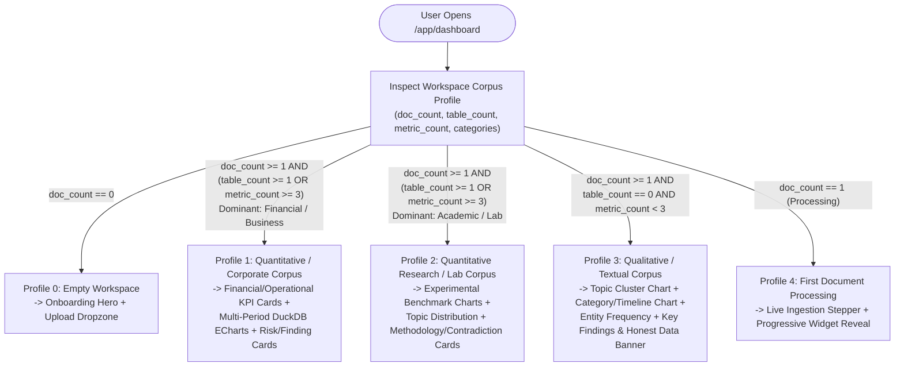

# 14 — Pillar B: Personalized Dashboard UX & Adaptive Intelligence Spec

> **Document ID:** `DOC-14`  
> **Status:** `[PROPOSED]` Core Product & UX Specification for Pillar B (Master Task Sections 1.2 & 4.6)  
> **Related Documents:** [01-PRODUCT-VISION.md](file:///c:/Users/arief/Downloads/WAICY/docs/documind-blueprint/01-PRODUCT-VISION.md), [03-PERSONAS-AND-USE-CASES.md](file:///c:/Users/arief/Downloads/WAICY/docs/documind-blueprint/03-PERSONAS-AND-USE-CASES.md), [15-DASHBOARD-GENERATION-ENGINE.md](file:///c:/Users/arief/Downloads/WAICY/docs/documind-blueprint/15-DASHBOARD-GENERATION-ENGINE.md), [23-UI-STATES-AND-EDGE-CASES.md](file:///c:/Users/arief/Downloads/WAICY/docs/documind-blueprint/23-UI-STATES-AND-EDGE-CASES.md)

---

## 1. Purpose & Core Philosophy of Pillar B

Master Task Section 1.2 defines **Pillar B — Personalized Dashboard** as one of the most important parts of DocuMind:
> *"Every user must have an individual dashboard. The dashboard should not simply display the same static analytics interface to every user. Its contents should be derived from the documents and information belonging to that particular user... Do not generate arbitrary charts just to fill dashboard space. If a document collection does not contain sufficient structured information for a particular chart, the dashboard should communicate that appropriately. Every generated metric and chart should have traceability to its underlying document sources."*

### What Was Wrong with the Prototype (`[OBSERVED]`)
1. In `apps/api/app/routers/analytics.py`, the backend ignored all uploaded documents and returned a hardcoded 5-row bar chart (`[120, 150, 180, 140, 210]`).
2. In `apps/web/app/dashboard/page.tsx`, the frontend rendered a static graphic-design layer mockup (`"Layer 01 — Primary Render"`, `"Shadow Pass"`).

This specification replaces both with a genuine **Corpus-Adaptive Personalized Dashboard (`/app/dashboard`)** (`PR-033`–`PR-040`, `ADR-010`).

---

## 2. How the Personalized Dashboard Adapts to 5 User Corpus Archetypes

Whenever a user opens `/app/dashboard`, the backend inspects the composition of `public.documents`, `public.document_tables`, `public.extracted_metrics`, `public.topics`, and `public.document_relationships` for `ctx.workspace_id` and classifies the workspace into one of **Five Corpus Profiles**:

### Detailed Comparison of Dashboard Contents by User Profile

| User Example | Detected Corpus Profile | Tier 1: Corpus Telemetry Strip | Tier 2: Auto-Discovered Domain Widgets | Tier 3: Qualitative Insights & Relationship Cards |
|---|---|---|---|---|
| **User A: AI Researcher** (25 ML papers, 14 benchmark tables) | `Profile 2: Quantitative Research` | `25 Papers` • `410 Pages` • `14 Benchmark Tables` • `8 Topic Clusters` | • **Benchmark Comparison Bar Chart** (e.g. Accuracy/Perplexity across models from extracted paper tables) • **Research Topic Distribution Donut/Treemap** | • **Top Methodological Findings Cards** • **2 Detected Cross-Paper Contradictions** • **Most Connected Central Papers** |
| **User B: Financial Analyst** (8 Quarterly PDFs + 2 Excel ledgers) | `Profile 1: Quantitative Corporate` | `10 Reports` • `280 Pages` • `22 Financial Tables` • `48 Extracted KPIs` | • **4 Headline KPI Cards** (Revenue, Net Income, Operating Margin, YoY Delta — with currency & source badge) • **Quarterly Revenue vs. Expense Trend Chart** (DuckDB SQL) • **Segment Breakdown Stacked Bar Chart** | • **Executive Risk & Guidance Highlights** • **Restatement / Discrepancy Alerts across Quarters** |
| **User C: Student / Lab Scientist** (10 Lab Reports + 5 Lecture PDFs) | `Profile 2: Quantitative Research` | `15 Docs` • `135 Pages` • `9 Experimental Tables` • `6 Core Subjects` | • **Experimental Parameter vs. Outcome Line/Scatter Chart** (from lab tables) • **Subject Coverage Breakdown** | • **Key Mechanisms & Equations Summary** • **Links between Lecture Theory & Lab Results** |
| **User D: Legal / Operations Manager** (20 SOPs & Contracts, **0 numerical tables**) | `Profile 3: Qualitative / Textual` | `20 Docs` • `310 Pages` • `0 Numerical Tables` • `11 Policy Domains` | • **Document Category & Department Coverage Bar Chart** (PostgreSQL count) • **Top Referenced Entities & Regulations Chart** • **Contract/Policy Effective Date Timeline** | • **Key Obligation & Clause Findings** • **Cross-Policy Conflict Alerts** • *Info Banner: "No quantitative tables detected. Upload spreadsheets or financial PDFs to unlock numerical metric charts."* |

---

## 3. Anatomy of a Personalized Dashboard Widget & Traceability Contract (`PR-037`)

Every single widget rendered on `/app/dashboard`—whether a KPI Card, an ECharts Visualization, or an AI Finding Card—conforms to a strict **Traceable Widget Contract**:

### 3.1 Visual Structure of a Chart / KPI Widget
1. **Header:**
   - **Widget Title** (e.g., *"Quarterly Revenue & Operating Margin (Q1–Q4 2026)"*)
   - **Origin Badge:** `Auto-Discovered` or `User Pinned`
   - **Unit / Currency Pill:** e.g., `All values in USD ($ Millions)`
   - **Action Menu:** `[Inspect Source & SQL]`, `[Refresh]`, `[Pin / Unpin]`, `[Delete]`
2. **Body:**
   - Responsive **Apache ECharts** canvas (`echarts-for-react`) OR structured **KPI Value + Delta + Context Subtitle**.
   - **AI Analytical Caption (1–2 sentences):** Explains the primary trend observed in the deterministic DuckDB result rows, with inline `[cite:CHUNK_ID]` badges.
3. **Footer (Source Provenance Strip):**
   - Displays clickable document pills: e.g., `Sources: [Q1_Report.pdf • p.4] [Q2_Report.pdf • p.6] [Q3_Report.pdf • p.4]`.

### 3.2 The "Inspect Source Evidence & SQL" Slide-Over Drawer
Clicking **`[Inspect Source & SQL]`** on any widget opens a verification drawer containing three tabs:
1. **`Source Passages & Tables` Tab:** Lists the exact PDF tables (`public.document_tables`) or KPI passages (`public.extracted_metrics`) used. Clicking any item opens `/app/documents/[docId]?page=P&bbox=...` with the source table highlighted on the PDF page!
2. **`Verified Data Table` Tab:** Shows the exact rows and columns returned by DuckDB that were bound to the chart.
3. **`Deterministic Computation (SQL)` Tab:** Shows the exact read-only SQL query executed in DuckDB (e.g., `SELECT period, SUM(revenue_usd) ...`), proving that the numbers were calculated deterministically and not invented by an LLM.

---

## 4. Dashboard Customization, Persistence & Update Lifecycle (`PR-039`)

1. **Initial Auto-Provisioning:**
   - When a user's first document finishes ingestion (`status = 'ready'`), the `DashboardEngine` automatically evaluates available `document_tables`, `extracted_metrics`, and `topics` and seeds up to **4 Tier-2 default widgets** in `public.dashboard_widgets` (`is_auto_generated = true`).
2. **User Natural-Language Widget Creation:**
   - Using the prompt bar at the top of `/app/dashboard` (*"Create a bar chart comparing battery energy density across my uploaded papers"*), the user can generate new widgets on demand.
3. **Pinning from Document Studio or Explore:**
   - Any chart generated inside `/app/documents/[docId]` or `/app/explore` has a **`[Pin to Dashboard]`** button that saves the widget to `public.dashboard_widgets` (`is_pinned = true`).
4. **Layout Customization:**
   - Users can reorder widgets (`display_order`), toggle widget width (`half` = 6 cols, `full` = 12 cols), edit widget titles, or delete widgets.
5. **Behavior When Documents Change or Are Deleted (`PR-018`, `PR-039`):**
   - **When a new document is uploaded:** Tier-1 Corpus Telemetry updates immediately. Any widget configured with `scope_mode = 'workspace_all'` (e.g., Topic Distribution or multi-report KPI table) shows a subtle `"New documents available — Click to refresh"` indicator (or auto-re-executes its saved SQL query).
   - **When a source document is deleted:** If a widget's `source_doc_ids` contained the deleted document:
     - If remaining documents in `source_doc_ids` still satisfy the query, the widget re-runs its SQL without the deleted document and logs `"Updated: 1 source document removed"`.
     - If the deleted document was the *only* data source for that widget, the widget transitions to `status = 'stale_source_deleted'`, displaying a clear placeholder card: *"The source document ('Q3_Report.pdf') for this chart was deleted."* with a 1-click **`[Remove Widget]`** button.

---

## 5. Handling Insufficient, Incomplete, or Contradictory Data (`PR-036`, `PR-038`)

| Data Edge Case | How the Personalized Dashboard Responds |
|---|---|
| **1. Insufficient Quantitative Data for a Requested Chart** | Does **not** render an empty chart or 1-bar chart. Returns `status = "insufficient_data"` with a clear explanation of what data exists vs. what is missing, and offers alternative qualitative cards. |
| **2. Missing Values in Time Series / Comparison (e.g., Q1, Q2, Q4 exist, but Q3 report is missing)** | Charts the existing data points (`Q1`, `Q2`, `Q4`) with an explicit visual gap/dashed connector for `Q3` and a warning badge: *"Note: No data found for Q3 in your repository."* — never interpolating or guessing `Q3`. |
| **3. Contradictory Metrics Across Documents (e.g., Draft Report says Revenue = \$12.0M; Final Audited Report says Revenue = \$11.4M)** | Instead of silently averaging `\$12.0M` and `\$11.4M` into a bogus `\$11.7M`, the Dashboard Validation Layer flags a **Metric Discrepancy Alert** on the KPI card showing **both** values alongside their respective document titles and page citations! |
