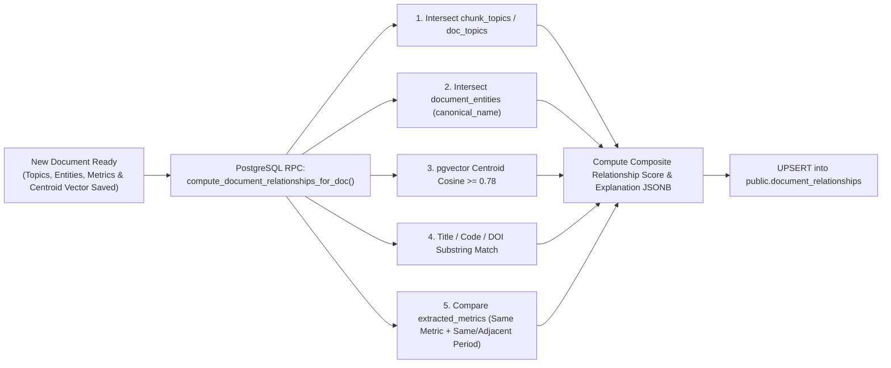

# 16 — Document Relationship Discovery & Knowledge Graph Engine

> **Document ID:** `DOC-16`  
> **Status:** `[PROPOSED]` Relationship Engine Specification (Master Task Section 4.7)  
> **Related Documents:** [10-DOCUMENT-INGESTION-PIPELINE.md](file:///c:/Users/arief/Downloads/WAICY/docs/documind-blueprint/10-DOCUMENT-INGESTION-PIPELINE.md), [17-INSIGHT-AND-CROSS-DOCUMENT-ANALYSIS.md](file:///c:/Users/arief/Downloads/WAICY/docs/documind-blueprint/17-INSIGHT-AND-CROSS-DOCUMENT-ANALYSIS.md), [20-DATA-MODEL-AND-ERD.md](file:///c:/Users/arief/Downloads/WAICY/docs/documind-blueprint/20-DATA-MODEL-AND-ERD.md), [26-ARCHITECTURE-DECISIONS.md](file:///c:/Users/arief/Downloads/WAICY/docs/documind-blueprint/26-ARCHITECTURE-DECISIONS.md)

---

## 1. Purpose & Scope

Master Task Section 4.7 requires us to:
> *"Investigate how document connections should be represented. Consider: Similarity relationships, Shared topics, Shared entities, Citations and references, Explicit references, Contradictory claims, Relationship confidence, Relationship explanations. Evaluate whether the current PostgreSQL architecture is sufficient or whether another graph-oriented technology is justified. Do not introduce additional infrastructure without demonstrating its value."*

The **Document Relationship Engine** (`PR-031`, `ADR-013`) automatically discovers, scores, explains, and stores connections between documents within a user's workspace—transforming a flat list of PDFs into an interconnected knowledge network.

---

## 2. Architectural Evaluation: PostgreSQL + `pgvector` vs. External Graph Databases (`ADR-013`)

In the legacy [docs/ARCHITECTURE.md](file:///c:/Users/arief/Downloads/WAICY/docs/ARCHITECTURE.md), "LightRAG" was mentioned, whereas [supabase/migrations/20261113000001_initial_schema.sql](file:///c:/Users/arief/Downloads/WAICY/supabase/migrations/20261113000001_initial_schema.sql) actually implemented relational tables (`public.topics` and `public.chunk_topics`). We evaluated three infrastructure options:

| Architecture Option | How It Works | Pros | Cons | Verdict |
|---|---|---|---|---|
| **Option 1: External Graph DB (Neo4j / Memgraph)** | Maintain a separate graph database server alongside Supabase PostgreSQL. | Native Cypher traversal for 5+ hop graphs. | Doubles infrastructure cost and operational complexity; requires dual-write synchronization on document delete; breaks single-database PostgreSQL RLS isolation. | **Rejected** (Over-engineered for 1-to-3 hop document relationships). |
| **Option 2: File-Based LightRAG / NetworkX in FastAPI RAM** | Build an in-memory Python `networkx` graph or local JSON files per workspace. | Easy to prototype in Python. | Volatile across container restarts; consumes heavy RAM per tenant; slow LLM entity-pair prompts on every upload. | **Rejected** (Violates stateless horizontal scaling and persistence). |
| **Option 3: Unified PostgreSQL Relational + `pgvector` Centroid Graph (`ADR-013`)** | Store normalized `topics`, `entities`, `document_entities`, `chunk_topics`, `documents.centroid_embedding`, and materialized `document_relationships` directly in Supabase PostgreSQL. | **Zero extra infrastructure**; 100% ACID cascade delete (`ON DELETE CASCADE`); native RLS tenant isolation; combines exact entity/topic joins with `pgvector` cosine similarity in `<30ms`. | 4+ hop unconstrained graph pathfinding requires recursive CTEs (rarely needed in document UIs). | **`[PROPOSED]` Selected Architecture (`ADR-013`)** |

---

## 3. Six Relationship Types & How Each Is Computed

Every edge in `public.document_relationships` between `source_doc_id` and `target_doc_id` (within the same `workspace_id`) is classified into one or more of **six relationship types**:

| Relationship Type (`relationship_type`) | Discovery Mechanism (Deterministic vs. AI) | Confidence Formula (`0.00–1.00`) | Example Explanation Generated for User |
|---|---|---|---|
| **1. `shared_topics`** | **Deterministic SQL Join:** Matches normalized `topics` extracted during Stage 11 (`DOC-10`) across documents in the same workspace. | $\min\left(1.0, \frac{|\text{Topics}_A \cap \text{Topics}_B|}{\min(|\text{Topics}_A|, |\text{Topics}_B|)}\right)$ (stored when $\ge 2$ shared topics or Jaccard $\ge 0.25$) | *"Shares 4 core topics: Solid-State Electrolytes, Dendrite Suppression, Sulfide Glass, Coulombic Efficiency."* |
| **2. `shared_entities`** | **Deterministic SQL Join:** Matches `canonical_name` and `entity_type` in `public.entities` (`organization`, `person`, `technology`, `regulation`). | Weighted count of shared distinct named entities (stored when $\ge 2$ shared entities). | *"Both documents reference 'PT Pertamina', 'ISO-14001', and 'Q3 2026 Audit'."* |
| **3. `semantic_similarity`** | **Deterministic `pgvector` Cosine Similarity:** Compares `documents.centroid_embedding` (`AVG(chunks.embedding)`) between `doc_a` and `doc_b`: `1 - (d1.centroid_embedding <=> d2.centroid_embedding)`. | Raw normalized cosine similarity when $\ge 0.78$. | *"High overall conceptual similarity (86% semantic overlap across document passages)."* |
| **4. `explicit_reference`** | **Deterministic Regex / String Match + Stage 11 Metadata:** Checks if `doc_a` mentions `doc_b`'s title, DOI, contract/report code, or primary author+year inside its text chunks. | `0.95` when exact DOI/document code matches; `0.80` when title/author+year matches. | *"Paper B explicitly cites Paper A ('Zhang et al., 2025') on Page 2 [cite:chk_09]."* |
| **5. `shared_metric_lineage`** | **Deterministic Metric Join:** Matches `metric_name` and `unit_or_currency` in `public.extracted_metrics` across time-ordered documents (e.g., Q1, Q2, Q3 reports). | `0.90` when $\ge 2$ identical KPI names exist across sequential periods. | *"Tracks the same 5 financial KPIs (Operating Revenue, EBITDA, Net Margin) across consecutive quarters."* |
| **6. `contradictory_claims`** | **AI Comparative Verification (`gpt-6.1-sol`):** Discovered either when the user runs Cross-Document Synthesis (`DOC-17`) or when two documents report different numerical values for the exact same `(metric_name, period_label)` in `public.extracted_metrics`. | `0.85–0.98` (backed by dual `source_chunk_id` and `target_chunk_id` evidence pointers). | *"Contradiction detected: Draft Report (p.4) states Q3 CAPEX was \$4.2M, whereas Final Filing (p.9) states \$3.7M."* |

---

## 4. Incremental Relationship Discovery Pipeline (Zero Extra LLM Cost at Upload)

When a new document (`new_doc_id`) completes Stage 12 of the Ingestion Pipeline (`DOC-10`), **Stage 13** calls the PostgreSQL function `compute_document_relationships_for_doc(target_workspace_id, new_doc_id)`:

### Composite Relationship Score Formula
For any pair of documents $(D_i, D_j)$ in a workspace that triggers at least one signal above, DocuMind computes a unified `composite_confidence` score $\in [0.0, 1.0]$:
$$S_{\text{rel}}(D_i, D_j) = \min\left(1.0,\; 0.35 \cdot S_{\text{vec}} + 0.25 \cdot S_{\text{topics}} + 0.20 \cdot S_{\text{entities}} + 0.20 \cdot \max(S_{\text{ref}}, S_{\text{metrics}}, S_{\text{contra}})\right)$$
Edges with $S_{\text{rel}}(D_i, D_j) \ge 0.30$ (or any explicit reference/contradiction) are persisted in `public.document_relationships` along with an `evidence_summary jsonb` listing the exact shared topic names, shared entity names, and supporting `chunk_id` pairs.

---

## 5. How Users Experience Document Relationships Across the UI

1. **In the Document Repository Preview Drawer (`/app/repository`):**
   - Displays the **"Connected Documents (Top 3)"** card showing why each document is linked and offering a 1-click **`[Compare Both Documents]`** button.
2. **In the Document Studio (`/app/documents/[docId]` — Overview Tab):**
   - Shows related documents grouped by connection type (*"Same Project / Metric Lineage"*, *"Shared Topics & Entities"*, *"Conflicting Claims"*) so a student or analyst reading Document A is immediately alerted to relevant evidence in Document B.
3. **In the Explore & Synthesize Hub (`/app/explore` — Relationship Map Mode):**
   - Renders a filterable **Relationship Matrix & Network View** where nodes are documents (colored by `category`), edge thickness represents `composite_confidence`, and dashed red edges highlight `contradictory_claims`. Clicking any edge opens an **Evidence Card** explaining the exact connection with clickable page citations.
