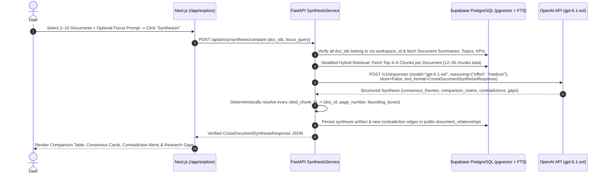

# 17 — Insight Discovery, Cross-Document Analysis & Secondary Studio Tools

> **Document ID:** `DOC-17`  
> **Status:** `[PROPOSED]` Cross-Document Analysis & Insight Specification (Master Task Sections 3.3 & 4.8)  
> **Related Documents:** [13-AI-ASSISTANT.md](file:///c:/Users/arief/Downloads/WAICY/docs/documind-blueprint/13-AI-ASSISTANT.md), [16-DOCUMENT-RELATIONSHIPS.md](file:///c:/Users/arief/Downloads/WAICY/docs/documind-blueprint/16-DOCUMENT-RELATIONSHIPS.md), [18-OPENAI-AND-MODEL-STRATEGY.md](file:///c:/Users/arief/Downloads/WAICY/docs/documind-blueprint/18-OPENAI-AND-MODEL-STRATEGY.md), [26-ARCHITECTURE-DECISIONS.md](file:///c:/Users/arief/Downloads/WAICY/docs/documind-blueprint/26-ARCHITECTURE-DECISIONS.md)

---

## 1. Purpose & Scope

Master Task Section 4.8 requires DocuMind to generate meaningful, evidence-backed findings across:
1. **Document-Level Insights** (automatically extracted per file at ingestion).
2. **Repository-Level & Cross-Document Comparative Synthesis** (comparing 2–10 documents side-by-side to uncover consensus themes, methodological/operational differences, trends, missing information/research gaps, and direct contradictions).
3. **Secondary Studio Extensions (`P2`, `PR-047`, `ADR-015`):** Adaptive Quiz Generation and Dual-Host Audio Briefings scoped cleanly inside the Document Studio.

> **Mandatory Evidence Rule:** Every single insight, comparison cell, contradiction alert, and quiz question **must** carry at least one verified `source_chunk_id` resolved deterministically to `(doc_id, doc_title, page_number, bounding_boxes)`.

---

## 2. Fixing the Broken Prototype Synthesis (`synthesis.py`)

### 2.1 `[OBSERVED]` What Was Broken in `apps/api/app/routers/synthesis.py`
In the current repository (`apps/api/app/routers/synthesis.py:43`), the endpoint `POST /api/synthesis/connect` constructs its prompt using **only the document IDs/filenames**:
```python
docs_context = f"Dokumen 1 ({request.doc_ids[0]})\nDokumen 2 ({request.doc_ids[1]})"
```
It never fetches a single paragraph, summary, or chunk from the documents! And because `gemini-3.8-flash` does not exist, it catches the exception and returns a hardcoded Indonesian string about R-134a refrigeration cycles.

### 2.2 Target Cross-Document Synthesis Pipeline (`PR-032`)



---

## 3. Structured Output Contract: `CrossDocumentSynthesisResponse` (`gpt-6.1-sol`)

Cross-document synthesis is routed to **`gpt-6.1-sol`** (`reasoning={"effort": "medium"}`) because comparing claims across multiple complex PDFs requires genuine multi-hop reasoning to distinguish true contradictions from differences in experimental conditions or fiscal periods:

```python
from pydantic import BaseModel, Field
from typing import Literal

class CitedClaimPointer(BaseModel):
    doc_id: str
    chunk_id: str = Field(description="Exact chunk_id from <untrusted_document_chunk>")
    verbatim_evidence: str = Field(description="Brief verbatim quote or metric from the chunk")

class SynthesisThemeItem(BaseModel):
    theme_title: str
    synthesis_explanation: str = Field(description="Detailed synthesis across documents with inline [cite:CHUNK_ID] markers")
    supporting_citations: list[CitedClaimPointer]

class ComparisonDimensionRow(BaseModel):
    dimension_name: str = Field(description="e.g., 'Methodology / Architecture', 'Sample Size / Dataset', 'Key Quantitative Outcome', 'Limitations'")
    per_document_cells: dict[str, str] = Field(description="Map of doc_id -> concise summary for this dimension with [cite:CHUNK_ID]")

class ContradictionAlertItem(BaseModel):
    topic_or_metric: str
    contradiction_type: Literal["numerical_discrepancy", "methodological_conflict", "opposing_conclusion", "policy_clause_conflict"]
    severity: Literal["high", "medium", "low"]
    claim_a: CitedClaimPointer
    claim_b: CitedClaimPointer
    nuance_or_explanation: str = Field(
        description="Explain why the claims conflict, or whether the difference is explained by different timeframes/assumptions."
    )

class MissingInformationGapItem(BaseModel):
    gap_title: str
    description: str = Field(description="What important question, period, or control variable is missing across the selected documents")
    recommended_next_step: str

class CrossDocumentSynthesisResponse(BaseModel):
    synthesis_title: str
    executive_synthesis: str
    consensus_findings: list[SynthesisThemeItem] = Field(description="2 to 5 findings supported by multiple documents")
    comparison_matrix: list[ComparisonDimensionRow] = Field(description="3 to 6 structured comparison rows across the selected documents")
    contradictions: list[ContradictionAlertItem] = Field(description="Verified contradictions between documents; empty list if none exist")
    missing_information_and_gaps: list[MissingInformationGapItem] = Field(description="2 to 4 research or operational gaps identified")
```

---

## 4. Three Levels of Insight Discovery in DocuMind

| Insight Level | When It Runs | Model Used | What It Produces & Where It Appears |
|---|---|---|---|
| **1. Document-Level Insights** | Automatically once at upload (`DOC-10` Stage 11). | `gpt-6-luna` (`flex` tier, \$0.0005/doc) | `executive_summary`, `key_findings[]` (3–6 headline findings with `source_chunk_id`), `extracted_kpis[]`, and `entities[]`. Displayed in Repository Preview Drawer and Document Studio `Overview` tab. |
| **2. Repository-Level Proactive Insights** | Automatically updated in SQL + lightweight `gpt-6-luna` digest when new documents share topics/metrics (`DOC-10` Stage 13–14). | PostgreSQL SQL + `gpt-6-luna` | Surfaces **Repeated Themes**, **Multi-Period Metric Trends**, and **Metric Discrepancy Alerts** (when two documents state different numbers for the same KPI/period). Displayed on the **Personalized Dashboard (`/app/dashboard`)**. |
| **3. On-Demand Multi-Document Synthesis** | Triggered by user selecting 2–10 documents in `/app/repository` or `/app/explore`. | `gpt-6.1-sol` (`reasoning="medium"`) | Full `CrossDocumentSynthesisResponse` (Consensus, Comparison Matrix, Contradictions, Gaps). Can be pinned to `/app/dashboard`. |

---

## 5. Specification of Secondary Studio Extensions (`P2`, `PR-047`, `ADR-015`)

As established in `04-PRODUCT-SCOPE-AND-PRIORITIES.md`, **Adaptive Quiz Generation** and **Audio Briefings** are preserved from the prototype as modular **P2 Studio Tabs** inside `/app/documents/[docId]`:

### 5.1 Adaptive Study Quiz (`POST /api/chat/quiz`)
- **Model:** `gpt-6.1-terra` (`reasoning={"effort": "low"}`).
- **Hallucination-Free Coordinate Fix (`ADR-009`):**
  - Instead of asking the LLM to output `BoundingBox` floats, the LLM receives the document's top key-finding chunks (with their `chunk_id`s) and outputs `QuizItemLLM`:
    ```python
    class QuizItemLLM(BaseModel):
        question: str
        options: list[str] = Field(min_length=4, max_length=4)
        correct_answer_index: int = Field(ge=0, le=3)
        explanation: str
        source_chunk_id: str = Field(description="Exact chunk_id containing the proof for the correct answer")
        proof_quote: str
    ```
  - The Python backend looks up `source_chunk_id` in the chunk map and attaches the real PyMuPDF `source_page` and `source_bbox` (`bounding_boxes`) before returning `QuizResponse` to the frontend. Clicking `"Locate Proof in PDF"` highlights the exact paragraph 100% of the time.

### 5.2 Dual-Host Audio Briefing (`POST /api/audio/briefing-script`)
- **Model:** `gpt-6-luna` (`reasoning={"effort": "none"}`, cost **~\$0.0007 per script**).
- **Input Context:** Uses the document's pre-computed `executive_summary`, `key_findings`, and top 6 chunks (`~2,500 tokens`).
- **Output Schema:** `PodcastScript` (`title`, `lines: list[PodcastLine]` alternating between `Host (Budi)` and `Expert (Susi)` with `source_chunk_id` per turn so the UI highlights the active transcript turn and lets the listener click to jump to the discussed PDF page!).
- **Playback Strategy:** Default playback uses the browser's native zero-cost `window.speechSynthesis` API (selecting distinct Indonesian/English voices for Host and Expert). An optional quota-gated endpoint (`POST /api/audio/render-mp3`) using `gpt-realtime-2.1-mini` can be enabled in Stage 6 if downloadable MP3 files are desired (`OQ-006`).
