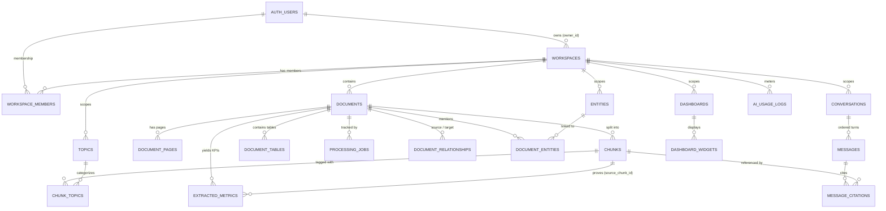

# 20 — Conceptual & Physical Data Model, ERD & Lifecycle

> **Document ID:** `DOC-20`  
> **Status:** **`DECIDED`** — Final 19-Entity Target Schema (`ADR-002`, `ADR-003`, `ADR-006`, `ADR-011`, `ADR-013`, `ADR-017`)  
> **Related Documents:** [30-FINAL-SELECTED-ARCHITECTURE-AND-DECISIONS.md](file:///c:/Users/arief/Downloads/WAICY/docs/documind-blueprint/30-FINAL-SELECTED-ARCHITECTURE-AND-DECISIONS.md), [08-MULTI-TENANCY-AND-DATA-ISOLATION.md](file:///c:/Users/arief/Downloads/WAICY/docs/documind-blueprint/08-MULTI-TENANCY-AND-DATA-ISOLATION.md), [10-DOCUMENT-INGESTION-PIPELINE.md](file:///c:/Users/arief/Downloads/WAICY/docs/documind-blueprint/10-DOCUMENT-INGESTION-PIPELINE.md), [15-DASHBOARD-GENERATION-ENGINE.md](file:///c:/Users/arief/Downloads/WAICY/docs/documind-blueprint/15-DASHBOARD-GENERATION-ENGINE.md), [16-DOCUMENT-RELATIONSHIPS.md](file:///c:/Users/arief/Downloads/WAICY/docs/documind-blueprint/16-DOCUMENT-RELATIONSHIPS.md), [21-API-AND-SYSTEM-CONTRACTS.md](file:///c:/Users/arief/Downloads/WAICY/docs/documind-blueprint/21-API-AND-SYSTEM-CONTRACTS.md)

---

## 1. Purpose & Evolution from Existing Schema

In [supabase/migrations/20261113000001_initial_schema.sql](file:///c:/Users/arief/Downloads/WAICY/supabase/migrations/20261113000001_initial_schema.sql) (`[VERIFIED]`), only 6 tables were defined (`workspaces`, `documents`, `chunks`, `topics`, `chunk_topics`, `dashboard_widgets`), and they lacked user ownership columns (`owner_id`/`user_id`), page-level tracking, structured table/KPI storage, explicit relationships, conversation persistence, and background job tracking.

This document specifies the complete **19-Entity Conceptual & Physical Data Model** in Supabase PostgreSQL (`pgvector`) that powers Pillar A, Pillar B, and Pillar C while preserving 100% backward compatibility with the existing 6 tables.

---

## 2. Master Entity-Relationship Diagram (Mermaid ERD)

---

## 3. Comprehensive Entity Catalog (All 19 Entities)

For every entity required in Master Task Section 9, the table below specifies its **Purpose**, **Key Attributes & Types**, **Relationships**, **Ownership & RLS Permission Rule**, and **Lifecycle & Retention Policy**:

| # | Entity / Table Name | Purpose | Key Attributes & Types | Relationships & Foreign Keys | Ownership & RLS Permission Rule | Lifecycle & Retention |
|---|---|---|---|---|---|---|
| **1** | **`auth.users`** *(Supabase Managed)* | Canonical user identity record. | `id uuid PK`, `email text`, `raw_user_meta_data jsonb`, `email_confirmed_at timestamptz`, `created_at` | 1:N with `workspaces`, `workspace_members` | Managed by Supabase Auth; self-readable via JWT. | Created on registration; hard-deleted on `DELETE /api/auth/account` (`PR-004`). |
| **2** | **`public.workspaces`** | Tenant isolation boundary (Personal Workspace by default; supports shared Org workspaces in `P3`). | `id uuid PK`, `owner_id uuid FK(auth.users)`, `name text`, `is_personal bool default true`, `settings jsonb`, `created_at` | Owned by `auth.users`; parent of all tenant tables. | `is_workspace_member(id)` for `SELECT`; `owner_id = auth.uid()` for `UPDATE`/`DELETE`. | Auto-created on user signup (`PR-006`); cascade-deleted on account deletion. |
| **3** | **`public.workspace_members`** | Associates users with workspaces and roles (`owner`, `editor`, `viewer`). | `workspace_id uuid FK`, `user_id uuid FK`, `role text CHECK (owner\|editor\|viewer)`, `joined_at`, `PK(workspace_id, user_id)` | Joins `workspaces` $\leftrightarrow$ `auth.users`. | Member can read own rows; workspace `owner` can manage members. | Created alongside workspace; removed if member leaves or workspace is deleted. |
| **4** | **`public.documents`** | Master record for every uploaded file in Pillar A (`Repository`). | `id uuid PK`, `workspace_id uuid FK`, `uploaded_by uuid FK(auth.users)`, `title text`, `original_filename text`, `storage_path text`, `file_sha256 text`, `mime_type text`, `file_size_bytes bigint`, `page_count int`, `status text`, `category text`, `primary_domain text`, `language_code text`, `summary text`, `key_findings jsonb`, `user_tags text[]`, `centroid_embedding vector(1536)`, `metadata jsonb`, `created_at`, `processed_at` | Belongs to `workspaces`; 1:N with `document_pages`, `chunks`, `document_tables`, `extracted_metrics`, `processing_jobs`. Unique index on `(workspace_id, file_sha256)`. | `is_workspace_member(workspace_id)` + mandatory backend `.eq("workspace_id", ctx.workspace_id)`. | Created on upload (`PR-012`); updated through 15-stage pipeline; hard-deleted on `DELETE /api/documents/{id}` (`PR-018`). |
| **5** | **`public.document_pages`** | Per-page geometry, word density, and OCR status tracking. | `id uuid PK`, `workspace_id uuid FK`, `doc_id uuid FK ON DELETE CASCADE`, `page_number int`, `width_pt float`, `height_pt float`, `digital_word_count int`, `needs_ocr bool`, `ocr_status text (not_needed\|completed\|failed)`, `UNIQUE(doc_id, page_number)` | Belongs to `documents`. | Scoped via `workspace_id`. | Populated in Stage 3 (`DOC-10`); deleted via cascade when parent document is deleted. |
| **6** | **`public.chunks`** | Coordinate-preserving text passages + 1,536-d embeddings (`text-embedding-3-large` truncated to `1536d`) for Hybrid RRF Search. | `id uuid PK`, `workspace_id uuid FK`, `doc_id uuid FK ON DELETE CASCADE`, `page_number int`, `chunk_index int`, `text_content text`, `token_count int`, `has_table bool default false`, `bounding_boxes jsonb not null`, `embedding vector(1536)`, `embedding_model text not null default 'openai:text-embedding-3-large:1536'`, `created_at` | Belongs to `documents`. Indexed by HNSW (`embedding vector_cosine_ops`) and GIN (`to_tsvector('simple', text_content)`). | Scoped via `workspace_id` (`PR-009`). | Populated in Stages 8–10; replaced atomically on reprocess; cascade-deleted with `documents`. |
| **7** | **`public.document_tables`** | Structured tables extracted from PDFs or uploaded `.csv`/`.xlsx` files for DuckDB analytics. | `id uuid PK`, `workspace_id uuid FK`, `doc_id uuid FK ON DELETE CASCADE`, `table_name text`, `table_title text`, `page_number int`, `bbox jsonb`, `columns_schema jsonb not null`, `rows_data jsonb not null`, `row_count int`, `extraction_method text (pymupdf\|vision_terra\|spreadsheet)`, `created_at` | Belongs to `documents`. | Scoped via `workspace_id` (`PR-010`). | Populated in Stage 7 (`PR-024`); hydrated into ephemeral DuckDB during dashboard queries; cascade-deleted with `documents`. |
| **8** | **`public.extracted_metrics`** | Verified standalone KPI numbers and units extracted during ingestion. | `id uuid PK`, `workspace_id uuid FK`, `doc_id uuid FK ON DELETE CASCADE`, `source_chunk_id uuid FK(chunks) ON DELETE CASCADE`, `metric_name text`, `canonical_metric_key text`, `numeric_value double precision not null`, `unit_or_currency text not null`, `period_label text`, `verbatim_quote text`, `created_at` | Belongs to `documents` and `chunks`. | Scoped via `workspace_id`. | Populated & regex-verified in Stages 11–12 (`PR-023`, `PR-036`); cascade-deleted with `documents`. |
| **9** | **`public.topics`** | Normalized thematic concepts discovered across the workspace. | `id uuid PK`, `workspace_id uuid FK ON DELETE CASCADE`, `name text not null`, `slug text not null`, `description text`, `doc_count int default 1`, `UNIQUE(workspace_id, slug)` | Belongs to `workspaces`; M:N with `chunks` via `chunk_topics`. | Scoped via `workspace_id`. | Upserted in Stage 11; orphaned topics (`doc_count = 0`) cleaned up on document delete. |
| **10** | **`public.chunk_topics`** | Join table linking chunks (and their parent documents) to topics. | `workspace_id uuid FK`, `chunk_id uuid FK ON DELETE CASCADE`, `doc_id uuid FK ON DELETE CASCADE`, `topic_id uuid FK ON DELETE CASCADE`, `relevance_score float default 1.0`, `PK(chunk_id, topic_id)` | Joins `chunks`/`documents` $\leftrightarrow$ `topics`. | Scoped via `workspace_id`. | Created in Stage 11; cascade-deleted with `chunks` or `topics`. |
| **11** | **`public.entities`** | Named entities (`organization`, `person`, `technology`, `location`, `regulation`) across the workspace. | `id uuid PK`, `workspace_id uuid FK ON DELETE CASCADE`, `name text`, `canonical_name text`, `entity_type text`, `UNIQUE(workspace_id, canonical_name, entity_type)` | Belongs to `workspaces`; M:N with `documents` via `document_entities`. | Scoped via `workspace_id`. | Upserted in Stage 11; used by Relationship Engine (`DOC-16`). |
| **12** | **`public.document_entities`** | Join table recording which documents and chunks mention an entity. | `workspace_id uuid FK`, `doc_id uuid FK ON DELETE CASCADE`, `entity_id uuid FK ON DELETE CASCADE`, `representative_chunk_id uuid FK(chunks) ON DELETE SET NULL`, `mention_count int default 1`, `PK(doc_id, entity_id)` | Joins `documents` $\leftrightarrow$ `entities`. | Scoped via `workspace_id`. | Created in Stage 11; cascade-deleted with `documents`. |
| **13** | **`public.document_relationships`** | Materialized edges connecting related or conflicting documents in Pillar C. | `id uuid PK`, `workspace_id uuid FK`, `source_doc_id uuid FK(documents) ON DELETE CASCADE`, `target_doc_id uuid FK(documents) ON DELETE CASCADE`, `relationship_type text`, `composite_confidence float`, `explanation text`, `evidence_summary jsonb`, `created_at`, `UNIQUE(workspace_id, source_doc_id, target_doc_id, relationship_type)` | Connects two `documents` in the same workspace. | Scoped via `workspace_id` (`PR-031`). | Computed in Stage 13 and enriched during Cross-Doc Synthesis (`DOC-16`, `DOC-17`); cascade-deleted if either document is deleted. |
| **14** | **`public.conversations`** | Multi-turn AI Assistant chat threads (scoped to 1 doc, $M$ docs, or whole repo). | `id uuid PK`, `workspace_id uuid FK`, `user_id uuid FK(auth.users)`, `title text`, `scope_mode text (single_doc\|multi_doc\|repository)`, `scoped_doc_ids uuid[]`, `compacted_summary text`, `created_at`, `updated_at` | Belongs to `workspaces` and `auth.users`; 1:N with `messages`. | Scoped via `workspace_id` and `user_id` (`PR-030`). | Created on first chat message; deleted by user or workspace cascade. |
| **15** | **`public.messages`** | Individual user and assistant turns within a conversation. | `id uuid PK`, `workspace_id uuid FK`, `conversation_id uuid FK ON DELETE CASCADE`, `role text (user\|assistant)`, `content text`, `model_used text`, `suggested_followups jsonb`, `created_at` | Belongs to `conversations`; 1:N with `message_citations`. | Scoped via `workspace_id`. | Appended per turn; immutable once completed; cascade-deleted with `conversations`. |
| **16** | **`public.message_citations`** | Verified coordinate citations attached to an assistant message. | `id uuid PK`, `workspace_id uuid FK`, `message_id uuid FK ON DELETE CASCADE`, `citation_index int`, `doc_id uuid FK(documents) ON DELETE CASCADE`, `chunk_id uuid FK(chunks) ON DELETE CASCADE`, `page_number int`, `bounding_boxes jsonb`, `verbatim_snippet text` | Links `messages` $\rightarrow$ `chunks`/`documents`. | Scoped via `workspace_id` (`PR-028`). | Inserted upon SSE stream completion; cascade-deleted if message or source document is deleted. |
| **17** | **`public.dashboards`** | Container for a user's Personalized Dashboard configuration in Pillar B. | `id uuid PK`, `workspace_id uuid FK ON DELETE CASCADE`, `user_id uuid FK(auth.users)`, `detected_corpus_profile text`, `layout_preferences jsonb`, `last_refreshed_at timestamptz`, `UNIQUE(workspace_id, user_id)` | Belongs to `workspaces` and `auth.users`; 1:N with `dashboard_widgets`. | Scoped via `workspace_id` and `user_id` (`PR-033`). | Provisioned on signup; updated automatically as corpus evolves. |
| **18** | **`public.dashboard_widgets`** | Individual KPI, ECharts, or Finding widgets on the Personalized Dashboard. | `id uuid PK`, `workspace_id uuid FK`, `dashboard_id uuid FK ON DELETE CASCADE`, `title text`, `subtitle text`, `widget_type text`, `is_auto_generated bool`, `is_pinned bool`, `status text (active\|stale_source_deleted\|needs_refresh)`, `display_order int`, `grid_span int default 6`, `sql_query text`, `unit_or_currency text`, `echarts_config jsonb`, `kpi_payload jsonb`, `narrative_insight text`, `source_doc_ids uuid[]`, `source_table_ids uuid[]`, `source_chunk_ids uuid[]`, `created_at`, `updated_at` | Belongs to `dashboards`. | Scoped via `workspace_id` (`PR-037`, `PR-039`). | Auto-seeded in Stage 14 or created/pinned by user; flagged `stale_source_deleted` if sole source doc is deleted. |
| **19** | **`public.processing_jobs` & `public.ai_usage_logs`** | Operational tables for checkpointed `arq` ingestion jobs and `AIGateway` token/cost telemetry. | • `processing_jobs`: `id uuid PK`, `workspace_id uuid FK`, `doc_id uuid FK ON DELETE CASCADE`, `current_stage text`, `progress_pct int`, `attempt_count int`, `last_error_code text`, `last_error_message text`, `checkpoint_state jsonb`, `started_at`, `completed_at` • `ai_usage_logs`: `id uuid PK`, `workspace_id uuid FK`, `user_id uuid`, `task_type text`, `provider text not null default 'openai'`, `model text`, `service_tier text`, `input_tokens int`, `cached_tokens int`, `output_tokens int`, `reasoning_tokens int`, `estimated_cost_usd numeric(10,6)`, `latency_ms int`, `created_at` | Scoped to `workspaces` (`processing_jobs` also links to `documents`). | Scoped via `workspace_id` (`PR-043`, `PR-046`). | `processing_jobs` tracks active/historical ingestion; `ai_usage_logs` retained for billing/cost governance. |
