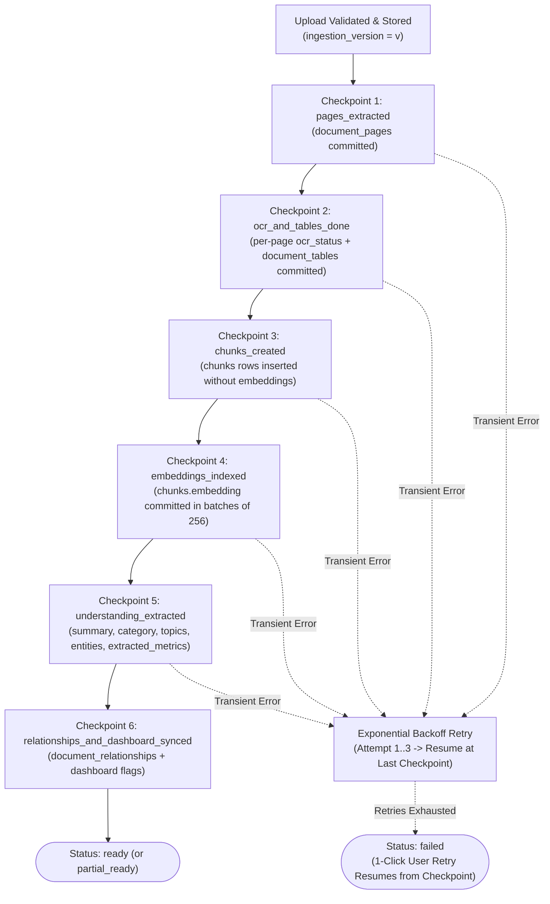

# 24 — Failure Recovery, Idempotency & System Resilience

> **Document ID:** `DOC-24`  
> **Status:** **`DECIDED`** — Final Resilience & Fault-Tolerance Specification (`ADR-014`, `ADR-017`)  
> **Related Documents:** [30-FINAL-SELECTED-ARCHITECTURE-AND-DECISIONS.md](file:///c:/Users/arief/Downloads/WAICY/docs/documind-blueprint/30-FINAL-SELECTED-ARCHITECTURE-AND-DECISIONS.md), [10-DOCUMENT-INGESTION-PIPELINE.md](file:///c:/Users/arief/Downloads/WAICY/docs/documind-blueprint/10-DOCUMENT-INGESTION-PIPELINE.md), [18-OPENAI-AND-MODEL-STRATEGY.md](file:///c:/Users/arief/Downloads/WAICY/docs/documind-blueprint/18-OPENAI-AND-MODEL-STRATEGY.md), [23-UI-STATES-AND-EDGE-CASES.md](file:///c:/Users/arief/Downloads/WAICY/docs/documind-blueprint/23-UI-STATES-AND-EDGE-CASES.md)

---

## 1. Purpose & Resilience Principles

Document processing pipelines that combine binary file parsing, Vision OCR, batch vector embeddings, and structured LLM extraction are inherently vulnerable to transient network timeouts, rate limits (`429`), and worker restarts.

DocuMind's resilience architecture (`PR-046`, `ADR-014`, `ADR-017`) enforces **four engineering guarantees**:
1. **Durable Worker Queue (`arq` + `documind-redis`) + Stage-Level Checkpointing (Never Re-Pay for Completed AI Stages):** Background jobs are queued in Railway Redis (`arq`) and checkpointed in `public.processing_jobs`. If a 40-page scanned PDF succeeds at Vision OCR (`Stage 6`) and fails during `Stage 11` (`gpt-6.1-terra` summary/KPI extraction), retrying the job resumes directly at `Stage 11` without re-running or re-billing Vision OCR or `text-embedding-3-large` embeddings.
2. **Idempotent Stage Commits:** Every pipeline stage can be safely re-executed multiple times for the same `(doc_id, ingestion_version)` without creating duplicate chunks, duplicate topics, or duplicate metrics.
3. **Graceful Degradation (`partial_ready` & FTS Fallback):** A single unreadable page or an OpenAI embeddings hiccup never takes down the entire document or search experience.
4. **Optimistic Version Fencing (`ingestion_version`):** Prevents stale background workers from overwriting newly replaced or deleted documents.

---

## 2. Checkpointed Ingestion State Machine (`public.processing_jobs`)



### Idempotency Contract per Checkpoint
- **Checkpoint 1 (`pages_extracted`):** `INSERT INTO public.document_pages ... ON CONFLICT (doc_id, page_number) DO UPDATE`.
- **Checkpoint 2 (`ocr_and_tables_done`):** Stage 6 only queries `SELECT page_number FROM document_pages WHERE doc_id = X AND needs_ocr = true AND ocr_status != 'completed'`. Already-OCR'd pages are skipped on retry!
- **Checkpoint 3 (`chunks_created`):** Wrapped in a single transaction: `DELETE FROM public.chunks WHERE doc_id = X` followed by bulk `INSERT`, setting `checkpoint_state.chunks_created = true`.
- **Checkpoint 4 (`embeddings_indexed`):** Only fetches chunks where `embedding IS NULL`, embeds in batches of `256`, and updates `chunks.embedding` per batch. If batch 3 of 4 fails, batches 1 and 2 are already saved in PostgreSQL!
- **Checkpoint 5 (`understanding_extracted`):** Updates `public.documents` metadata and replaces `extracted_metrics` (`DELETE FROM extracted_metrics WHERE doc_id = X` + `INSERT`).

---

## 3. `AIGateway` Retry, Backoff & Model Failover Chains (`ADR-008`, `ADR-017`)

All calls inside `AIGateway` (`apps/api/app/ai/gateway.py`) implement structured retry and failover logic:

| Failure Condition | Immediate Retry Policy | Secondary Model / Tier Failover | Final Graceful Degradation |
|---|---|---|---|
| **`429 Resource Unavailable` on `service_tier="flex"`** | Wait `1.0s`, retry once on `flex`. | Immediately switch request to **`service_tier="auto"`** (Standard Tier) using the same model (`gpt-6.1-terra` or `gpt-6-luna`). | Guarantees background jobs finish on time even during OpenAI `flex` capacity saturation. |
| **`429 Rate Limit Exceeded` on Standard Tier (`auto`)** | Honor `Retry-After` / `x-ratelimit-reset-tokens` header with jittered exponential backoff (`1s`, `2.5s`, `6s`). | • If `gpt-6.1-terra` is rate-limited in Standard Chat $\rightarrow$ fail over to **`gpt-6-luna`**.<br/>• If `gpt-6.1-sol` is rate-limited in Dashboard SQL or Synthesis $\rightarrow$ fail over to **`gpt-6.1-terra`** (`reasoning="high"`). | Return structured `ERR_AI_RATE_LIMITED` (`retryable: true`) preserving user prompt in UI. |
| **`500 / 502 / 503 / 504` OpenAI Server Error or Timeout** | Retry up to 2 times with `1.5s` and `4.0s` backoff (`timeout=25s` for interactive chat, `60s` for synthesis/OCR). | Fail over along model chain (`terra` $\leftrightarrow$ `luna`, `sol` $\rightarrow$ `terra`) or configured secondary provider adapter. | For Stage 11 ingestion, populate heuristic Page-1 summary and mark document `partial_ready` (`EC-013`). |
| **`POST /v1/embeddings` Outage during Search** | Retry once after `800ms` (`timeout=3.0s`). | Bypass vector branch in `match_document_chunks_hybrid` (pass zero-vector with `min_vector_similarity = 2.0`) so **PostgreSQL GIN Full-Text Search (`tsvector`)** still returns exact keyword matches! | Search & RAG continue functioning in lexical fallback mode with a subtle UI note. |

---

## 4. Concurrency Control, Version Fencing & Startup Recovery

### 4.1 Optimistic Version Fencing (`ingestion_version`)
To prevent race conditions when a user deletes (`EC-016`) or replaces (`EC-017`) a document while a background worker is mid-flight:
1. `public.documents` includes `ingestion_version int not null default 1`.
2. When a worker starts processing `(doc_id, expected_version)`, every stage commit checks:
   ```sql
   UPDATE public.documents
   SET status = $1
   WHERE id = $2 AND ingestion_version = $3
   RETURNING id;
   ```
3. If `0` rows are returned (because the document was deleted or `ingestion_version` was incremented to `v+1`), the worker immediately raises `StaleJobAborted`, cancels any remaining OpenAI sub-tasks, and exits cleanly.

### 4.2 Orphaned Job Recovery on `documind-worker` (`arq`) Startup (`EC-018`)
When the `documind-worker` (`arq`) or `documind-api` process starts:
1. Queries `public.processing_jobs` where `status = 'running'` and `updated_at < now() - interval '3 minutes'`.
2. Resets those jobs to `status = 'queued'` (preserving their `current_stage` and `checkpoint_state`) and re-enqueues them into the `arq` Redis queue so interrupted uploads self-heal automatically after any container restart or Railway deployment.
