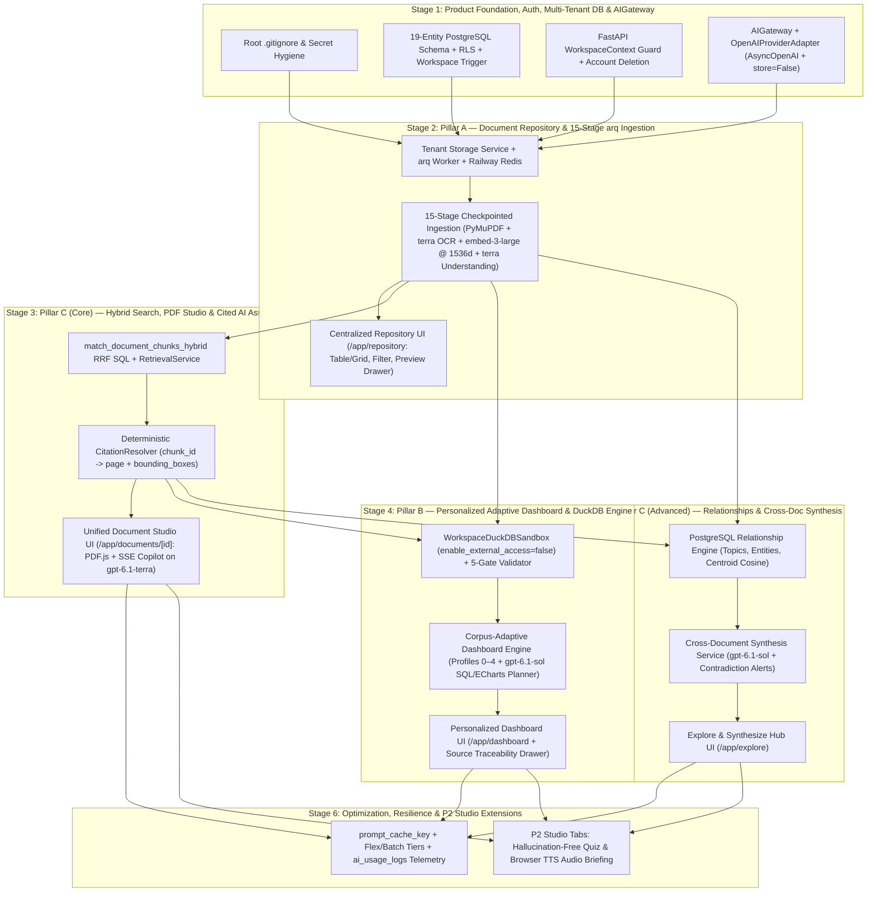

# 27 — 6-Stage Implementation Roadmap & Dependency Map (Planning Only)

> **Document ID:** `DOC-27`  
> **Status:** **`DECIDED`** — Final Dependency-Ordered Engineering Roadmap (`ADR-001`–`ADR-022`)  
> **Related Documents:** [30-FINAL-SELECTED-ARCHITECTURE-AND-DECISIONS.md](file:///c:/Users/arief/Downloads/WAICY/docs/documind-blueprint/30-FINAL-SELECTED-ARCHITECTURE-AND-DECISIONS.md), [02-PRODUCT-REQUIREMENTS.md](file:///c:/Users/arief/Downloads/WAICY/docs/documind-blueprint/02-PRODUCT-REQUIREMENTS.md), [04-PRODUCT-SCOPE-AND-PRIORITIES.md](file:///c:/Users/arief/Downloads/WAICY/docs/documind-blueprint/04-PRODUCT-SCOPE-AND-PRIORITIES.md), [25-TESTING-AND-ACCEPTANCE-CRITERIA.md](file:///c:/Users/arief/Downloads/WAICY/docs/documind-blueprint/25-TESTING-AND-ACCEPTANCE-CRITERIA.md), [26-ARCHITECTURE-DECISIONS.md](file:///c:/Users/arief/Downloads/WAICY/docs/documind-blueprint/26-ARCHITECTURE-DECISIONS.md), [29-AGENT-CONTEXT-AND-WORKING-PROTOCOL.md](file:///c:/Users/arief/Downloads/WAICY/docs/documind-blueprint/29-AGENT-CONTEXT-AND-WORKING-PROTOCOL.md)

---

## 1. Purpose & Execution Sequence Rationale

This document defines the **6-Stage Implementation Roadmap** for building DocuMind from its current prototype state into the complete Three-Pillar Document Intelligence Workspace.

### Why This Exact Sequence Is Required
The order of stages is dictated by strict technical dependencies discovered in the repository:
1. **Identity, RLS, and the 19-Entity Schema (`Stage 1`)** must exist before any document can be persisted safely (`Stage 2`).
2. **The Centralized Repository & 15-Stage Ingestion Pipeline (`Stage 2`)** must populate `chunks`, `bounding_boxes`, `embeddings`, `document_tables`, `extracted_metrics`, and `topics` before either Hybrid Search/RAG (`Stage 3`) or the Personalized Dashboard (`Stage 4`) has real data to query.
3. **Hybrid Search, PDF Studio & Cited AI Assistant (`Stage 3`)** establishes the `CitationResolver` and PDF.js coordinate viewer, which **Personalized Dashboard Traceability (`Stage 4`)** and **Cross-Document Synthesis (`Stage 5`)** both depend on to verify sources.
4. **Caching, Flex/Batch Optimization & P2 Studio Extensions (`Stage 6`)** polish unit economics and secondary study tools once all P0/P1 pillars are verified.

---

## 2. System Component Dependency Graph

---

## 3. Detailed Stage-by-Stage Engineering Specifications

### Stage 1 — Product Foundation, Identity, Multi-Tenant Isolation & `AIGateway` Core
- **Objectives:** Close all critical security vulnerabilities (`TM-01`, `TM-04`, `TM-06`), establish the 19-entity PostgreSQL schema with Dual-Layer Tenant Isolation (`ADR-003`), wire account deletion, and create the provider-flexible `AIGateway` (`ADR-017`) with `OpenAIProviderAdapter`.
- **Requirements Covered:** `PR-001`–`PR-007`, `PR-041`, `PR-044`, `PR-045`.
- **Required Components to Build:**
  1. Root `.gitignore` protecting `.env` and `.env.local`.
  2. Supabase migration `20261115000002_documind_complete_schema.sql` creating all 19 tables (`DOC-20`), `is_workspace_member()` RLS policies, `on_auth_user_created` Personal Workspace provisioning trigger, and `match_document_chunks_hybrid` RRF function.
  3. `apps/api/app/core/workspace.py`: `get_verified_workspace_context` dependency enforcing JWT + `workspace_members` lookup.
  4. `apps/api/app/ai/` (`contracts.py`, `registry.py`, `gateway.py`, `providers/openai_adapter.py`): `AIGateway` + `OpenAIProviderAdapter` (`AsyncOpenAI`, `responses.parse()`, `responses.create(stream=True)`, `embeddings.create()`, `store=False` enforced).
  5. `DELETE /api/auth/account` endpoint for self-service account & workspace cascade deletion (building on the 10 already-implemented Next.js auth routes in `apps/web/app/api/auth/*`).
- **Existing Components to Reuse:** `apps/web/lib/server/supabase-auth.ts`, `security.ts`, `apps/web/app/api/auth/*` (all 10 auth routes including `forgot-password`, `reset-password`, `recovery-session`, `resend-verification`), `apps/web/app/(auth)/*`, `apps/web/app/api/proxy/[...path]/route.ts`, `apps/api/app/core/security.py`.
- **Components to Replace/Remove:** Remove `gemini-3.8-*` model defaults in `apps/api/app/core/config.py`.
- **Dependencies:** None (Entry Stage).
- **Risks:** Forgetting that `SUPABASE_SERVICE_ROLE_KEY` bypasses RLS—mitigated by mandatory `.eq("workspace_id", ctx.workspace_id)` in every repository method (`ADR-003`).
- **Test & Completion Criteria:** `AC-001` through `AC-007` and `AC-044` pass 100%.

---

### Stage 2 — Pillar A: Centralized Document Repository & 15-Stage `arq` Ingestion Pipeline
- **Objectives:** Replace volatile in-memory dicts (`DOCUMENTS_STORE`, `CHUNKS_STORE`) with persistent Supabase Storage and PostgreSQL, build the 15-stage deterministic + OpenAI ingestion pipeline (`DOC-10`) executed via `arq` + Railway Redis (`documind-worker`, `ADR-014`), and build the Centralized Document Repository UI (`/app/repository`, `DOC-09`).
- **Requirements Covered:** `PR-008`, `PR-011`–`PR-024`, `PR-046`.
- **Required Components to Build:**
  1. `apps/api/app/services/storage_service.py`: Tenant-scoped Supabase Storage upload/stream/delete (`workspaces/{ws_id}/documents/{doc_id}/...`).
  2. Refactor `apps/api/app/services/pdf_service.py` + new `ingestion_service.py` + `worker.py` (`arq`): 15-stage checkpointed pipeline (Magic-byte/encryption check, SHA-256 dedup, PyMuPDF block/table extraction, `<20` word scanned-page gate $\rightarrow$ `gpt-6.1-terra` Vision OCR, 300–600 token layout chunking with `bounding_boxes jsonb`, `text-embedding-3-large` [`dimensions=1536`] batch vectors, and `gpt-6.1-terra` single-pass `DocumentUnderstandingPayload`).
  3. Refactor `apps/api/app/routers/documents.py`: Paginated list/search/filter/sort, upload, status polling, preview details, reprocess, and cascade delete.
  4. Build `apps/web/app/(app)/repository/page.tsx` + `DocumentTable`, `DocumentGrid`, `UploadDropzoneTray`, and `QuickPreviewDrawer`.
- **Existing Components to Reuse:** PyMuPDF coordinate normalization math (`x0/w, y0/h, x1/w, y1/h`) in `pdf_service.py`.
- **Components to Replace/Remove:** Delete `DOCUMENTS_STORE` and `CHUNKS_STORE` in `documents.py`.
- **Dependencies:** Stage 1.
- **Risks:** Long scanned PDFs blocking HTTP workers—mitigated by dedicated `documind-worker` (`arq` + Redis) execution with 6 checkpoints in `public.processing_jobs` (`ADR-014`).
- **Test & Completion Criteria:** `AC-008` and `AC-011` through `AC-024` pass 100%.

---

### Stage 3 — Pillar C (Core): Hybrid Search, PDF Studio & Evidence-Grounded AI Assistant
- **Objectives:** Enable sub-second Hybrid RRF search (`pgvector` HNSW + GIN FTS), build the deterministic `CitationResolver`, wire the SSE-streamed AI Assistant (`gpt-6.1-terra` default / `gpt-6.1-sol` deep Q&A via `AIGateway`), and build the Unified Document Studio (`/app/documents/[docId]`).
- **Requirements Covered:** `PR-009`, `PR-025`–`PR-030`.
- **Required Components to Build:**
  1. `apps/api/app/services/retrieval_service.py` & `citation_resolver.py`: Executes `match_document_chunks_hybrid` (using `text-embedding-3-large` query vectors at `1536d`), enforces relevance confidence thresholds (`min_vector_similarity = 0.28`), and maps `[cite:CHUNK_ID]` to verified `BoundingBox` arrays.
  2. Refactor `apps/api/app/routers/chat.py` + new `search.py`: SSE streaming (`POST /api/chat/stream`), conversation persistence (`public.conversations`, `public.messages`, `public.message_citations`), and explicit abstention when evidence is missing (`PR-029`).
  3. Build `apps/web/app/(app)/documents/[docId]/page.tsx`: Resizable split-pane **PDF.js Citation Viewer** (`PdfCitationViewer.tsx` with SVG `0..1000` `viewBox` overlay) + **AI Copilot Pane** (`Overview & Entities`, `AI Chat`, `Data & Charts` tabs).
- **Existing Components to Reuse:** Coordinate highlight concepts from `main.js` ported cleanly into React/TypeScript.
- **Components to Replace/Remove:** Delete `apps/api/app/services/gemini_service.py`, `google-genai` from `requirements.txt`, `doc_chunks[:15]` slicing in `chat.py`, and `context_chunks[:2]` fake citations.
- **Dependencies:** Stages 1 & 2.
- **Test & Completion Criteria:** `AC-009` and `AC-025` through `AC-030` pass 100%.

---

### Stage 4 — Pillar B: Personalized Adaptive Dashboard & Sandboxed DuckDB Engine
- **Objectives:** Replace the fake graphic-design mockup in `apps/web/app/dashboard/page.tsx` and the hardcoded 5-row `demo_data` in `analytics.py` with the Corpus-Adaptive Personalized Dashboard (`DOC-14`) and the 5-Gate Sandboxed DuckDB Engine (`DOC-15`).
- **Requirements Covered:** `PR-010`, `PR-033`–`PR-040`.
- **Required Components to Build:**
  1. Refactor `apps/api/app/services/duckdb_service.py` into `WorkspaceDuckDBSandbox`: Hydrates workspace `document_tables` and `extracted_metrics` into an ephemeral `:memory:` cursor, enforces `SET enable_external_access = false; SET lock_configuration = true;`, and implements the 5-Gate Validation Layer (SQL AST regex guard, execution & 1-step self-repair, cardinality check, unit/currency homogeneity gate, and citation provenance).
  2. Refactor `apps/api/app/routers/analytics.py` + `dashboard.py`: Corpus Profile classifier (`Profiles 0–4`), Tier-1 PostgreSQL telemetry, Tier-2 auto-discovered domain widgets, and Tier-3 natural-language custom widget generation (`gpt-6.1-sol` `DashboardGenerationPlan` via `AIGateway`).
  3. Replace `apps/web/app/dashboard/page.tsx` (and route `/app/dashboard`): Render Corpus Telemetry Strip, Adaptive ECharts & KPI Grid (`echarts-for-react`), Natural-Language Chart Prompt Bar, Honest Insufficient-Data Cards, and the **Source & SQL Traceability Drawer**.
- **Existing Components to Reuse:** `echarts` and `echarts-for-react` already installed in `apps/web/package.json`.
- **Components to Replace/Remove:** Delete `demo_data` in `analytics.py`, `.split()` SQL filter in `duckdb_service.py`, and the `"Layer 01–03"` mockup components in `apps/web/components/dashboard/*`.
- **Dependencies:** Stages 1, 2, & 3.
- **Test & Completion Criteria:** `AC-010` and `AC-033` through `AC-040` pass 100%.

---

### Stage 5 — Pillar C (Advanced): Document Relationships & Cross-Document Synthesis
- **Objectives:** Activate automated document relationship discovery (`DOC-16`) and `gpt-6.1-sol` Cross-Document Comparative Synthesis & Contradiction Detection (`DOC-17`) inside `/app/explore`.
- **Requirements Covered:** `PR-031`, `PR-032`.
- **Required Components to Build:**
  1. PostgreSQL RPC `compute_document_relationships_for_doc()` + `apps/api/app/routers/relationships.py`: Computes `shared_topics`, `shared_entities`, `semantic_similarity` ($\ge 0.78$), `explicit_reference`, and `shared_metric_lineage`.
  2. Refactor `apps/api/app/routers/synthesis.py`: Fetches actual document summaries, topics, and stratified top chunks across 2–10 selected `doc_ids`, invokes `gpt-6.1-sol` (`CrossDocumentSynthesisResponse`), resolves dual citations for contradiction alerts, and saves contradiction edges to `public.document_relationships`.
  3. Build `apps/web/app/(app)/explore/page.tsx`: Unified Repository-Wide Search, Multi-Doc AI Chat, Comparative Synthesis Matrix Table, Contradiction Cards, and Relationship Network Explorer.
- **Components to Replace/Remove:** Delete the broken filename-only prompt (`Dokumen 1 (doc_a)`) and R-134a fallback in `synthesis.py`.
- **Dependencies:** Stages 1–3.
- **Test & Completion Criteria:** `AC-031` and `AC-032` pass 100%.

---

### Stage 6 — Optimization, Cost Telemetry & Secondary P2 Studio Extensions
- **Objectives:** Enforce `prompt_cache_key` static-prefix caching, `service_tier="flex"` background routing, `ai_usage_logs` cost governance (`DOC-19`), and wire the refactored P2 Studio tabs (Adaptive Quiz with `source_chunk_id` lookup and Browser TTS Audio Briefing).
- **Requirements Covered:** `PR-042`, `PR-043`, `PR-047`, `PR-048`.
- **Required Components to Build:**
  1. Prompt cache prefix formatter + `ai_usage_logs` telemetry writer in `openai_service.py` + usage summary view in `/app/settings`.
  2. Refactor `/api/chat/quiz` (`gpt-6.1-terra` outputting `source_chunk_id` resolved to `BoundingBox`) and `/api/audio/briefing-script` (`gpt-6-luna` + Web Speech API player tab in `/app/documents/[docId]`).
- **Dependencies:** Stages 1–5.
- **Test & Completion Criteria:** `AC-041` through `AC-048` pass 100%.

---

## 4. Stage Complexity & Effort Summary

| Stage | Primary Focus | Estimated Complexity | Estimated Engineering Effort |
|---|---|---|---|
| **Stage 1** | Foundation, Auth Guards, 19-Table RLS Schema & `AIGateway` (`apps/api/app/ai/`) | **Low–Medium** | 1.5 – 2 days |
| **Stage 2** | Pillar A: Centralized Repository UI & 15-Stage `arq` + Redis Ingestion Pipeline | **Medium–High** | 3 – 4 days |
| **Stage 3** | Pillar C (Core): Hybrid RRF Search, PDF.js Studio & Cited SSE Assistant (`gpt-6.1-terra`) | **Medium–High** | 3 – 4 days |
| **Stage 4** | Pillar B: Personalized Adaptive Dashboard (`gpt-6.1-sol`) & Sandboxed DuckDB Engine | **High** | 3 – 4 days |
| **Stage 5** | Pillar C (Advanced): Relationship Engine & `gpt-6.1-sol` Synthesis Matrix | **Medium** | 2 – 3 days |
| **Stage 6** | Prompt Caching, Cost Telemetry & P2 Studio Extensions (Quiz/Audio) | **Low–Medium** | 1.5 – 2 days |
| **Total** | **Complete Production Modernization** | | **~14 – 19 engineering days** |
