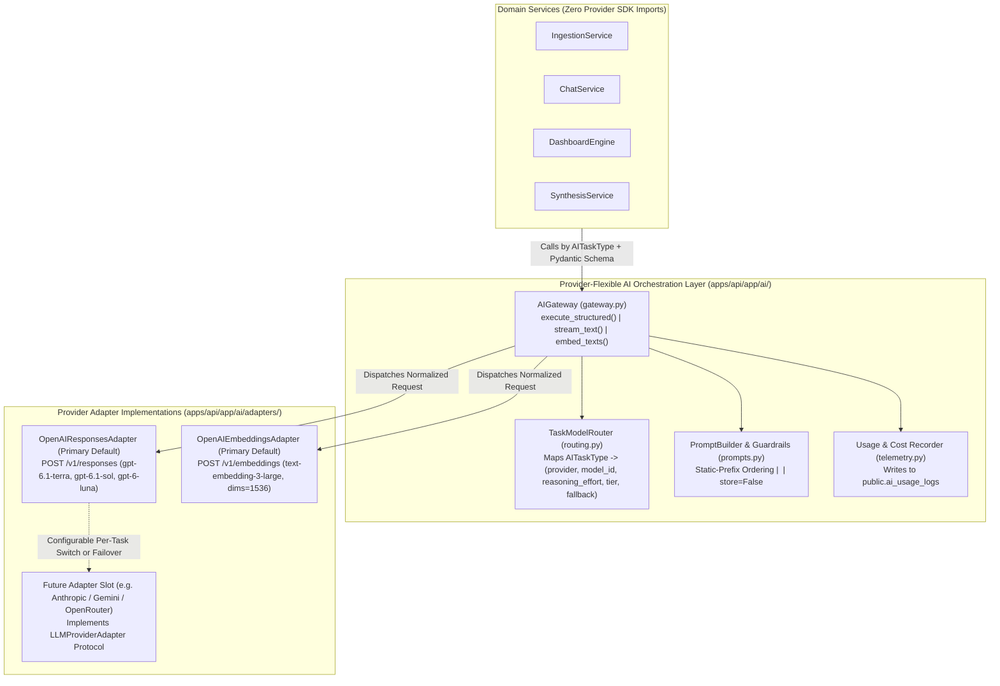
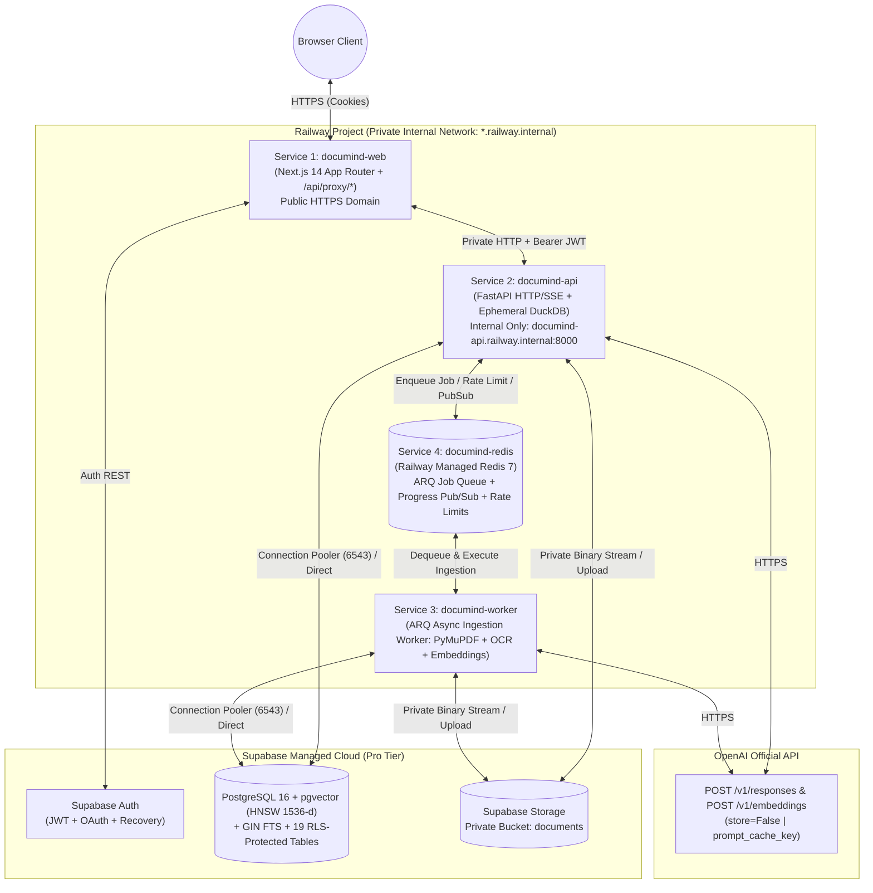

# 30 — Final Selected Architecture & Autonomous Technical Decisions

> **Document ID:** `DOC-30`  
> **Status:** **`DECIDED`** — Authoritative Target Architecture for DocuMind  
> **Decision Authority:** Principal Software & AI Systems Architecture Specification (Autonomous Decision Mode)  
> **Last Updated:** November 15, 2026  
> **Related Documents:** [00-START-HERE.md](file:///c:/Users/arief/Downloads/WAICY/docs/documind-blueprint/00-START-HERE.md), [18-OPENAI-AND-MODEL-STRATEGY.md](file:///c:/Users/arief/Downloads/WAICY/docs/documind-blueprint/18-OPENAI-AND-MODEL-STRATEGY.md), [19-API-COST-AND-PERFORMANCE.md](file:///c:/Users/arief/Downloads/WAICY/docs/documind-blueprint/19-API-COST-AND-PERFORMANCE.md), [26-ARCHITECTURE-DECISIONS.md](file:///c:/Users/arief/Downloads/WAICY/docs/documind-blueprint/26-ARCHITECTURE-DECISIONS.md), [27-IMPLEMENTATION-ROADMAP.md](file:///c:/Users/arief/Downloads/WAICY/docs/documind-blueprint/27-IMPLEMENTATION-ROADMAP.md), [28-OPEN-QUESTIONS-AND-DECISIONS.md](file:///c:/Users/arief/Downloads/WAICY/docs/documind-blueprint/28-OPEN-QUESTIONS-AND-DECISIONS.md)

---

## 1. Executive Declaration of the Selected Architecture

Exploratory comparison is complete. **This document defines the final, selected production architecture for DocuMind.**

Where previous iterations optimized for absolute minimum token cost or left architectural choices open as proposals, this specification makes **definitive engineering decisions (`DECIDED`)** calibrated to your actual operating conditions:
1. **Quality-First Within a Reasonable Budget:** We do not compromise retrieval precision, document understanding, citation accuracy, or SQL planning just to save fractions of a cent. We select higher-capability models (`text-embedding-3-large` at 1,536 dimensions, `gpt-6.1-terra` for ingestion understanding and standard Q&A, and `gpt-6.1-sol` for dashboard SQL planning and cross-document synthesis) where they materially improve output quality.
2. **Managed, Production-Grade Infrastructure (Railway + Supabase):** Instead of fragile in-process FastAPI `BackgroundTasks` or volatile RAM dictionaries, DocuMind deploys as a clean, right-sized service topology on **Railway** (`web`, `api`, `worker`, `redis`) backed by **Supabase** (PostgreSQL 16 + `pgvector` HNSW + GIN FTS + Auth + Private Storage).
3. **OpenAI-First, Provider-Flexible AI Gateway:** OpenAI's official API (`POST /v1/responses` and `POST /v1/embeddings`) is the primary intelligence layer, encapsulated behind a clean, practical **Task-Based AI Gateway & Provider Adapter Layer (`apps/api/app/ai/`)** so models or providers can be swapped per task via configuration without touching business services.

---

## 2. Definitive Decisions Across All 23 Architectural Domains

Every major architectural area of DocuMind is now **`DECIDED`**:

| # | Architectural Area | Final Selected Technology / Architecture (`DECIDED`) | Why This Was Selected Over Alternatives |
|---|---|---|---|
| **1** | **Frontend Framework & Architecture** | **Next.js 14 App Router (`apps/web`, TypeScript, Tailwind CSS, `pdfjs-dist`, `echarts-for-react`)** in a unified 4-View Workspace Shell (`/app/dashboard`, `/app/repository`, `/app/documents/[docId]`, `/app/explore`). Retire root `index.html`. | Consolidates the split frontends (`ADR-001`). Next.js already houses the verified 10-route Supabase Auth & BFF Proxy layer and has ECharts installed. |
| **2** | **Backend Framework & Architecture** | **FastAPI (`apps/api`, Python 3.12+, AsyncIO, Pydantic v2)** structured into strict layers: `routers/` $\rightarrow$ `services/` $\rightarrow$ `repositories/` (tenant-scoped) $\rightarrow$ `ai/` (provider-agnostic gateway) $\rightarrow$ `workers/` (ARQ). | Keeps existing FastAPI investment while replacing prototype in-memory dicts and direct provider calls with clean layered boundaries. |
| **3** | **Database Technology** | **Supabase Managed PostgreSQL 16** with `pgvector` (`0.7+`) and native PostgreSQL Full-Text Search (`tsvector` GIN) + JSONB. | Single ACID database handling relational metadata, 1,536-d HNSW vectors, lexical FTS, extracted tables, and document relationship edges without multi-DB sync debt. |
| **4** | **File & Object Storage** | **Supabase Storage (`documents` private bucket)** with tenant-prefixed keys (`workspaces/{workspace_id}/documents/{doc_id}/{filename}`) streamed via authenticated backend endpoints. | Native integration with Supabase IAM, zero public URL leakage, and atomic cleanup on document/account deletion (`ADR-003`). |
| **5** | **Authentication** | **Supabase Auth + Next.js HTTP-Only Cookie Session (`lib/server/supabase-auth.ts`) + BFF Proxy (`/api/proxy/[...path]`) + FastAPI `require_authenticated_user` JWT Verification.** | Reuses the `[VERIFIED]` 10-route auth system in `apps/web` while closing the unauthenticated router gap in FastAPI (`ADR-002`). |
| **6** | **Multi-User & Tenant Isolation** | **Personal Workspace Default + Organization-Ready `workspace_members` Schema (`ADR-004`)** enforced via **Dual-Layer Isolation (`ADR-003`)**: PostgreSQL RLS + mandatory backend `WorkspaceContext` `.eq("workspace_id", ...)` guards. | Counters the `SUPABASE_SERVICE_ROLE_KEY` `BYPASSRLS` trap (`[VERIFIED]`) and makes future team workspaces a zero-migration upgrade. |
| **7** | **Document Processing** | **15-Stage Checkpointed Hybrid Pipeline (`PyMuPDF` + `openpyxl`/`pandas` + Selective AI)** running in dedicated background workers (`DOC-10`). | Uses deterministic Python for fast, zero-cost coordinate & digital table extraction, reserving AI calls strictly for OCR, embeddings, and semantic extraction. |
| **8** | **OCR & Visual Document Understanding** | **Deterministic Page Gate (`word_count < 20` or `image_area_ratio > 0.35`) $\rightarrow$ `gpt-6.1-terra` Multimodal Vision OCR (`150 DPI` PNG, Structured Output).** | Avoids wasting vision tokens on the ~90% of pages with clean digital fonts while accurately transcribing scanned pages, equations, and embedded charts (`ADR-005`). |
| **9** | **Embeddings** | **OpenAI `text-embedding-3-large` truncated to `dimensions=1536`** via native Matryoshka representation, stored alongside `embedding_model` metadata in `public.chunks`. | **Quality Upgrade (`DECIDED`):** Delivers significantly stronger multilingual (Indonesian/English) and technical retrieval accuracy than `3-small` for only ~\$0.0008 more per document, while fitting the exact `vector(1536)` HNSW index (`ADR-006`). |
| **10** | **Semantic Search** | **`pgvector` HNSW Index (`vector_cosine_ops`, `m=16`, `ef_construction=64`)** filtered by `workspace_id` and document metadata predicates. | Sub-30ms approximate nearest-neighbor search inside PostgreSQL with 100% tenant isolation. |
| **11** | **Hybrid Retrieval** | **Reciprocal Rank Fusion (`match_document_chunks_hybrid`, RRF $k=60$)** combining `pgvector` HNSW cosine similarity + PostgreSQL GIN `to_tsvector('simple', text_content)` + stratified per-document balancing. | Captures both exact technical codes/clauses and semantic concepts while preserving `[x0, y0, x1, y1]` PDF bounding boxes (`ADR-006`). |
| **12** | **AI Orchestration & Provider Abstraction** | **Task-Based `AIGateway` (`apps/api/app/ai/gateway.py`) + `LLMProviderAdapter` / `EmbeddingProviderAdapter` Protocols** (Default: `OpenAIResponsesAdapter` using `POST /v1/responses` with `store=False`). | Satisfies the **OpenAI-First, Provider-Flexible** requirement (`ADR-017`): business services never import the OpenAI SDK directly. |
| **13** | **Model Routing (Quality-Optimized)** | • **`gpt-6.1-terra`:** Stage 11 Document Understanding, Vision OCR, **Standard Grounded Q&A**, & Study Quizzes.<br/>• **`gpt-6.1-sol`:** **Dashboard SQL/ECharts Planning**, **Deep/Multi-Doc Q&A**, & **Cross-Document Synthesis**.<br/>• **`gpt-6-luna`:** Fast query classification/routing, coreference query rewriting, conversation compaction, & P2 audio scripts. | Upgrades Stage 11 Understanding, Standard Q&A, and Dashboard SQL Planning from `luna`/`terra` to `terra`/`sol` so core user-facing intelligence and KPI extraction have maximum reliability (`ADR-008`). |
| **14** | **Document Repository (Pillar A)** | **Centralized Single-Page Library (`/app/repository`)** with Table/Grid toggle, SHA-256 duplicate detection, live 15-stage progress stepper, multi-facet filters, bulk actions, and slide-over Quick Preview Drawer. | Eliminates fragmented file views and gives users complete visibility into their document corpus (`DOC-09`). |
| **15** | **Personalized Dashboard (Pillar B)** | **3-Tier Corpus-Adaptive Dashboard (`/app/dashboard`) + Persisted `document_tables`/`extracted_metrics` + Ephemeral Sandboxed DuckDB (`enable_external_access=false`) + 5-Gate Validator + Apache ECharts.** | Guarantees every user gets a dashboard tailored to their documents (`Profiles 0–4`), with 100% deterministic math and 1-click PDF/SQL traceability (`ADR-010`, `ADR-011`, `ADR-012`). |
| **16** | **Document Relationship Discovery** | **PostgreSQL Relational + `pgvector` Document Centroid Graph (`public.document_relationships`)** computing shared topics, shared entities, cosine similarity ($\ge 0.78$), explicit citations, metric lineage, and contradictions. | Zero external graph DB infrastructure (no Neo4j/LightRAG operational overhead) with instant ACID cascade cleanup (`ADR-013`). |
| **17** | **Background Jobs** | **Dedicated Async Ingestion Workers (`documind-worker`)** paired with **6-Stage Database Checkpointing (`public.processing_jobs`)** and optimistic `ingestion_version` fencing. | Prevents OCR and PDF parsing from blocking HTTP/SSE requests and allows failed jobs to resume from their exact failed stage without re-billing completed AI stages (`ADR-014`). |
| **18** | **Queue Infrastructure** | **Managed Redis on Railway (`documind-redis`) + Python `arq` (AsyncIO Redis Queue).** | Lightweight, native `asyncio` job queue with automatic retries, job timeouts, and zero Celery/RabbitMQ complexity (`ADR-014`). |
| **19** | **Caching** | **3-Layer Caching (`ADR-019`):** (1) OpenAI Prompt Caching (`prompt_cache_key` + static prefix ordering, 90%–95% input discount); (2) PostgreSQL persisted widgets & SHA-256 file dedup; (3) Redis short-TTL cache (`60s`) for workspace telemetry & rate-limit counters. | Maximizes responsiveness (`<100ms` dashboard loads) and cuts repeated prompt token costs by up to 95%. |
| **20** | **Deployment Topology** | **Railway (4 Services in Private Network: `documind-web`, `documind-api`, `documind-worker`, `documind-redis`) + Supabase Pro (Managed PostgreSQL/`pgvector`/Auth/Storage).** | Practical, zero-DevOps-headache cloud deployment with private internal networking (`railway.internal`) and independent worker scaling (`ADR-018`). |
| **21** | **Monitoring & Observability** | **Structured JSON Logging (`structlog`) + `public.ai_usage_logs` (Per-Call Cost/Token/Latency Telemetry) + Sentry Error Tracking + Railway Metrics.** | Full visibility into token spend per workspace, model latency, and ingestion job failure rates (`ADR-020`). |
| **22** | **Security** | **Defense-in-Depth (`DOC-22`):** Dual-layer RLS + backend workspace guards, private storage streaming, `<untrusted_document_chunk>` prompt injection isolation, DuckDB `enable_external_access=false`, OpenAI `store=False`, and Redis sliding-window rate limits. | Protects against IDOR (`TM-01`), DuckDB local file read (`TM-02`), indirect prompt injection (`TM-03`), and wallet exhaustion (`TM-05`). |
| **23** | **Testing** | **5-Layer Automated Verification Suite (`pytest` + `Playwright`, `DOC-25`)** gating CI on multi-tenant isolation, DuckDB sandbox safety, coordinate normalization, and citation verification. | Prevents regressions in security isolation or citation accuracy (`ADR-021`). |

---

## 3. OpenAI-First, Provider-Flexible AI Architecture (`ADR-017`)

To satisfy Section 4 (*"OpenAI as the default intelligence provider, with the architectural freedom to switch models or providers whenever it becomes beneficial"*), DocuMind isolates all provider-specific SDK calls inside `apps/api/app/ai/`.

### 3.1 Architecture Diagram of the `apps/api/app/ai/` Layer



### 3.2 Concrete Adapter Protocol & Task Routing Specification

```python
# apps/api/app/ai/contracts.py
from enum import StrEnum
from typing import AsyncIterator, Protocol, TypeVar
from pydantic import BaseModel

T = TypeVar("T", bound=BaseModel)

class AITaskType(StrEnum):
    QUERY_REWRITE_AND_ROUTING = "query_rewrite_and_routing"
    CONVERSATION_COMPACTION   = "conversation_compaction"
    VISION_OCR_AND_TABLES     = "vision_ocr_and_tables"
    DOCUMENT_UNDERSTANDING    = "document_understanding"
    GROUNDED_CHAT_STANDARD    = "grounded_chat_standard"
    GROUNDED_CHAT_DEEP        = "grounded_chat_deep"
    DASHBOARD_SQL_PLANNING    = "dashboard_sql_planning"
    CROSS_DOC_SYNTHESIS       = "cross_doc_synthesis"
    STUDY_QUIZ_GENERATION     = "study_quiz_generation"
    AUDIO_BRIEFING_SCRIPT     = "audio_briefing_script"
    EMBEDDING_DOCUMENT        = "embedding_document"
    EMBEDDING_QUERY           = "embedding_query"

class TaskRouteSpec(BaseModel):
    provider: str                   # Default: "openai"
    model_id: str                   # e.g., "gpt-6.1-terra", "gpt-6.1-sol", "gpt-6-luna"
    reasoning_effort: str | None    # "none" | "low" | "medium" | "high"
    service_tier: str               # "auto" | "flex"
    max_output_tokens: int
    fallback_provider: str          # "openai" (or secondary provider if configured)
    fallback_model_id: str          # e.g., "gpt-6.1-terra" <-> "gpt-6.1-sol"

class LLMProviderAdapter(Protocol):
    async def generate_structured(
        self,
        route: TaskRouteSpec,
        system_instructions: str,
        input_blocks: list[dict],
        response_Format: type[T],
        cache_key: str | None = None,
    ) -> tuple[T, dict]: ...

    def stream_text(
        self,
        route: TaskRouteSpec,
        system_instructions: str,
        input_blocks: list[dict],
        cache_key: str | None = None,
    ) -> AsyncIterator[dict]: ...

class EmbeddingProviderAdapter(Protocol):
    async def embed_texts(
        self,
        model_id: str,
        texts: list[str],
        dimensions: int = 1536,
    ) -> tuple[list[list[float]], int]: ...
```

### 3.3 Finalized Task-to-Model Routing Table (Quality-Optimized)

| `AITaskType` | Primary Provider & Model (`DECIDED`) | Reasoning Effort & Tier | Fallback Model | Why This Model Was Selected |
|---|---|---|---|---|
| **`EMBEDDING_DOCUMENT` / `EMBEDDING_QUERY`** | `openai` / **`text-embedding-3-large`** (`dimensions=1536`) | Standard (`auto`) | `text-embedding-3-small` (`1536`) | Highest retrieval accuracy across bilingual Indonesian/English & technical tables while keeping `vector(1536)` storage footprint. |
| **`VISION_OCR_AND_TABLES`** (Stage 6–7) | `openai` / **`gpt-6.1-terra`** | `low` (`flex` -> `auto`) | `gpt-6.1-sol` | Dedicated multimodal vision & layout specialist for scanned PDF pages and charts. |
| **`DOCUMENT_UNDERSTANDING`** (Stage 11) | `openai` / **`gpt-6.1-terra`** | `low` (`flex` -> `auto`) | `gpt-6-luna` | **Upgraded from `luna` to `terra`:** Runs once per document; ensures high-precision KPI extraction, unit detection, and executive summaries. |
| **`GROUNDED_CHAT_STANDARD`** (Single-Doc & Repo Q&A) | `openai` / **`gpt-6.1-terra`** | `low` (`auto`, SSE) | `gpt-6.1-sol` | **Upgraded from `luna` to `terra`:** Superior grounding discipline, table reading, and citation accuracy for ~0.38 cents/query. |
| **`GROUNDED_CHAT_DEEP`** (Multi-Doc / Complex Q&A) | `openai` / **`gpt-6.1-sol`** | `medium` (`auto`, SSE) | `gpt-6.1-terra` (`high`) | Deep multi-hop reasoning when comparing 3+ documents or complex scientific derivations in chat. |
| **`DASHBOARD_SQL_PLANNING`** (`DashboardGenerationPlan`) | `openai` / **`gpt-6.1-sol`** | `low` / `medium` (`auto`) | `gpt-6.1-terra` | **Upgraded from `terra` to `sol`:** Eliminates SQL join bugs, handles multi-table period deduplication, and enforces strict currency/unit homogeneity. |
| **`CROSS_DOC_SYNTHESIS`** (`CrossDocumentSynthesisResponse`) | `openai` / **`gpt-6.1-sol`** | `medium` (`auto`) | `gpt-6.1-terra` (`high`) | Best-in-class comparative synthesis and subtle contradiction discovery across 2–10 PDFs. |
| **`STUDY_QUIZ_GENERATION`** (`P2` Studio) | `openai` / **`gpt-6.1-terra`** | `low` (`auto`) | `gpt-6-luna` | Strong distractor quality and exact `source_chunk_id` alignment. |
| **`QUERY_REWRITE_AND_ROUTING`**, **`CONVERSATION_COMPACTION`**, **`AUDIO_BRIEFING_SCRIPT`** | `openai` / **`gpt-6-luna`** | `none` (`auto`) | `gpt-6.1-terra` | Ultra-low-latency (`<350ms`), \$0.10/1M tasks where compact speed is ideal. |

---

## 4. Production Infrastructure & Deployment Topology (Railway + Supabase)



### Why This 4-Service Railway + Supabase Topology Is Optimal
1. **Zero Public Attack Surface on FastAPI (`TM-04`):** `documind-api` does not even need a public domain on Railway! Only `documind-web` is exposed to the internet, talking to `http://documind-api.railway.internal:8000` over Railway's encrypted private network.
2. **Smooth Interactive Performance Under Heavy Upload Load:** Because `documind-worker` runs in its own container separate from `documind-api`, a user uploading ten 50-page scanned PDFs never causes CPU spikes or SSE latency jitter for users chatting or viewing dashboards.
3. **Single Monorepo Codebase:** Both `documind-api` and `documind-worker` deploy from the exact same `apps/api` directory on Railway (differing only in their start command: `uvicorn app.main:app` vs. `arq app.workers.ingestion_worker.WorkerSettings`).

---

## 5. Expected Operating Cost Summary (Quality-Optimized Profile)

Under this finalized quality-first architecture (`text-embedding-3-large` [1536d] + `gpt-6.1-terra` default Q&A/Ingestion + `gpt-6.1-sol` Dashboard/Synthesis + Railway + Supabase):

| Deployment Scale | Monthly OpenAI API Spend | Monthly Infrastructure Spend (Supabase + Railway) | Total Combined Monthly Cost | All-In Cost per Active User |
|---|---:|---:|---:|---:|
| **Small / Launch Profile** (100 Active Users, 500 Docs/mo, 3,000 Q&A, 300 Charts, 150 Syntheses) | **\$24.80 / mo** *(~\$0.25/user)* | **\$39.00 / mo** *(Supabase Pro \$25 + Railway 4 services ~\$14)* | **~\$63.80 / mo** | **\$0.64 / user / mo** |
| **Medium / Growth Profile** (1,000 Active Users, 5,000 Docs/mo, 40,000 Q&A, 4,000 Charts, 2,000 Syntheses) | **\$318.50 / mo** *(~\$0.32/user)* | **\$95.00 / mo** *(Supabase Pro+Compute \$45 + Railway ~\$50)* | **~\$413.50 / mo** | **\$0.41 / user / mo** |
| **High-Usage / Institutional Profile** (10,000 Active Users, 50,000 Docs/mo, 500,000 Q&A, 50,000 Charts, 25,000 Syntheses) | **\$3,640.00 / mo** *(~\$0.36/user)* | **\$520.00 / mo** *(Supabase Large \$280 + Railway Auto-Scaled ~\$240)* | **~\$4,160.00 / mo** | **\$0.42 / user / mo** |

*(Detailed itemization in [19-API-COST-AND-PERFORMANCE.md](file:///c:/Users/arief/Downloads/WAICY/docs/documind-blueprint/19-API-COST-AND-PERFORMANCE.md)).*
